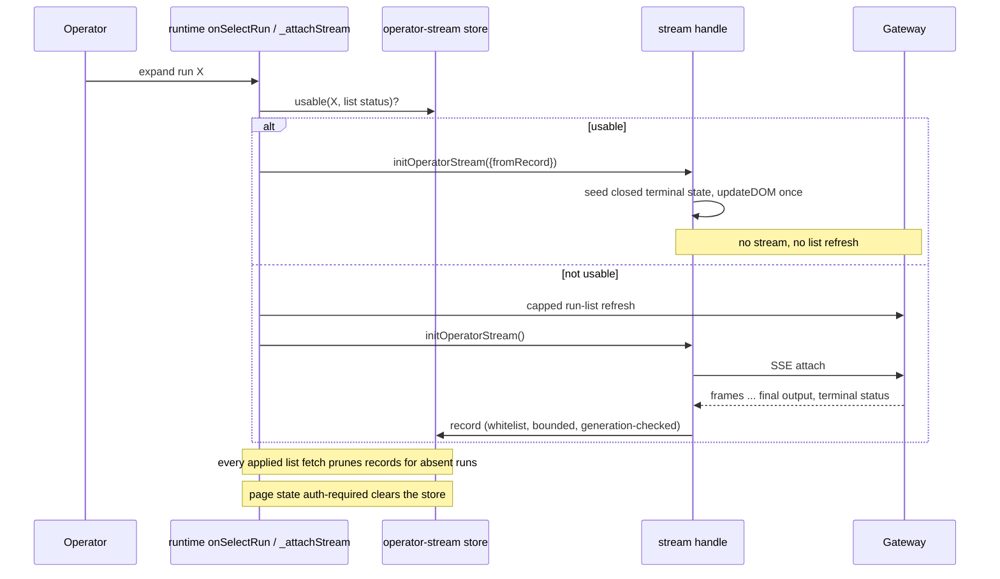

# feat: Show a finished run instantly on re-expand

## Overview

Once a run card's stream has shown a terminal run, the page keeps a bounded, in-memory record of what that card displayed. Re-expanding that run paints from the record and opens no stream and no pre-expand run-list request. Runs the page has not seen finish behave as they do today.

## Problem Frame

Every expand attaches a fresh SSE stream. For a finished run whose gateway replay has expired, that means waiting through attach and a `reset: no-snapshot` before the card says "Output no longer available", on every re-expand, even though the page showed the full result moments earlier. Durable replay on the gateway (fro-bot/agent#1639) would fix the expired case at the source, but it is out of this repo's hands. A terminal run never changes, so the page can keep what it already rendered.

This reverses the earlier rule in `docs/plans/2026-10-10-002-feat-run-card-time-and-waiting-line-plan.md` that a re-expanded card shows only what the stream reports now. That rule still holds for every run the page hasn't recorded.

## Requirements

- R1. When a card's stream first sees its run turn terminal (succeeded, failed or cancelled), the page records what the card displayed. The record holds `runId`, `status`, `terminal`, `phase`, `stale`, `startedAt`, the failure `reasonLabel`, the output text with its truncated and coalesced flags, "output unavailable", and the checkout provenance and preparation detail.
- R2. Re-expanding a recorded run paints that record immediately. It opens no stream, sends no pre-expand run-list request, and arms no first-frame timer.
- R3. A notification jump to a recorded run keeps its single run-list refresh, which it needs to find the card, then paints from the record.
- R4. The record lives in page memory only. Nothing goes to any browser storage, the URL, or logs.
- R5. The store is bounded to 100 runs and 2,000,000 characters of output, evicting the least recently used entry first. Per-run output is already capped at 256,000 characters, so the store always holds at least seven maximum-size runs, and typical runs are far smaller.
- R6. The store is cleared whenever the page state becomes `auth-required`, whatever the source. A frame that lands after the clear can't re-add an entry. Offline, rate-limited and unavailable states keep the store.
- R7. A record is used only while its run is in the latest successfully applied run list and the status the list last applied to the card matches the recorded status. That value can be up to one refresh interval old, and this is accepted. On a mismatch, or when the card has no list status yet (an unadopted launch card), the expand takes today's path. Records for runs that drop out of an applied list are deleted.
- R8. A result is recorded only when its output is final, or it is the "output no longer available" result. Output with gaps or without a final frame is left for a live attach to repair.
- R9. In fixture mode, entries are keyed by fixture session, and the store is cleared when the fixture scenario changes.
- R10. Every miss takes today's path exactly: the capped pre-expand refresh, then a live attach.

## Scope Boundaries

- No gateway change. Durable terminal replay stays with fro-bot/agent#1639.
- No persistence across reloads or app restarts. A cold boot always misses.
- The cancel control's own "Run stopped." line is per-attachment UI and isn't recorded. A cancelled run's status and reason are recorded like any other terminal result.
- Question and approval regions are already cleared at terminal, so nothing from them is recorded. `questionPageStore` is not touched.
- Stream 401/403 handling is unchanged. A session that expires while a recorded card is collapsed is cleared by the next list refresh, which happens at most 30 s later while visible. Showing the operator output they already saw, within that window, is accepted.
- Launch prompt (#628) and Markdown output (#586) are separate.

## Context & Research

### Relevant Code and Patterns

- `public/operator-stream.js`:
  - `questionPageStore` with `getQuestionPageStore` and `resetQuestionPageStore` is the page-lifetime store idiom: a module-level `Map`, a getter, and a reset export. The new store is a sibling with its own bounds and contract.
  - The `status` and `reset: no-snapshot` cases of `nextStreamState` produce the terminal run entry. `dispatch` runs the reducer, then `syncQuestionStatuses`, then `updateDOM`. `dispatch` is reachable after `close()`, so a write there must check `aborted` itself.
  - `initOperatorStream` is synchronous. It seeds state, builds the decision clients, paints once with `updateDOM()`, then calls `connect()`.
  - `updateDOM` paints the status only when the connection is live or the run entry is `terminal`. `getConnectionStatus()` returns `'terminal'` only when the entry's `terminal` is true.
  - The start time comes from a handle-local `latestStartedAt` that only `dispatch` sets.
- `web/src/operator/runtime.ts`:
  - `onSelectRun` checks for a collapse, closes the active stream, writes the hash, runs the capped refresh, then calls `_attachStream`.
  - `_attachStream` is shared by expand, restore, jump and launch.
  - `discoverCardSummaryStatus` reads the list-written status class and returns `undefined` for optimistic cards.
  - `_activeStreamServes` decides whether a jump only reveals.
- `public/operator-run-index.js`: `diffRunIndexList` removes cards absent from an applied fetch, except the protected ones. `markRunStreamAttached` protects the expanded card from list writes.
- Test mocks that replace the stream module with only the current exports: `web/src/operator/runtime.test.ts`, `runtime-auth-recovery.test.tsx`, `sign-in-recovery.test.ts`, `launch-card.test.ts`. `stream-reattach.test.ts` and `runtime.test.ts` reset `questionPageStore` between tests.

### Institutional Learnings

- `docs/solutions/logic-errors/state-machines-without-a-do-nothing-branch-2026-09-21.md`: a known-terminal `no-snapshot` closes and never reconnects. That fallback stays for misses. Update the doc after this ships.
- `docs/solutions/best-practices/consume-gateway-operator-contract-1-8-0-2026-10-07.md`: each attach clears and hides stream-owned regions, and only `updateDOM` reveals them. A recorded paint uses the same seed-then-`updateDOM` path, so the rule holds.
- `docs/solutions/best-practices/operator-sse-output-consumption-2026-06-22.md`: output is inert text, and the terminal status arrives after the final output frame.
- `docs/solutions/best-practices/operator-approval-channel-consumption-2026-06-22.md`: question tombstones are deliberately unbounded, so the new store stays separate.
- `docs/solutions/best-practices/operator-local-fixture-harness-2026-06-30.md`: verify on the assembled fixture app, including A→B→A.

## Prior-Art Survey

```json
{
  "schema_version": 2,
  "verdict": "build-new-within-scope",
  "scope": "public/operator-*.js and web/src/operator/ (operator stream, run index, launch, runtime seam)",
  "freshness": {
    "vcs_reference": "9d590cde5f35715ed3b268f6291c4cd163bf2921"
  },
  "budget": {
    "max_search_passes": 15,
    "max_candidate_inspections": 14,
    "exhausted": false
  },
  "candidates": [
    {
      "path_or_symbol": "public/operator-stream.js questionPageStore / getQuestionPageStore / resetQuestionPageStore",
      "description": "Module-level Map keyed by runId holding question tombstones and drafts for the page lifetime.",
      "disposition": "insufficient",
      "insufficiency_reason": "Holds no run status, output, checkout or reason, and its tombstones are unbounded by design; the new store needs its own bounds and eviction."
    },
    {
      "path_or_symbol": "public/operator-stream.js initOperatorStream state and getConnectionStatus",
      "description": "Per-attachment reducer state and the handle's connection read.",
      "disposition": "extend",
      "insufficiency_reason": "Per-attachment only and discarded on close(); extended with a seeded terminal state for the recorded path."
    },
    {
      "path_or_symbol": "public/operator-stream.js nextStreamState terminal branches",
      "description": "Builds the terminal run entry from a terminal status frame or a no-snapshot reset.",
      "disposition": "reuse",
      "insufficiency_reason": "Source of the recorded fields; owns no storage."
    },
    {
      "path_or_symbol": "public/operator-run-index.js renderRunCard / updateCardInPlace / diffRunIndexList",
      "description": "Card DOM, list-driven writes to non-active cards, and removal of runs absent from an applied fetch.",
      "disposition": "extend",
      "insufficiency_reason": "Card DOM cannot be the record because the list rewrites cards and attach clears regions; the applied run IDs drive record pruning."
    },
    {
      "path_or_symbol": "web/src/operator/runtime.ts _activeStreamHandle / _activeStreamRunId / _attachStream",
      "description": "Single active-stream slot and the shared attach path.",
      "disposition": "extend",
      "insufficiency_reason": "Holds no result after close; extended with the recorded fast path while keeping its collapse bookkeeping."
    }
  ]
}
```

## Key Technical Decisions

- **The record lives in the stream module, next to `questionPageStore`, with its own contract.**
  - The stream module produces the terminal entry and owns the painter, so recording and replaying stay in one file.
  - The question store's unbounded tombstones are left alone.
  - The new store gets its own reset export, which tests call wherever they reset the question store.
- **Record once, when the stream's own run entry first turns terminal.**
  - The write lives in `dispatch`, keys on the stream's run ID, and is skipped for aborted attachments.
  - It copies an explicit field whitelist into a deeply frozen record, with the checkout objects copied and frozen too.
  - Spreading the run entry would drag in approval tombstones and question state.
  - Streams are per-run in practice. A later frame never updates an existing record within the same attachment.
- **A recorded paint reuses `initOperatorStream`.**
  - A new option seeds `{connection: 'closed', runs: {[runId]: copy with terminal: true and cancelInFlight: false}, shouldReconnect: false}`.
  - It sets `latestStartedAt` from the record before the first paint.
  - It skips `connect()`, the first-frame timer, and the cancel, approval and question clients.
  - It paints once through `updateDOM`.
  - The handle stays real, so `getConnectionStatus()` returns `'terminal'`, `close()` stays safe, and the runtime's collapse and jump logic works unchanged.
- **The runtime decides hit or miss before any request, and owns the miss path.**
  - `onSelectRun`, after its collapse guards, asks the store whether this run has a usable record. Usable means the run is in the latest applied list and the card's list status matches.
  - On a hit, it cancels any pending expand, closes the active stream, writes the hash, and attaches from the record, all synchronously.
  - Anything else runs today's refresh-then-attach.
  - `_attachStream` applies the same check, so jump, launch and in-page restore benefit too.
  - Because `initOperatorStream` is synchronous, the peek and the paint can't race.
- **Runs that leave the list leave the store.**
  - After every successfully applied list fetch, the store drops records whose run IDs aren't in it.
  - Revocation and redaction drop a run from the list, so this also stops a record from outliving the operator's access, without a per-expand gateway check.
- **Clear on the page's `auth-required` transition.**
  - The clear runs where the runtime reports the `auth-required` state, so every source is covered.
  - A generation counter, captured at attach and bumped by the clear, drops writes from older attachments.
- **Fixture mode keys by session and clears on scenario change.**
  - Fixture sessions are minted per `GET /session`, and scenario switches reuse them.
  - Production keys are the run ID.

## Open Questions

### Resolved During Planning

- Should the summary-only "Output no longer available" result be recorded? Yes. The run is terminal and won't change.
- Should a notification jump skip its refresh on a hit? No, it needs the refresh to find the card. One run-list GET is acceptable.
- Which pushes can jump? Only question pushes today. Approval pushes can too once fro-bot/agent#1840 ships. `run_failed` has no run ID.
- Does a recorded handle need the decision clients? No, they are skipped.
- What can checkout detail contain? The same capped provenance and preparation strings, such as paths and branch names, that the card already renders. The record adds no new class of data. Output text can name a private repo, as the card itself can. That exposure exists today and is unchanged.
- Does switching fixture scenarios mint a new session? No. The scenario is read at submit and the session effect doesn't depend on it, hence the clear on scenario change.

### Deferred to Implementation

- Exact export names and the shape of the usable-record check.
- Where the runtime observes the `auth-required` transition: the runtime's state callback or `Operator.tsx`. Pick whichever owns the single transition point.

## High-Level Technical Design

> *This illustrates the intended approach and is directional guidance for review, not implementation specification. The implementing agent should treat it as context, not code to reproduce.*



## Implementation Units

- [x] **Unit 1: Finished-run store and recording**

**Goal:** Record a card's displayed terminal result, bounded and in memory, and make sure a clear can't be undone by late frames.

**Requirements:** R1, R4, R5, R6, R8, R9

**Dependencies:** None

**Files:**
- Modify: `public/operator-stream.js`
- Modify: `public/operator-stream.d.ts`
- Test: `test/operator-stream-core.test.ts`

**Approach:**
- Add a module-level `Map` store with these exports: a usable-record check, a prune-to-run-IDs function, a clear that bumps a generation counter, and a reset for tests.
- Keys are the run ID, or the fixture session plus run ID in fixture mode.
- Store the whitelist from R1 as a deeply frozen record.
- Bounds: 100 entries and 2,000,000 output characters. An overwrite subtracts the old size and re-inserts the entry as newest. A read moves the entry to newest.
- Record from `dispatch` when the stream's own run entry first becomes terminal and the attachment isn't aborted. Only record if the output is final or unavailable, and only if the generation hasn't changed since attach.
- Don't add call forms the privacy guard matches, such as `location.hash` or `history.pushState`, in code or comments.

**Execution note:** Implement test-first.

**Patterns to follow:** `questionPageStore`; the `MAX_OUTPUT_TEXT_CHARS` truncation.

**Test scenarios:**
- Happy path: live terminal frames for succeeded, failed with a known reason, and cancelled each record exactly the R1 key set, with `terminal: true`.
- Happy path: a `no-snapshot` reset with a terminal summary records an entry with output unavailable.
- Edge case: unknown `no-snapshot`, `reset: terminal` with no status frame, and a stream closed while running record nothing.
- Edge case: output deltas at seq 1 and 3 followed by a terminal status with no final frame record nothing. A final frame followed by a terminal status records the output. Truncated final output records with its flag.
- Edge case: the 101st entry evicts the least recently used one. A read refreshes recency. An overwrite isn't counted twice.
- Edge case: the character budget evicts the oldest entries until the new one fits.
- Edge case: a terminal frame after `close()` records nothing.
- Edge case: pruning to a run-ID set drops every other record.
- Edge case: fixture-mode keys from two sessions with the same run ID don't collide.
- Error path: after a clear, a write from an older generation adds nothing.
- Integration: the existing privacy guard tests still pass. A new sentinel test covers terminal, record, recorded init and clear, and sees no console, storage, cache, history or location calls, and no sentinel text in attributes, dataset or class names.

**Verification:** The store records only finished, displayed results, stays within both bounds, and is empty after a clear.

- [x] **Unit 2: Paint a recorded run without a stream**

**Goal:** `initOperatorStream` can start from a record and paint the finished card with no network activity.

**Requirements:** R2, R4

**Dependencies:** Unit 1

**Files:**
- Modify: `public/operator-stream.js`
- Modify: `public/operator-stream.d.ts`
- Test: `test/operator-stream-core.test.ts`, `web/src/operator/stream-reattach.test.ts`

**Approach:**
- A new init option paints from the record for the run.
- Seed a null-prototype `runs` with a mutable copy of the record. Never pass the frozen record itself.
- Set `latestStartedAt` before the first paint.
- Skip `connect()`, the first-frame timer, and the cancel, approval and question clients.
- Paint through the existing single `updateDOM()` call.

**Execution note:** Implement test-first.

**Patterns to follow:** The existing attach-time clear, and the early `updateDOM()` before `connect()`.

**Test scenarios:**
- Happy path: a recorded init makes zero fetches. The status pill shows the status label, not "Unavailable", and the closed-stream notice is empty.
- Happy path: the reason, output, coalesced or truncated hint, checkout detail, start time and the "Run failed: …" notice all match the original live paint.
- Happy path: `getConnectionStatus()` returns `'terminal'`, and `close()` is safe and idempotent.
- Edge case: advancing past `FIRST_FRAME_TIMEOUT_MS` doesn't move the connection to `submitted-unobservable`.
- Edge case: on a real card in jsdom, the cancel, approvals, questions and waiting regions stay hidden and empty, and three re-expands leave a single copy of each region's content.
- Edge case: "Output no longer available" repaints for a recorded expired run.

**Verification:** A recorded card looks identical to the live terminal card it came from, and no request leaves the page.

- [x] **Unit 3: Runtime fast path, list pruning and clear**

**Goal:** Expand, jump, launch and in-page restore use a usable record. Applied list fetches prune the store, and `auth-required` clears it.

**Requirements:** R2, R3, R6, R7, R9, R10

**Dependencies:** Unit 2

**Files:**
- Modify: `web/src/operator/runtime.ts`
- Modify: `web/src/views/Operator.tsx` (if it owns the state transition or the fixture scenario change)
- Test: `web/src/operator/runtime.test.ts`
- Update mocks: `web/src/operator/runtime-auth-recovery.test.tsx`, `web/src/operator/sign-in-recovery.test.ts`, `web/src/operator/launch-card.test.ts`
- Update reset hooks: `web/src/operator/stream-reattach.test.ts`, `web/src/operator/runtime.test.ts`

**Approach:**
- In `onSelectRun`, after the collapse and pending-expand guards, check for a usable record using the card's list status. On a hit, run the synchronous path. Otherwise, run today's path unchanged.
- `_attachStream` applies the same check for jump, launch and restore. A jump keeps its refresh.
- The hit path keeps the active handle, the active run ID and `markRunStreamAttached`.
- After each successfully applied init or refresh, prune the store to the applied run IDs.
- Clear the store at the `auth-required` transition.
- Clear it when the fixture scenario changes.
- Pass the fixture session for keying.
- Extend the typed `Pick` of the stream module, and add the new exports to every stream-module mock. Don't add `typeof` guards.

**Execution note:** Implement test-first.

**Patterns to follow:** `_pendingExpand` cancellation; the existing jump and auth-recovery tests.

**Test scenarios:**
- Happy path: expanding a recorded run makes no `refreshOperatorRunIndex` call and no fetch. It writes the hash, sets the handle and the attached mark, and paints synchronously.
- Happy path: A→B→A where A finished while open, so the second expand of A hits. If A was closed while still running, it misses.
- Edge case: a launched run that finishes, then collapses and re-expands before the list adopts it, misses. After adoption, it hits.
- Edge case: collapsing a recorded card closes it and clears the hash without re-expanding.
- Edge case: a pending expand of X is cancelled when the user clicks recorded Y.
- Edge case: a jump to a collapsed recorded card refreshes once, then paints from the record. A jump to an expanded recorded card only reveals it, with no `_attachStream`.
- Edge case: an in-page restore after a runtime remount hits, and a fresh module misses.
- Edge case: when the card's list status differs from the record, the expand takes the refresh-then-attach path, and the live result re-records.
- Edge case: a refresh that no longer lists a run deletes its record, so a later expand of a protected card misses.
- Edge case: when an auth clear lands during a miss path's refresh await, the expand attaches live.
- Edge case: an evicted run attaches live and is recorded again at terminal.
- Error path: the page state becoming `auth-required` empties the store. Offline, rate-limited and unavailable don't empty it.
- Integration: switching the fixture scenario clears the store, so a run ID shared across scenarios never paints the old scenario's result.
- Integration: the auth-recovery and sign-in tests still reach `auth-required` with the updated mocks.

**Verification:** Every expand trigger either paints from a usable record with no stream, or behaves exactly as today.

- [x] **Unit 4: Browser verification and docs**

**Goal:** Prove the hit and miss paths on the assembled fixture app, and record the new path in the docs that describe attach and `no-snapshot`.

**Requirements:** R2, R10

**Dependencies:** Unit 3

**Files:**
- Modify: `docs/solutions/logic-errors/state-machines-without-a-do-nothing-branch-2026-09-21.md`
- Modify: `docs/solutions/best-practices/consume-gateway-operator-contract-1-8-0-2026-10-07.md`
- Modify, only if a scenario is missing: `src/gateway/operator-fixture-sse.ts`, `src/routes/operator-fixture-harness.ts`

**Approach:**
- On the fixture build, check these in a real browser with network inspection:
  - a run finishing while open, then collapse and re-expand: same result, no `/stream` or `/operator/runs` request
  - an expired completed run re-expanded twice: the second expand is instant
  - A→B→A
  - a miss on a never-finished run
  - a scenario switch
  - dark and light themes, and 390px
- Then add the doc sentences.

**Test scenarios:**
- Test expectation: none in code. Verification is the browser checklist, with screenshots.

**Verification:** Network logs show no request on a hit, and the checklist passes in both themes and at 390px.

## System-Wide Impact

- **Interaction graph:**
  - Expand, restore, jump and launch all reach `_attachStream`.
  - List fetches write to non-active cards and now also prune the store.
  - Push jumps reach a recorded card only through question notifications, plus approval notifications once fro-bot/agent#1840 ships.
- **State lifecycle risks:**
  - The record outlives the attachment that wrote it, by design.
  - A gateway reclassification shows up only once the list writes the new status to a collapsed card.
  - A changed failure reason with the same status stays as recorded until pruning, eviction or reload. This is accepted.
- **Unchanged invariants:**
  - Misses attach exactly as today.
  - The `questionPageStore` contract is unchanged.
  - Text-only rendering is unchanged.
  - No browser storage.
  - Terminal-sticky list writes are unchanged.
  - Stream 401/403 handling is unchanged.

## Risks & Dependencies

| Risk | Mitigation |
|------|------------|
| A recorded card differs from what the live card showed | The record includes `terminal` and the fields `updateDOM` reads; Unit 2 compares the recorded paint to the live terminal paint |
| A partial result becomes sticky | Only final or unavailable output is recorded; a list-status mismatch forces a live attach |
| A record outlives the operator's access to the run | Every applied list fetch prunes records for runs it no longer lists; `auth-required` clears the store |
| Late frames after a clear re-add data | The generation counter drops writes from attachments older than the clear |
| New exports break mocked tests | Unit 3 updates every stream-module mock and reset hook |
| The final output arrives after the terminal status | Accepted: the record is written only when the run first turns terminal, so that attachment records nothing and the next expand attaches live. The gateway sends the final output first |

## Sources & References

- Related issues: fro-bot/agent#1639 (durable terminal replay), fro-bot/agent#1840 (approval push run ID), #628, #586
- Related plan: `docs/plans/2026-10-10-002-feat-run-card-time-and-waiting-line-plan.md`
- Related code: `public/operator-stream.js`, `web/src/operator/runtime.ts`, `public/operator-run-index.js`
