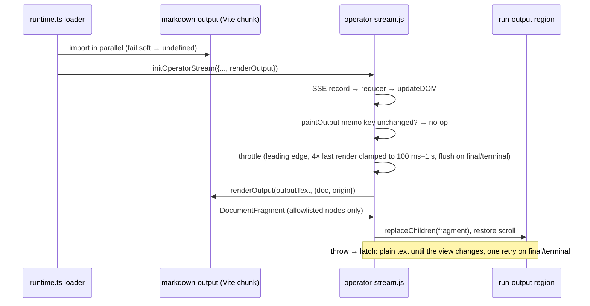

# feat: Render run output as Markdown

## Overview

Render operator run output as Markdown: while it streams, for the final answer, and on a recorded repaint. Use a bundled `markdown-it` parser whose tokens are turned into DOM nodes from a fixed allowlist, so no HTML string is ever built. Each card gets a Rendered/Raw toggle, backed by a page-wide in-memory preference, and a Copy raw button.

## Problem Frame

Run output is painted with `textContent`, so agent replies show literal `**bold**`, `- ` bullets and backtick spans (fro-bot/dashboard#586). Output is untrusted model text, and a model that read prompt-injected issue or PR content can emit anything. This change makes output readable without letting it become HTML, load a resource, or run script.

The July 2026 redesign put a gate on any richer renderer: P1–P7 in `docs/plans/2026-07-03-001-feat-operator-home-run-centric-redesign-plan.md` and R15 in `docs/brainstorms/2026-07-03-001-operator-home-run-centric-redesign-requirements.md`. This plan meets that gate. The P2, P6 and R15 readings it applies are under Key Technical Decisions.

## Requirements Trace

- R1. Run output renders as Markdown while streaming, on the authoritative final frame, and on a recorded repaint of a finished run.
- R2. Only headings, paragraphs, emphasis, strikethrough, lists, code spans and blocks, blockquotes, horizontal rules, line breaks, tables and links are emitted. Every other construct renders as its text.
- R3. Raw HTML in output is shown as literal text. No ``, `<script>`, `style`, `on*` attribute, or other resource-loading element is ever created.
- R4. A link becomes an anchor only when its destination parses as an absolute `http:` or `https:` URL of at most 2,048 characters, with no userinfo and an origin that differs from the page origin. It opens in a new tab with `rel="noopener noreferrer"`. Bare http(s) URLs are linkified under the same rule. When an accepted link's visible text is not its URL, the destination host is shown as muted text right after the anchor. A link that shows its own URL also gets the host when the host it shows is not plain ASCII.
- R5. Streaming rendering is throttled. It tolerates unfinished Markdown and never lets the final answer lag.
- R6. Each card has a Rendered/Raw toggle and a Copy raw button. The toggle sets one page-wide, in-memory preference. Copy raw copies the run's current raw text.
- R7. Plain text remains the fallback when the renderer is missing, fails to load, is too slow to load, or throws. A throw switches that attachment to plain text until the view changes, with one retry on its final frame or terminal status.
- R8. The innerHTML-family ban covers the renderer module, and CSP is unchanged.
- R9. Selecting text or clicking a link inside the output does not collapse the card.
- R10. `docs/solutions/best-practices/operator-sse-output-consumption-2026-06-22.md` documents the new rendering rule.
- R18 (July 2026 redesign requirements). No sensitive value reaches rendered text, DOM attributes or link targets. Disposition: run output is already displayed verbatim, link targets are the only new sink, and the decision on redaction under Key Technical Decisions covers it.

## Scope Boundaries

- Approval prompts, question text, checkout details and notices stay plain text.
- No syntax highlighting, images, or Markdown in push notifications.
- No persistence of the Rendered/Raw preference. It lives in page memory only.
- The run card stays `role="button"`. Its effect on assistive tech, which flattens links and tables inside the card, is documented and deferred.

### Deferred to Separate Tasks

- Splitting the card header into the only activation target, so card content gets full semantics: a follow-up issue after this lands.

## Context & Research

### Relevant Code and Patterns

- `public/operator-stream.js`:
  - `updateDOM()` is the single painter. Output is painted in the output block, which writes `outputEl.textContent`.
  - `dispatch()` calls `updateDOM()` once per SSE record.
  - `MAX_OUTPUT_TEXT_CHARS` caps output at 256,000 characters.
  - `recordedStreamSetup` and `takeUsableFinishedRun` seed a recorded repaint from raw `outputText`.
  - `clearFinishedRuns` and `pruneFinishedRuns` bound the finished-run store.
  - A bootstrap `initOperatorStream` call at the bottom of the file runs for `?manual=1`. It is not an attach path.
- `web/src/operator/runtime.ts`: the loader dynamically imports the three `public/operator-*.js` modules, using `Pick`-typed casts and `.d.ts` sidecars. `_attachStream` builds `InitOptions`. `onAuthRequired` is the one place the page learns its session is gone. The injected-client options on `initOperatorStream` (`approvalClient`, `questionClient`, `cancelClient`) are the existing injection pattern, used only by tests so far.
- Card anatomy comes in three shapes:
  - the fetched list card, built by the card builder in `public/operator-run-index.js`;
  - the launch card in `public/operator-launch.js`;
  - a card adopted through `ensureRunCardAnatomy` in `public/operator-run-index.js`.
  - `SUBSTRUCTURE_ROLES` and `bindCardActivation` also live in `public/operator-run-index.js`. `discoverCardStreamTargets` in `runtime.ts` finds the regions.
- `web/src/index.css`: the `[data-role="run-output"]` rules (mono font, `pre-wrap`, `word-break: break-all`, 400px scroll box) and the explicit grid rows for card regions.
- HTML-sink bans: `test/static-assets.test.ts`, `test/operator-stream-core.test.ts` and `test/operator-launch-core.test.ts`. They match only `innerHTML|outerHTML|insertAdjacentHTML` followed by `=`. `test/static-assets.test.ts` strips comments before matching.
- `src/server.ts` CSP: `script-src 'self'`, `img-src 'self' data:`, `connect-src 'self'`. There is no Trusted Types policy.
- `web/vitest.config.ts` runs jsdom over `web/src/**`. Stream-core tests use plain-object fakes with no `createTextNode`.

### Institutional Learnings

- `docs/solutions/best-practices/operator-sse-output-consumption-2026-06-22.md`:
  - Final output replaces deltas.
  - Terminal status ends the run.
  - Output is inert. This doc is rewritten in this change.
- `docs/solutions/logic-errors/state-machines-without-a-do-nothing-branch-2026-09-21.md`: a recorded run skips the stream. The render state machine needs an explicit no-op branch for status-only frames.
- `docs/solutions/ui-bugs/nested-control-click-bubbles-to-run-card-2026-10-10.md`: a click on a control inside the card must not reach the card handler, with a test that uses a parent click listener. This plan does it with a target guard in `bindCardActivation`, not `stopPropagation`.
- `docs/solutions/workflow-issues/css-selector-emitter-mismatch-2026-07-04.md`: CSS selectors must match the classes and roles the renderer emits. A guard test derives them from the source.
- `docs/solutions/best-practices/operator-local-fixture-harness-2026-06-30.md` and `docs/solutions/workflow-issues/unit-green-is-not-feature-done-verify-the-assembled-surface-2026-06-23.md`: verify in the assembled fixture app, not by unit tests alone.
- `docs/solutions/best-practices/authenticated-sse-consumption-fetch-stream-no-leak-2026-06-20.md` recommended a no-build module with no new dependency for the stream. This plan keeps `public/operator-stream.js` no-build and dependency-free. The parser lives on the Vite side and is passed in.

### External References

- markdown-it API and safety options: https://markdown-it.github.io/markdown-it/
- markdown-it security advisories: https://github.com/markdown-it/markdown-it/security/advisories
- Rendering streamed LLM responses: https://developer.chrome.com/docs/ai/render-llm-responses
- `rel="noopener"`: https://developer.mozilla.org/en-US/docs/Web/HTML/Reference/Attributes/rel/noopener

## Prior-Art Survey

```json
{
  "schema_version": 2,
  "verdict": "build-new-within-scope",
  "scope": "web/src, public, src runtime code (tests read for constraints only)",
  "freshness": {
    "vcs_reference": "896a004"
  },
  "budget": {
    "max_search_passes": 4,
    "max_candidate_inspections": 8,
    "exhausted": false
  },
  "candidates": [
    {
      "path_or_symbol": "public/operator-stream.js updateDOM output paint",
      "description": "Paints accumulated outputText into outputEl via textContent",
      "disposition": "extend",
      "insufficiency_reason": "Integration point only: it has no structure, link handling or view mode"
    },
    {
      "path_or_symbol": "public/operator-stream.js sanitizeCheckoutText and QUESTION_REMOVED_CHARS",
      "description": "Control and bidi stripping with length caps for short DTO strings",
      "disposition": "insufficient",
      "insufficiency_reason": "Flat character normalization; applying it to output would alter the raw view"
    },
    {
      "path_or_symbol": "web/src/views/Listener.tsx listener body text",
      "description": "Renders listener message bodies as React text children",
      "disposition": "insufficient",
      "insufficiency_reason": "Plain text by design, with no block structure or link validation"
    },
    {
      "path_or_symbol": "public/operator-run-index.js card builder and public/operator-launch.js card anatomy",
      "description": "createElement plus textContent builders for fixed card regions",
      "disposition": "extend",
      "insufficiency_reason": "Builds a fixed set of regions, not arbitrary trees; the toolbar region is added here"
    },
    {
      "path_or_symbol": "web/src/push/notification-click.ts URL parse",
      "description": "Parses a URL to compare its pathname",
      "disposition": "insufficient",
      "insufficiency_reason": "No protocol allowlist; no http(s) link validator exists in the repo"
    }
  ]
}
```

## Key Technical Decisions

- **Gate map.** Each gate item from the July plan maps to a decision and the unit that enforces it:
  - P1, raw HTML is text: Unit 1.
  - P2, by construction plus allowlist tests: Units 1 and 5.
  - P3, no resource loading: Unit 1.
  - P4, CSP unchanged: System-Wide Impact.
  - P5, malicious-Markdown corpus: Unit 1.
  - P6, Rendered by default, plain-text fallback, auth close: Units 2 and 4.
  - P7, independent security review plus Marcus's sign-off: Unit 7.
- **Parser: `markdown-it` 15.0.3, as an exact pin in root `package.json` `devDependencies` (Renovate-managed). Marcus approved the dependency.**
  - It is bundled into the Vite chunk at build time, so the production image does not need it. Version 15.0.3 ships its own types, so there is no `@types/markdown-it`.
  - Configure it with `html: false`, `linkify: true` and `typographer: false`. With `html: false`, raw HTML parses as text tokens, so it never becomes a node to skip.
  - Use `md.parse()` tokens only. `render`, `renderInline` and `renderer.rules` are never used.
  - Rejected alternatives:
    - `marked` has no mode that disables HTML.
    - The mdast family returns `html` nodes that would need a rewrite pass, and has about 43 transitive dependencies.
    - A hand-written parser would leave us owning correctness for tables and nested lists.
- **Gate P2, met by construction.** P2 asks for a DOMPurify-style sanitizer before DOM insertion. The renderer builds DOM from tokens with `createElement` and `textContent`, from a fixed allowlist, and never builds an HTML string, so there is nothing to sanitize. A second sanitizer would be redundant code plus another dependency. Two checks enforce the invariant: Unit 1 asserts an explicit element, attribute and href allowlist over every corpus output, and Unit 5 grows the HTML-sink ban to cover the renderer module.
- **R15 "allowlists no external link/image origins", read as resource loading.** Nothing loads from any origin: no images, iframes, styles or scripts, and CSP is unchanged. Clickable http(s) links are user-initiated navigation that #586 asks for. They open in a new tab with `noopener noreferrer`.
- **Gate P5, P6 and P7.**
  - P5 is the malicious-Markdown corpus in Unit 1.
  - P6: Rendered Markdown is the default (#586). Plain text is the fallback when the renderer is missing, fails to load or throws. On `auth-required`, `onAuthRequired` in `web/src/operator/runtime.ts` calls `_closeActiveStream()` and resets the view preference, so no further paints or toggle repaints happen, and the run content leaves the page because the view leaves the ready state. The finished-run store is cleared.
  - P7: signed off by Marcus after an independent security review, which passed P1–P5.
- **Redaction (R18).** Run output is already displayed verbatim, and link targets are the only new sink. The gateway owns repo-name filtering of output. This plan adds no repo-name rendering and no repo-name lookup, so AGENTS.md invariant 2 (redaction preservation) is untouched.
- **The renderer is a pure function passed into the stream.**
  - It is a Vite-built module in `web/src/operator/`, loaded by the runtime alongside the three operator modules, and passed to `initOperatorStream` as an optional `renderOutput(text, {doc, origin})`. The stream passes its document and the page origin. The function returns a `DocumentFragment`.
  - `public/operator-stream.js` stays no-build and dependency-free. It owns mounting, throttling, scroll, selection and fallback.
  - With no renderer, output is painted with `textContent`.
  - The renderer counts the nodes it creates and throws past 20,000, so that paint falls back to plain text. The repaint interval follows the measured render time (see Throttle).
- **The renderer loads in parallel with the operator modules, and the first attach waits for it, bounded.**
  - A recorded repaint is a single synchronous paint with no later frame to upgrade it, so the renderer must be known before the first attach. The loader starts a literal-path dynamic import of the renderer first and does not await it before the run index and launch initialize. A stalled renderer import therefore never stops those from initializing.
  - Only the attaches that happen before the import settles wait for it: `_attachStream` defers the attach until the import settles or `RENDERER_LOAD_CAP_MS` (2,000 ms, counted from the loader's start) passes. Once settled, attaches are synchronous.
  - The loader reads the renderer through `web/src/operator/renderer-source.ts`, whose default is the literal-path dynamic import. Specs install their own source (an already-resolved stub by default in `test-setup.ts`, or a promise they control), because a registry mock cannot reliably hold one dynamic import back while the loader's other imports run.
  - A rejected import, a missing chunk and a timeout all mean no renderer: that stream paints plain text. A renderer that arrives after the cap is kept for later attaches.
  - The loader starts the import and the cap timer before it imports any operator module, so a slow module import does not add to the cap.
  - Closing the active stream, auth-required and cleanup cancel a waiting attach. A second click on the card whose attach is waiting is a collapse: it cancels the attach and clears the hash. When a waiting attach is released, it re-checks that the card is still listed and attaches nothing if the list dropped it. A stale shell that predates the renderer passes no renderer and degrades the same way.
- **Links.**
  - A destination is parsed with `new URL(href)` and no base URL, so relative, `#fragment`, protocol-relative and `mailto:` destinations stay text. This also keeps same-origin paths such as `/operator/...` and the `#<runId>` jump hashes inert.
  - An anchor is created only for `http:` or `https:` destinations of at most 2,048 characters. Its `href` is set to the normalized `url.href`.
  - A destination with userinfo (`username` or `password`) is rejected. An absolute URL whose origin equals the page origin is rejected, so output cannot link into the operator's own routes.
  - Only `href`, `target` and `rel` are set. A token `title` is ignored.
  - A rejected link renders its label followed by the destination as plain text.
  - Linkified bare URLs pass the same check.
  - When an accepted link's visible text is not its URL, the renderer appends the destination host as muted text right after the anchor, for example `Source (evil.example)`. The host comes from `url.hostname`, with IDNs in punycode form. A bare URL, an autolink or a label that is its own URL shows the host only when the host it displays is not plain ASCII, for example `https://раypal.com (xn--…)`; ASCII ones show nothing extra.
- **Headings are clamped to h4–h6**, so a model `# Title` cannot insert an h1 into the page outline.
- **Images render as their alt text,** or `[image]` when the alt is empty. Inside a link, the alt text becomes the link label.
- **Tables are wrapped.** The renderer wraps each `table` in a `div` with a class. Unit 6 styles the wrapper with `overflow-x: auto`.
- **One painter, memoized.**
  - `paintOutput` is a closure inside `initOperatorStream`, called from `updateDOM`. Tests drive it through `initOperatorStream`. It skips the DOM write when the key `(outputText, outputUnavailable, effective view)` is unchanged, so status, heartbeat, approval and question frames never re-render output. A plain-text fallback records the key with the plain view, so status, heartbeat and approval frames never re-render a latched attachment.
  - The rendered fragment is swapped in with one `replaceChildren`. A throw mid-build leaves the DOM as painted, and that paint falls back to plain text and sets the render-failure latch.
- **Throttle with `setTimeout` only, with an interval that follows the render.**
  - The first non-empty output paints immediately.
  - After a rendered paint the next streaming paint waits 4 times the duration of that render and swap, measured with `performance.now()` (`Date.now()` where it is missing), clamped to 100 ms and 1,000 ms. That keeps rendering to about 20% of each window on the device it runs on.
  - A plain-text paint (Raw view, a latched attachment, no renderer) waits 100 ms.
  - The duration is per attachment and starts at zero on attach.
  - A final output frame and a terminal status flush synchronously.
  - The timer callback checks `aborted` and reads current state when it fires.
  - `close()` cancels it.
  - `requestAnimationFrame` is not used, because it pauses in background tabs.
- **Render failure latches per attachment.**
  - When the renderer throws or returns no node, the attachment sets `renderFailed`. While it is set, every paint writes plain text, the renderer is not called, and the memo key records the plain-text write.
  - The latch clears when the view preference changes.
  - It also clears exactly once when a final output frame or a terminal status arrives, which allows one retry. If that retry throws, the latch stays set. A renderer that always throws is therefore called at most twice across a stream.
  - The toggle is hidden while the latch is set. Copy raw stays visible.
  - Neither the error nor the text is logged.
- **Page-wide view preference.** It is one module-level in-memory variable in `public/operator-stream.js`, defaulting to Rendered, read at paint time.
  - The toggle sets it and repaints every attachment. A module-level `Set` holds one repaint callback per live attachment: each registers when it is created and unregisters in `close()`. Setting the preference calls each callback, which force-paints that attachment's output and toolbar, skips an aborted attachment, and respects its latch.
  - A separate `resetOutputView()` export resets it to Rendered. `onAuthRequired` calls it. `clearFinishedRuns` does not reset it, because `clearFinishedRuns` also runs on fixture scenario change (`web/src/views/Operator.tsx`).
  - The effective view is Raw when the preference is Raw or when no renderer exists.
  - A fallback never rewrites the preference. The toggle's `aria-pressed` state reflects the view actually painted (`data-output-view`), which differs from the preference while a render failure is latched.
- **Toolbar.**
  - It is a new card region `run-output-tools`, placed after `run-output` in all three card shapes and in `SUBSTRUCTURE_ROLES`. It is hidden on collapse, for the unavailable result, and for empty output.
  - It has its own grid row next to the output row in `web/src/index.css`.
  - The toggle is one button, labelled "Raw text", with `aria-pressed`. It is hidden (not absent) when no renderer is injected.
  - Handlers are bound per attachment and released in `close()`, so they never stack across re-attaches.
- **Copy raw.**
  - It copies `outputText` from state at click time, never the DOM.
  - The dashboard is served only over https (production) and loopback (dev), both secure contexts. It calls `navigator.clipboard.writeText` synchronously inside the click. If that is missing or rejects, it shows "Copy failed. Select the text and copy it."
  - Feedback is "Copied" for about 1.5 s, announced in a polite status span in the toolbar.
  - When the output is truncated, the label says the copy covers only the first 256,000 characters.
- **Card click guard.** The target guard in `bindCardActivation` is the only mechanism. It ignores clicks whose target is inside an `a[href]` or a `button` within the card, and clicks made while a non-collapsed text selection sits inside the card. Plain clicks on output text still toggle the card. Keydown already ignores non-card targets. Neither the toolbar nor links stop propagation.
- **Scroll and selection.**
  - Before a swap, if the output box is scrolled to the bottom (within 8px), it is pinned to the bottom after the swap. Otherwise the previous `scrollTop` is restored, clamped to the new height.
  - While a run streams, repaints are deferred in three cases: a non-collapsed selection inside the output, a pointer pressed inside the output, and `document.activeElement` inside the output. A focused link or a mid-click press keeps its target in the DOM.
  - All three deferrals share one bound, `OUTPUT_SELECTION_HOLD_MS` (3,000 ms), armed when the first paint is deferred. When it expires the paint proceeds through the selection, press and focus checks, even if none has changed, so a stale selection, a lost `pointerup` (alt-tab, say) or a focus that returns with the window cannot freeze the output. A condition that still holds defers the next streaming paint for another hold. A selection also resumes from current state on `selectionchange`.
  - A pointer deferral resumes on `pointerup` or `pointercancel`. The paint runs on the next task, after the click that follows `pointerup` has been delivered. A press that ends outside the output is caught by document-level listeners that exist only during the press. A focus deferral resumes on `focusout` that leaves the output.
  - The `selectionchange` listener exists only while a selection defers a paint, and the hold timer only while any deferral is pending. The pointer and focus listeners on the output exist only when a renderer is injected. The resume timer and every listener are removed in `close()`.
  - A final or terminal paint always proceeds.
- **One view attribute drives CSS.** `data-output-view` is set to `rendered`, `raw` or `unavailable` on each paint. The `.run-output-unavailable` class is kept alongside it, so existing pins hold.
  - rendered prose uses the body font, `white-space: normal` and `overflow-wrap: anywhere`;
  - raw keeps the mono `pre-wrap` box;
  - wide tables sit in the `overflow-x: auto` wrapper.

## Open Questions

### Resolved During Planning

- **Parser choice and dependency approval:** `markdown-it` 15.0.3, approved by Marcus.
- **Gate P2, P6 and R15 readings:** as described above. P7 is signed off by Marcus after an independent security review.
- **Link-host display:** shown as muted text after an anchor whose visible text is not its URL, and after one that shows its own URL with a non-ASCII host. ASCII bare and autolinked URLs show nothing extra.
- **Scope of the toggle:** a page-wide in-memory preference, read at paint time, applied to every live attachment.
- **Bare URLs:** linkified, under the same http(s) check.
- **P6 at the auth boundary:** `onAuthRequired` closes the active stream, resets the view preference and clears the stores. The run content leaves the page because the view leaves the ready state.

### Deferred to Implementation

- Exact toolbar placement at 390px: Unit 6 settles the visual rules with the designer against the row pins Unit 3 sets.

## High-Level Technical Design

> *This illustrates the intended approach and is directional guidance for review, not implementation specification. The implementing agent should treat it as context, not code to reproduce.*



## Implementation Units

- [x] **Unit 1: Renderer module and dependency**

**Goal:** a pure, tested token-to-DOM renderer that meets P1, P3 and P5.

**Requirements:** R2, R3, R4, R8

**Dependencies:** none

**Files:**
- Modify: `package.json`, `pnpm-lock.yaml` (`markdown-it` exact pin in `devDependencies`)
- Create: `web/src/operator/markdown-output.ts`
- Test: `web/src/operator/markdown-output.test.ts`

**Approach:**
- Use one module-level `markdownIt` instance with the fixed config.
- Export `renderOutput(text, {doc, origin})`.
- Walk block and inline tokens into elements created by the passed `document`. An unknown token appends its text content and never drops it.
- Honor `token.hidden` for tight-list paragraphs.
- Validate `ol start` as a positive integer.
- Drop table alignment attributes and fence info strings.
- Wrap each `table` in a `div` with a class.
- Apply the link policy: http(s) only, at most 2,048 characters, no userinfo, origin different from `origin`. Append the muted destination host after an accepted link whose visible text is not its URL.
- Count created nodes and throw past 20,000.

**Execution note:** test-first. Write the P5 corpus before the renderer.

**Patterns to follow:** the `createElement` and `textContent` card builders in `public/operator-run-index.js`.

**Test scenarios:**
- Happy path:
  - each allowlisted construct renders as its element: headings clamped to h4–h6, tight and loose lists, nested lists, `ol start`, blockquote, a table, fenced and indented code, em, strong, strikethrough, hr, a hard break;
  - a table sits inside its wrapper `div` with the class;
  - a bare `https://` URL becomes a link with exact `target` and `rel`.
- Malicious input (P5): each case yields only allowlisted elements, with no `img`, `script`, `iframe`, `style` element, `style` attribute or `on*` attribute.
  - `<script>`, ``, an SVG with `onload`, `<iframe>`, and raw block and inline HTML all render as literal text;
  - entities such as `&lt;script&gt;` stay text;
  - broken nesting.
- Allowlist (P2): over every corpus output, every element is in an explicit tag set, every attribute is in an explicit attribute set, and every `a` has an `http:` or `https:` href. This is the primary assertion, and the absence checks above stay as well.
- Links, as one table-driven test:
  - rejected, rendering label plus destination text: `javascript:`, `data:`, `vbscript:`, `file:`, a `java\nscript:` variant, `mailto:`, a relative link, `#frag`, `//host`, `ftp:`, a URL with userinfo (`https://user:pw@host/` and `https://user@host/`), `https://<page host>/operator/runs/x/cancel`, and a 5,000-character URL;
  - accepted: uppercase `HTTP://` is normalized, and a punycode host is normalized.
- Link details:
  - a link inside a code span or fence stays inert;
  - a token `title` is not copied;
  - reference-style links work.
- Link host (D2):
  - a label naming one domain that links to another shows the destination host after the anchor;
  - an autolinked URL shows no extra host;
  - a punycode host shows its punycode form.
- Images: alt text, empty alt becomes `[image]`, an image inside a link, a `javascript:` image source.
- Edge cases: an unclosed fence runs to the end of input; an unmatched `*` stays literal; a half table stays a paragraph; an empty string returns an empty fragment.
- Node cap: input that would create more than 20,000 nodes throws. For a 256k table, deeply nested blockquotes, 50k links, one 256k line and repeated `*a*`, the test asserts the node count (at most 20,000, or the cap throw). There are no timed assertions.
- Config pin: the instance has `html` and `typographer` false and `linkify` true, and the module never references `.render(`, `.renderInline(` or `renderer.rules`.

**Verification:** renderer tests pass under jsdom. The corpus fails if `html` is flipped to true.

- [x] **Unit 2: Stream painting, throttle and fallback**

**Goal:** `operator-stream.js` paints through an optional renderer with memo, throttle, scroll and selection handling, and plain-text fallback.

**Requirements:** R1, R5, R7

**Dependencies:** none, because tests use a fake renderer. Unit 4 wires the real one.

**Files:**
- Modify: `public/operator-stream.js`, `public/operator-stream.d.ts` (`InitOptions.renderOutput`, `resetOutputView`)
- Test: `test/operator-stream-core.test.ts`

**Approach:**
- Extract `paintOutput` from the output block of `updateDOM` as a closure inside `initOperatorStream`. Tests drive it through `initOperatorStream`.
- Add the memo key, the throttle timer, and the page-wide preference with its `resetOutputView()` export. `clearFinishedRuns` does not touch the preference.
- On a renderer throw, set the per-attachment render-failure latch: paint plain text, record the memo key for the plain write, and call the renderer again only after a view change or once on the final frame or terminal status.
- Add the `data-output-view` attribute (keeping the `.run-output-unavailable` class) and the scroll handling.
- While a non-collapsed selection, a pointer press or focus is inside streaming output, defer repaints. Add the `selectionchange` listener and the hold timer only while a selection defers a paint, end that deferral after `OUTPUT_SELECTION_HOLD_MS`, and remove every listener and timer in `close()`. A final or terminal paint always proceeds.
- The recorded repaint goes through the same painter.
- Tests use a fake renderer that returns a sentinel `DocumentFragment`. The plain-object fakes may gain `replaceChildren` and any other method the painter needs.

**Execution note:** test-first, using fake timers and a fake renderer.

**Patterns to follow:** the existing `aborted` guard and `close()` cleanup in `initOperatorStream`. The finished-run store's module-level state.

**Test scenarios:**
- Happy path:
  - with no renderer, output paints with `textContent` and the existing output tests pass;
  - with a renderer, the first output paints immediately and a trailing paint lands after the adaptive interval (100 ms for a fast render, 4 times the render time up to 1 s for a slow one);
  - a final frame flushes synchronously and clears the pending timer;
  - a terminal status flushes before the record is written.
- Edge cases:
  - a burst of 20 output frames renders at most twice;
  - the cooldown is 100 ms after a 10 ms render, 240 ms after a 60 ms render and 1,000 ms after a 400 ms render; a final frame, a terminal status and a view change paint inside it; Raw and latched paints use 100 ms; the duration starts at zero on each attach;
  - a status-only, heartbeat or approval frame does not call the renderer;
  - an authoritative empty final hides the region;
  - the timer reads current state when it fires;
  - a recorded repaint renders once, synchronously, and honors a Raw preference.
- Error path:
  - a renderer throw latches: later paints write plain text without calling the renderer, and status frames neither render nor rewrite;
  - a renderer that always throws is called at most twice across a long stream;
  - the final frame or a terminal status retries once, a success clears the latch, and a failed retry keeps it;
  - a changed view clears the latch, and an unchanged one does not;
  - neither the error nor the text is logged.
- Lifecycle:
  - `close()` cancels the timer;
  - a late timer from an old attachment does not write into the shared `outputEl`;
  - `aborted` is checked inside the callback;
  - a replay burst after reconnect is absorbed.
- Preference:
  - flipping it repaints every attached card, and a closed attachment is not repainted;
  - `resetOutputView()` resets it to Rendered;
  - `clearFinishedRuns` does not touch it;
  - the effective view is Raw when no renderer exists, without changing the preference.
- Scroll and selection:
  - an at-bottom box stays pinned after a swap;
  - a mid-scroll position is restored;
  - a selection inside the output defers streaming repaints;
  - selecting text, the stream going quiet, then clearing the selection repaints from current state;
  - the `selectionchange` listener exists only while a paint is deferred and is removed on `close()`;
  - a final paint proceeds despite a selection;
  - a held selection repaints after the hold limit, and `close()` clears the hold timer;
  - a pointer press or a focused link inside the output defers a streaming paint, release or focus leaving resumes it, a final paint proceeds anyway, and `close()` removes the listeners.

**Verification:** stream-core tests pass, including all existing output tests.

- [x] **Unit 3: Output toolbar and card click guard**

**Goal:** the toggle and Copy raw controls exist on every card shape, and interacting with links, buttons or a text selection never collapses the card.

**Requirements:** R6, R9

**Dependencies:** Unit 2. The jsdom tests use a fake renderer. Real-renderer integration lives in Unit 4.

**Files:**
- Modify:
  - `public/operator-run-index.js` (list card builder, `ensureRunCardAnatomy`, `SUBSTRUCTURE_ROLES`, `bindCardActivation`)
  - `public/operator-launch.js` (launch card)
  - `public/operator-stream.js` (toolbar binding in attach and `close()`)
  - `public/operator-stream.d.ts`, `public/operator-run-index.d.ts`
  - `web/src/operator/runtime.ts` (`discoverCardStreamTargets`)
  - `web/src/index.css` (toolbar grid row pin and the `[data-role="run-output-tools"][hidden] { display: none; }` rule)
- Test:
  - `web/src/operator/output-toolbar.test.ts` (jsdom, real stream module, fake renderer)
  - `test/operator-run-index-core.test.js` (anatomy parity)
  - `test/operator-stream-core.test.ts` (add the toolbar role to the hidden-rule `it.each`)
  - `web/src/operator/runtime.test.ts`
  - `web/src/operator/stream-reattach.test.ts` (`REGION_ROLES`)

**Approach:**
- Add the `run-output-tools` role after `run-output` in the three card shapes (list card, launch card, adopted card), and as a hidden region in `SUBSTRUCTURE_ROLES`.
- Pin the toolbar to its own grid row next to the output row in `web/src/index.css`. This unit owns role order and row pins.
- Bind handlers per attachment and release them in `close()`.
- Guard the card handler by target: ignore clicks inside `a[href]` or `button` within the card, and clicks made while a non-collapsed selection is inside the card. Add no `stopPropagation` to the toolbar or links. Keydown already ignores non-card targets.
- Copy raw calls `navigator.clipboard.writeText` synchronously in the click and shows "Copy failed. Select the text and copy it." on rejection or absence.

**Execution note:** test-first, with a parent click listener in every click test.

**Patterns to follow:** `docs/solutions/ui-bugs/nested-control-click-bubbles-to-run-card-2026-10-10.md` for the test shape.

**Test scenarios:**
- Happy path:
  - Copy raw writes the current `outputText`, read at click time;
  - the toggle flips the page preference and repaints the active handle;
  - `aria-pressed` reflects the painted view, and the toggle is hidden while a render failure is latched, with Copy raw still visible.
- Edge cases:
  - the truncated label appears only when `outputTruncated` is set;
  - the toolbar is hidden on collapse, for the unavailable result, and for empty output;
  - the toggle is hidden (not absent) when no renderer is injected, while Copy remains.
- Error path:
  - `navigator.clipboard` undefined, rejecting, or throwing synchronously each shows the failure message;
  - the feedback timer is cleared on `close()`.
- Integration:
  - clicking the toggle, Copy, or a rendered link does not toggle the card;
  - a plain click on output text still toggles the card;
  - Space or Enter on the toolbar buttons does not toggle the card;
  - a click with a non-collapsed selection inside the card does not toggle it;
  - handlers do not stack across A→B→A (spy count is 1);
  - the three card shapes have the same role order and row pins.

**Verification:** jsdom and parity tests pass, and the anatomy pins match the new anatomy exactly.

- [x] **Unit 4: Runtime wiring**

**Goal:** the runtime loads the renderer with the operator modules, passes it to every attach, and closes the stream at the auth boundary.

**Requirements:** R1, R7

**Dependencies:** Units 1–3

**Files:**
- Modify: `web/src/operator/runtime.ts`
- Create: `web/src/operator/output-render-integration.test.ts` (real stream module, real renderer)
- Test: `web/src/operator/runtime.test.ts`

**Approach:**
- Import `markdown-output` in the loader's module step, using a literal-path dynamic import with `.catch(() => undefined)`.
- Pass it as `renderOutput` from `_attachStream` on every attach path: click, launch, restore, jump and recorded repaint. The bootstrap `initOperatorStream` call at the bottom of `public/operator-stream.js` is not an attach path (`?manual=1`) and gets no renderer.
- `onAuthRequired` calls `_closeActiveStream()` and `resetOutputView()`, besides the existing `clearFinishedRuns()`. No further paints or toggle repaints happen after `auth-required`, and the run content leaves the page because the view leaves the ready state.
- Add `resetOutputView` to the stream module's `Pick` type. The runtime tests' fake stream modules gain it.

**Test scenarios:**
- Happy path: every attach path passes `renderOutput`.
- Error path: a rejected renderer import still mounts the runtime, and attaches pass no renderer (the stale-shell case).
- Integration, with the real stream module and real renderer:
  - a recorded repaint receives the renderer at init and renders Markdown;
  - clicks on links and the toolbar, and a selection, behave as in Unit 3;
  - after `auth-required`, an arriving frame and a toggle click paint nothing, and the preference is back to Rendered;
  - `clearFinishedRuns()` alone does not change the preference.

**Verification:** runtime tests pass. `web/dist/sw.js` lists the new chunk after `pnpm build:web`.

- [x] **Unit 5: Static guards**

**Goal:** the HTML-sink ban enforces P2 across every module that builds output DOM.

**Requirements:** R3, R8

**Dependencies:** Unit 1

**Files:**
- Modify: `test/static-assets.test.ts`

**Approach:**
- Strip comments first, as `test/static-assets.test.ts` already does. Then scan non-test files in `public/` and `web/src/operator/` for write and call forms only, with `(?:innerHTML|outerHTML|insertAdjacentHTML|setHTMLUnsafe|createContextualFragment|parseFromString|srcdoc|document\.write)['"\]\s]*(?:\+?=|\()`.
- Also match `setAttribute\(\s*['"]href` and `\.href\s*=` outside the renderer module.
- This scan is the HTML-sink check in `test/static-assets.test.ts`. The stream-core and launch-core bans stay.

**Test scenarios:**
- Happy path: the scan passes on the current tree.
- Error path: in-test string fixtures. Each sink form must match: `el['innerHTML'] = x`, `el.innerHTML += x`, `insertAdjacentHTML(...)`, `document.write(...)`, `setAttribute('href', ...)` and `a.href = x` outside the renderer. A `// never innerHTML` comment must not match.
- Edge case: `*.test.*` files are excluded.

**Verification:** the scan covers the renderer module and passes on the tree, and every fixture sink form matches.

- [x] **Unit 6: Styling (designer)**

**Goal:** rendered output reads as prose in both themes and at 390px, and the toolbar looks right in its pinned row.

**Requirements:** R1, R6

**Dependencies:** Units 1–3

**Files:**
- Modify: `web/src/index.css`
- Test: `test/operator-stream-core.test.ts` (selector-to-emitter guard for `data-output-view`, the toolbar role, the table wrapper class and the link-host class)

**Approach:**
- This unit owns visual rules only. Role order and row pins belong to Unit 3.
- Style `[data-output-view]` per view.
- Rendered output gets prose typography, with mono reserved for code. Code blocks wrap and add no third nested scroller. The table wrapper gets `overflow-x: auto`.
- Style the link-host text as muted.
- The grid item gets `min-width: 0`.
- Blockquotes get no side-stripe border.
- Check link, host, table and code contrast in dark and light themes.

**Test scenarios:**
- Every class and `data-output-view` value the renderer and stream emit has a rule in `index.css`.

**Verification:** a designer browser pass on the fixture server, in dark, light and 390px. The CI Design Check passes.

- [x] **Unit 7: Fixtures, docs and browser verification**

**Goal:** the assembled app proves streaming, recorded and malicious-input behavior, and the docs match.

**Requirements:** R1–R10

**Dependencies:** Units 1–6

**Files:**
- Modify:
  - `src/gateway/operator-fixture-sse.ts`, `src/routes/operator-fixture-harness.ts`, `web/src/views/Operator.tsx` (fixture scenarios)
  - `docs/solutions/best-practices/operator-sse-output-consumption-2026-06-22.md`
  - `docs/plans/2026-07-03-001-feat-operator-home-run-centric-redesign-plan.md` (a one-line pointer to this plan beside the gate)
- Test: `test/operator-fixture-harness.test.ts`

**Approach:**
- Add a streamed Markdown scenario that delivers the deltas in chunks, splitting mid-fence, mid-emphasis and mid-table, followed by a final frame.
- Add a malicious-output scenario.
- Rewrite the doc's `textContent`-only section as "never an HTML string: DOM built from a parsed allowlist", keeping the inert-output and visibility rules. State the accessibility limitation there: the card keeps `role="button"`, which flattens links and tables inside it.

**Test scenarios:**
- Scenario names stay out of the production bundle.

**Verification:**
- A designer browser pass on a fixture server the orchestrator owns:
  - streamed rendering;
  - the toggle flipping the active card between Rendered and Raw;
  - Copy raw;
  - selecting text and clicking links without collapsing the card;
  - a recorded repaint rendered;
  - the malicious scenario inert, with no network request in the log;
  - one 256k paint timed, with the number recorded in the PR;
  - dark, light and 390px.
- Gates pass. An independent security review (P7) runs, followed by Marcus's sign-off.

## System-Wide Impact

- **Interaction graph:**
  - The `updateDOM` output block, `dispatch` flush points and `close()` change.
  - The card-click handler gains a target guard.
  - The runtime loader gains one import.
  - `onAuthRequired` closes the active stream and calls `resetOutputView()`. The finished-run store reset leaves the view preference alone.
- **Error propagation:** a renderer failure stays inside the stream module as a plain-text fallback for that paint. The renderer import failing is a soft failure in the loader.
- **State lifecycle risks:**
  - Timers and the selection listener must be released in `close()`.
  - Toolbar handlers must not stack.
  - Late timers must not write into a re-used `outputEl`.
- **API surface parity:** `InitOptions` gains an optional `renderOutput`, and the stream module gains a `resetOutputView` export. The `.d.ts` sidecars and the `Pick` types in `runtime.ts` change together.
- **Integration coverage:** Unit 3's jsdom tests use a fake renderer. Unit 4's integration test runs the real stream module with the real renderer for click, selection, repaint and auth-boundary behavior. The fixture browser pass covers the assembled surface.
- **Invariants held:**
  - The reducer treats the final frame as authoritative and terminal status as completion.
  - `MAX_OUTPUT_TEXT_CHARS` stays 256,000.
  - No new routes.
  - CSP is not relaxed (P4).
  - The service worker strategy is as configured.
  - `public/operator-stream.js` stays no-build with no imports beyond `operator-time.js`.

## Risks & Dependencies

| Risk | Mitigation |
|------|------------|
| A parser bug turns input into an unexpected node | The DOM is built only from allowlisted token types. Unknown tokens become text. The P5 corpus and the explicit element, attribute and href allowlist assertions run in CI. |
| A misleading link label hides its real destination | The destination host is shown after any link whose label is not its URL, and after any link that shows a non-ASCII host. Only http(s) URLs become links, they are normalized, and userinfo, same-origin and relative paths stay text. |
| Re-parsing up to 256k characters causes stalls | Memo plus throttle, a 20,000-node cap that drops that paint to plain text, node-count tests in Unit 1, and a timed 256k paint recorded in the PR (Unit 7). |
| The renderer chunk is missing after a deploy | Soft failure to plain text, with the toggle hidden. |
| New anatomy breaks pinned grid tests | Unit 3 owns role order and row pins and updates them on purpose, Unit 6 changes visual rules only, and a parity test covers all three card shapes. |
| `markdown-it` releases a security advisory | Exact pin, Renovate updates, and the same config-pin test. |

## Documentation / Operational Notes

- Rewrite the rendering section of `operator-sse-output-consumption-2026-06-22.md`, including the accessibility limitation.
- Add a one-line pointer in the July 2026 plan beside the gate.
- After merge, file an issue for the card header-as-button accessibility split.

## Sources & References

- Related issue: fro-bot/dashboard#586
- Gate: `docs/plans/2026-07-03-001-feat-operator-home-run-centric-redesign-plan.md`, `docs/brainstorms/2026-07-03-001-operator-home-run-centric-redesign-requirements.md`
- Related code: `public/operator-stream.js`, `web/src/operator/runtime.ts`, `public/operator-run-index.js`
