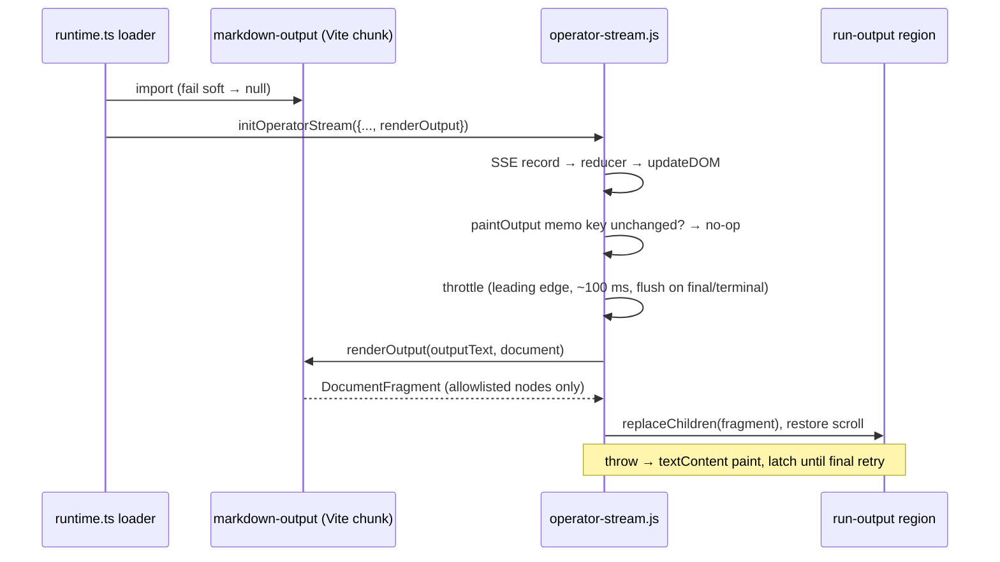

# feat: Render run output as Markdown

## Overview

Render operator run output as Markdown: while it streams, for the final answer, and on a recorded repaint. Use a bundled `markdown-it` parser whose tokens are turned into DOM nodes from a fixed allowlist, so no HTML string is ever built. Each card gets a Rendered/Raw toggle, backed by a page-wide in-memory preference, and a Copy raw button.

## Problem Frame

Run output is painted with `textContent`, so agent replies show literal `**bold**`, `- ` bullets and backtick spans (fro-bot/dashboard#586). That rule was deliberate: output is untrusted model text, and a model that read prompt-injected issue or PR content can emit anything. This change makes output readable without letting it become HTML, load a resource, or run script.

The July 2026 redesign put a gate on any richer renderer: P1–P7 in `docs/plans/2026-07-03-001-feat-operator-home-run-centric-redesign-plan.md` and R15 in `docs/brainstorms/2026-07-03-001-operator-home-run-centric-redesign-requirements.md`. This plan meets that gate, with two wording amendments recorded under Key Technical Decisions.

## Requirements Trace

- R1. Run output renders as Markdown while streaming, on the authoritative final frame, and on a recorded repaint of a finished run.
- R2. Only headings, paragraphs, emphasis, strikethrough, lists, code spans and blocks, blockquotes, horizontal rules, line breaks, tables and links are emitted. Every other construct renders as its text.
- R3. Raw HTML in output is shown as literal text. No ``, `<script>`, `style`, `on*` attribute, or other resource-loading element is ever created.
- R4. A link becomes an anchor only when its destination parses as an absolute `http:` or `https:` URL. It opens in a new tab with `rel="noopener noreferrer"`. Bare http(s) URLs are linkified under the same rule.
- R5. Streaming rendering is throttled. It tolerates unfinished Markdown and never lets the final answer lag.
- R6. Each card has a Rendered/Raw toggle and a Copy raw button. The toggle sets one page-wide, in-memory preference. Copy raw copies the run's current raw text.
- R7. Plain text remains the fallback when the renderer is missing, fails to load, or throws.
- R8. The innerHTML-family ban covers the renderer module, and CSP is unchanged.
- R9. Selecting text or clicking a link inside the output does not collapse the card.
- R10. `docs/solutions/best-practices/operator-sse-output-consumption-2026-06-22.md` documents the new rendering rule.

## Scope Boundaries

- Approval prompts, question text, checkout details and notices stay plain text.
- No syntax highlighting, link-host display, images, or Markdown in push notifications.
- No persistence of the Rendered/Raw preference. It lives in page memory only.
- The run card stays `role="button"`. Its effect on assistive tech, which flattens links and tables inside the card, is documented and deferred.

### Deferred to Separate Tasks

- Splitting the card header into the only activation target, so card content gets full semantics: a follow-up issue after this lands.

## Context & Research

### Relevant Code and Patterns

- `public/operator-stream.js`:
  - `updateDOM()` is the single painter. Output is painted in the output block, which writes `outputEl.textContent`.
  - `dispatch()` calls `updateDOM()` once per SSE record.
  - `MAX_OUTPUT_TEXT_CHARS` caps output at 256,000 characters.
  - `recordedStreamSetup` and `takeUsableFinishedRun` seed a recorded repaint from raw `outputText`.
  - `clearFinishedRuns` and `pruneFinishedRuns` bound the finished-run store.
- `web/src/operator/runtime.ts`: the loader dynamically imports the three `public/operator-*.js` modules, using `Pick`-typed casts and `.d.ts` sidecars. `_attachStream` builds `InitOptions`. The injected-client options on `initOperatorStream` (`approvalClient`, `questionClient`, `cancelClient`) are the existing injection pattern, used only by tests so far.
- Card anatomy:
  - built in `public/operator-run-index.js` (card builder, `ensureRunCardAnatomy`, `SUBSTRUCTURE_ROLES`, `bindCardActivation`) and `public/operator-launch.js` (launch card);
  - discovered by `discoverCardStreamTargets` in `runtime.ts`.
- `web/src/index.css`: the `[data-role="run-output"]` rules (mono font, `pre-wrap`, `word-break: break-all`, 400px scroll box) and the explicit grid rows for card regions.
- HTML-sink bans: `test/static-assets.test.ts`, `test/operator-stream-core.test.ts` and `test/operator-launch-core.test.ts`. They match only `innerHTML|outerHTML|insertAdjacentHTML` followed by `=`.
- `src/server.ts` CSP: `script-src 'self'`, `img-src 'self' data:`, `connect-src 'self'`. There is no Trusted Types policy.
- `web/vitest.config.ts` runs jsdom over `web/src/**`. Stream-core tests use plain-object fakes with no `createTextNode`.

### Institutional Learnings

- `docs/solutions/best-practices/operator-sse-output-consumption-2026-06-22.md`:
  - Final output replaces deltas.
  - Terminal status ends the run.
  - Output is inert. This doc is rewritten in this change.
- `docs/solutions/logic-errors/state-machines-without-a-do-nothing-branch-2026-09-21.md`: a recorded run skips the stream. The render state machine needs an explicit no-op branch for status-only frames.
- `docs/solutions/ui-bugs/nested-control-click-bubbles-to-run-card-2026-10-10.md`: controls inside the card must stop propagation, with a test that uses a parent click listener.
- `docs/solutions/workflow-issues/css-selector-emitter-mismatch-2026-07-04.md`: CSS selectors must match the classes and roles the renderer emits. A guard test derives them from the source.
- `docs/solutions/best-practices/operator-local-fixture-harness-2026-06-30.md` and `docs/solutions/workflow-issues/unit-green-is-not-feature-done-verify-the-assembled-surface-2026-06-23.md`: verify in the assembled fixture app, not by unit tests alone.
- `docs/solutions/best-practices/authenticated-sse-consumption-fetch-stream-no-leak-2026-06-20.md` recommended a no-build module with no new dependency for the stream. This plan keeps `public/operator-stream.js` no-build and dependency-free. The parser lives on the Vite side and is passed in.

### External References

- markdown-it API and safety options: https://markdown-it.github.io/markdown-it/
- markdown-it advisories on linkify and smartquotes complexity, fixed in 15.0.1 and 15.0.2: https://github.com/markdown-it/markdown-it/security/advisories
- Rendering streamed LLM responses: https://developer.chrome.com/docs/ai/render-llm-responses
- `rel="noopener"`: https://developer.mozilla.org/en-US/docs/Web/HTML/Reference/Attributes/rel/noopener

## Prior-Art Survey

```json
{
  "schema_version": 2,
  "verdict": "build-new-within-scope",
  "scope": "web/src, public, src runtime code (tests read for constraints only)",
  "freshness": {
    "vcs_reference": "896a004"
  },
  "budget": {
    "max_search_passes": 4,
    "max_candidate_inspections": 8,
    "exhausted": false
  },
  "candidates": [
    {
      "path_or_symbol": "public/operator-stream.js updateDOM output paint",
      "description": "Paints accumulated outputText into outputEl via textContent",
      "disposition": "extend",
      "insufficiency_reason": "Integration point only: it has no structure, link handling or view mode"
    },
    {
      "path_or_symbol": "public/operator-stream.js sanitizeCheckoutText and QUESTION_REMOVED_CHARS",
      "description": "Control and bidi stripping with length caps for short DTO strings",
      "disposition": "insufficient",
      "insufficiency_reason": "Flat character normalization; applying it to output would alter the raw view"
    },
    {
      "path_or_symbol": "web/src/views/Listener.tsx listener body text",
      "description": "Renders listener message bodies as React text children",
      "disposition": "insufficient",
      "insufficiency_reason": "Plain text by design, with no block structure or link validation"
    },
    {
      "path_or_symbol": "public/operator-run-index.js card builder and public/operator-launch.js card anatomy",
      "description": "createElement plus textContent builders for fixed card regions",
      "disposition": "extend",
      "insufficiency_reason": "Builds a fixed set of regions, not arbitrary trees; the toolbar region is added here"
    },
    {
      "path_or_symbol": "web/src/push/notification-click.ts URL parse",
      "description": "Parses a URL to compare its pathname",
      "disposition": "insufficient",
      "insufficiency_reason": "No protocol allowlist; no http(s) link validator exists in the repo"
    }
  ]
}
```

## Key Technical Decisions

- **Parser: `markdown-it` 15.0.3, as an exact runtime pin in root `package.json` (Renovate-managed). Marcus approved the dependency.**
  - Configure it with `html: false`, `linkify: true` and `typographer: false`. With `html: false`, raw HTML parses as text tokens, so it never becomes a node to skip.
  - Use `md.parse()` tokens only. `render`, `renderInline` and `renderer.rules` are never used.
  - Rejected alternatives:
    - `marked` has no mode that disables HTML.
    - The mdast family returns `html` nodes that would need a rewrite pass, and has about 43 transitive dependencies.
    - A hand-written parser would leave us owning correctness for tables and nested lists.
- **Gate P2, met by construction.** P2 asks for a DOMPurify-style sanitizer before DOM insertion. The renderer builds DOM from tokens with `createElement` and `textContent`, from a fixed allowlist, and never builds an HTML string, so there is nothing to sanitize. A second sanitizer would be redundant code plus another dependency. The HTML-sink ban grows to cover the renderer module (Unit 5) so the invariant is enforced, not assumed.
- **R15 "allowlists no external link/image origins", read as resource loading.** Nothing loads from any origin: no images, iframes, styles or scripts, and CSP is unchanged. Clickable http(s) links are user-initiated navigation that #586 asks for. They open in a new tab with `noopener noreferrer`.
- **Gate P5, P6 and P7.**
  - P5 is the malicious-Markdown corpus in Unit 1.
  - P6: plain text stays the fallback when the renderer is missing, fails to load, or throws. After `auth-required` no new Markdown paint happens, and the finished-run store is cleared as it is today.
  - P7: an independent Oracle security review of P1–P6 runs before the PR merges, and Marcus signs off.
- **The renderer is a pure function passed into the stream.**
  - It is a Vite-built module in `web/src/operator/`, loaded by the runtime alongside the three operator modules, and passed to `initOperatorStream` as an optional `renderOutput(text, doc)`. That function returns a `DocumentFragment`.
  - `public/operator-stream.js` stays no-build and dependency-free. It owns mounting, throttling, scroll, selection and fallback.
  - With no renderer, the existing `textContent` path runs unchanged.
- **The renderer loads up front, not lazily on first paint.** A recorded repaint is a single synchronous paint with no later frame to upgrade it. So the runtime awaits the renderer with the other modules and fails soft to no renderer. Version skew in either direction degrades to plain text:
  - a new stream module with an old shell gets no renderer;
  - an old stream module with a new shell ignores the option.
- **Links.**
  - A destination is parsed with `new URL(href)` and no base URL, so relative, `#fragment`, protocol-relative and `mailto:` destinations stay text. This also keeps same-origin paths such as `/operator/...` and the `#<runId>` jump hashes inert.
  - An anchor is created only for `http:` or `https:` destinations of at most 2,048 characters. Its `href` is set to the normalized `url.href`.
  - Only `href`, `target` and `rel` are set. A token `title` is ignored.
  - A rejected link renders its label followed by the destination as plain text.
  - Linkified bare URLs pass the same check.
- **Headings are clamped to h4–h6**, so a model `# Title` cannot insert an h1 into the page outline.
- **Images render as their alt text,** or `[image]` when the alt is empty. Inside a link, the alt text becomes the link label.
- **One painter, memoized.**
  - Output painting moves into a `paintOutput` step inside `updateDOM`. It skips the DOM write when the key `(outputText, outputUnavailable, effective view)` is unchanged, so status, heartbeat, approval and question frames never re-render output.
  - The rendered fragment replaces the old content in one `replaceChildren` swap. A throw mid-build leaves the old DOM in place, and that frame paints plain text.
- **Throttle with `setTimeout` only, around 100 ms.**
  - The first non-empty output paints immediately.
  - A final output frame and a terminal status flush synchronously.
  - The timer callback checks `aborted` and reads current state when it fires.
  - `close()` cancels it.
  - `requestAnimationFrame` is not used, because it pauses in background tabs.
  - An adaptive interval or a DOM-node budget is added only if Unit 1's timing fixtures show a measurable stall.
- **Render failure latches per attachment.** A throw paints plain text and stops rendering for that attachment, with one retry when the final output arrives. Neither the error nor the text is logged.
- **Page-wide view preference.** It is a module-level in-memory value in `public/operator-stream.js`, defaulting to Rendered. Any card's toggle flips it, and every attached card repaints. `clearFinishedRuns` resets it at the auth boundary.
  - The effective view is Raw when the preference is Raw, when no renderer exists, or when this attachment's render latch is set.
  - A fallback never rewrites the preference, and the toggle's `aria-pressed` state reflects the preference.
- **Toolbar.**
  - It is a new card region `run-output-tools`, placed after `run-output` in all three anatomy builders and in `SUBSTRUCTURE_ROLES`. It is hidden on collapse, for the unavailable result, and for empty output.
  - The toggle is one button, labelled "Raw text", with `aria-pressed`. It is hidden when no renderer is injected.
  - Handlers are bound per attachment and released in `close()`, so they never stack across re-attaches.
- **Copy raw.**
  - It copies `outputText` from state at click time, never the DOM.
  - It calls `navigator.clipboard.writeText` synchronously inside the click. If that is missing or rejects, it falls back to an off-screen textarea with `execCommand('copy')`. If that also fails, it shows "Copy failed. Select the text and copy it."
  - Feedback is "Copied" for about 1.5 s, announced in a polite status span in the toolbar.
  - When the output is truncated, the label says the copy covers only the first 256,000 characters.
- **Card click guard.** `bindCardActivation` ignores clicks whose target is inside the output region, a link or a button, and clicks made while a non-collapsed text selection sits inside the card. Selecting output or opening a link no longer collapses the card.
- **Scroll and selection.**
  - Before a swap, if the output box is scrolled to the bottom (within 8px), it is pinned to the bottom after the swap. Otherwise the previous `scrollTop` is restored, clamped to the new height.
  - While a run streams and a non-collapsed selection is inside the output, repaints wait until the selection clears.
  - A final or terminal paint always proceeds.
- **One view attribute drives CSS.** `data-output-view` is set to `rendered`, `raw` or `unavailable` on each paint, replacing the single-state `.run-output-unavailable` class:
  - rendered prose uses the body font, `white-space: normal` and `overflow-wrap: anywhere`;
  - raw keeps the mono `pre-wrap` box;
  - wide tables sit in an `overflow-x: auto` wrapper.

## Open Questions

### Resolved During Planning

- **Parser choice and dependency approval:** `markdown-it` 15.0.3, approved by Marcus.
- **Gate P2 and R15 wording:** amended as described above. The Oracle review plus Marcus's sign-off satisfy P7.
- **Link-host display:** none. Browsers already show the link destination on hover.
- **Scope of the toggle:** a page-wide in-memory preference.
- **Bare URLs:** linkified, under the same http(s) check.
- **P6 at the auth boundary:** stop new Markdown paints and clear the stores. Already-painted DOM is not reverted.

### Deferred to Implementation

- Exact toolbar grid row and placement at 390px: Unit 6 settles these with the designer against the existing explicit `grid-row` pins.
- Whether a pathological 256k input needs a DOM-node budget or an adaptive interval: decide from the Unit 1 timing fixtures.
- How the stream-core plain-object fakes gain `replaceChildren` and `createTextNode`: either extend the fakes, or use a fake renderer that returns a sentinel node.

## High-Level Technical Design

> *This illustrates the intended approach and is directional guidance for review, not implementation specification. The implementing agent should treat it as context, not code to reproduce.*



## Implementation Units

- [ ] **Unit 1: Renderer module and dependency**

**Goal:** a pure, tested token-to-DOM renderer that meets P1, P3 and P5.

**Requirements:** R2, R3, R4, R8

**Dependencies:** none

**Files:**
- Modify: `package.json`, `pnpm-lock.yaml` (`markdown-it` exact pin, plus `@types/markdown-it` if needed)
- Create: `web/src/operator/markdown-output.ts`
- Test: `web/src/operator/markdown-output.test.ts`

**Approach:**
- Use one module-level `markdownIt` instance with the fixed config.
- Walk block and inline tokens into elements created by the passed `document`. An unknown token appends its text content and never drops it.
- Honor `token.hidden` for tight-list paragraphs.
- Validate `ol start` as a positive integer.
- Drop table alignment attributes and fence info strings.

**Execution note:** test-first. Write the P5 corpus before the renderer.

**Patterns to follow:** the `createElement` and `textContent` card builders in `public/operator-run-index.js`.

**Test scenarios:**
- Happy path:
  - each allowlisted construct renders as its element: headings clamped to h4–h6, tight and loose lists, nested lists, `ol start`, blockquote, a table, fenced and indented code, em, strong, strikethrough, hr, a hard break;
  - a bare `https://` URL becomes a link with exact `target` and `rel`.
- Malicious input (P5): each case yields only allowlisted elements, with no `img`, `script`, `iframe`, `style` element, `style` attribute or `on*` attribute.
  - `<script>`, ``, an SVG with `onload`, `<iframe>`, and raw block and inline HTML all render as literal text;
  - entities such as `&lt;script&gt;` stay text;
  - broken nesting.
- Links:
  - `javascript:`, `data:`, `vbscript:`, `file:`, a `java\nscript:` variant, `mailto:`, a relative link, `#frag`, `//host` and `ftp:` all render as label plus destination text;
  - uppercase `HTTP://` is accepted and normalized;
  - a punycode host is normalized;
  - a 5,000-character URL becomes text;
  - a link inside a code span or fence stays inert;
  - a token `title` is not copied;
  - reference-style links work.
- Images: alt text, empty alt becomes `[image]`, an image inside a link, a `javascript:` image source.
- Edge cases: an unclosed fence runs to the end of input; an unmatched `*` stays literal; a half table stays a paragraph; an empty string returns an empty fragment.
- Performance: time a 256k table, deeply nested blockquotes, 50k links, a single 256k line, and the linkify advisory pattern. Record the results in the test as assertions with generous bounds.
- Config pin: the instance has `html` and `typographer` false and `linkify` true, and the module never references `.render(`, `.renderInline(` or `renderer.rules`.

**Verification:** renderer tests pass under jsdom. The corpus fails if `html` is flipped to true.

- [ ] **Unit 2: Stream painting, throttle and fallback**

**Goal:** `operator-stream.js` paints through an optional renderer with memo, throttle, scroll and selection handling, and plain-text fallback.

**Requirements:** R1, R5, R7

**Dependencies:** none, because tests use a fake renderer. Unit 4 wires the real one.

**Files:**
- Modify: `public/operator-stream.js`, `public/operator-stream.d.ts` (`InitOptions.renderOutput`)
- Test: `test/operator-stream-core.test.ts`

**Approach:**
- Extract `paintOutput` from the output block of `updateDOM`.
- Add the memo key, the throttle timer, the per-attachment render latch, and the page-wide preference with its reset inside `clearFinishedRuns`.
- Add the `data-output-view` attribute and the scroll and selection handling.
- The recorded repaint goes through the same painter.

**Execution note:** test-first, using fake timers and a fake renderer.

**Patterns to follow:** the existing `aborted` guard and `close()` cleanup in `initOperatorStream`. The finished-run store's module-level state and its reset.

**Test scenarios:**
- Happy path:
  - with no renderer, the `textContent` path is unchanged and existing tests stay green;
  - with a renderer, the first output paints immediately and a trailing paint lands around 100 ms;
  - a final frame flushes synchronously and clears the pending timer;
  - a terminal status flushes before the record is written.
- Edge cases:
  - a burst of 20 output frames renders at most twice;
  - a status-only, heartbeat or approval frame does not call the renderer;
  - an authoritative empty final hides the region;
  - the timer reads current state when it fires;
  - a recorded repaint renders once, synchronously, and honors a Raw preference.
- Error path:
  - a renderer throw paints plain text for that frame, sets the latch, and retries once on final;
  - a second throw keeps plain text;
  - neither the error nor the text is logged.
- Lifecycle:
  - `close()` cancels the timer;
  - a late timer from an old attachment does not write into the shared `outputEl`;
  - `aborted` is checked inside the callback;
  - a replay burst after reconnect is absorbed.
- Preference:
  - flipping it repaints the attached card;
  - `clearFinishedRuns` resets it to Rendered;
  - the effective view is Raw when no renderer exists, without changing the preference.
- Scroll and selection:
  - an at-bottom box stays pinned after a swap;
  - a mid-scroll position is restored;
  - a selection inside the output defers streaming repaints until it clears;
  - a final paint proceeds despite a selection.

**Verification:** stream-core tests pass, and all existing output tests are unchanged.

- [ ] **Unit 3: Output toolbar and card click guard**

**Goal:** the toggle and Copy raw controls exist on every card shape, and interacting with the output never collapses the card.

**Requirements:** R6, R9

**Dependencies:** Unit 2

**Files:**
- Modify:
  - `public/operator-run-index.js` (builder, `ensureRunCardAnatomy`, `SUBSTRUCTURE_ROLES`, `bindCardActivation`)
  - `public/operator-launch.js`
  - `public/operator-stream.js` (toolbar binding in attach and `close()`)
  - `public/operator-stream.d.ts`, `public/operator-run-index.d.ts`
  - `web/src/operator/runtime.ts` (`discoverCardStreamTargets`)
- Test:
  - `web/src/operator/output-toolbar.test.ts` (jsdom, real stream module)
  - `test/operator-run-index-core.test.js` (anatomy parity)
  - `web/src/operator/runtime.test.ts`

**Approach:**
- Add the `run-output-tools` role after `run-output` in all three builders, and as a hidden region in `SUBSTRUCTURE_ROLES`.
- Bind handlers per attachment and release them in `close()`.
- Stop propagation on the toolbar and on rendered links.
- Guard the card handler against output, link, button and selection targets.

**Execution note:** test-first, with a parent click listener in every click test.

**Patterns to follow:** `docs/solutions/ui-bugs/nested-control-click-bubbles-to-run-card-2026-10-10.md`, and the approval and question click-stop containers.

**Test scenarios:**
- Happy path:
  - Copy raw writes the current `outputText`, read at click time;
  - the toggle flips the page preference and every attached card repaints;
  - `aria-pressed` reflects the preference.
- Edge cases:
  - the truncated label appears only when `outputTruncated` is set;
  - the toolbar is hidden on collapse, for the unavailable result, and for empty output;
  - the toggle is absent when no renderer is injected, while Copy remains.
- Error path:
  - `navigator.clipboard` undefined, rejecting, or throwing synchronously each falls back to `execCommand`;
  - when both fail, the failure message shows;
  - the feedback timer is cleared on `close()`.
- Integration:
  - clicking the toggle, Copy, a rendered link, or inside the output does not toggle the card;
  - Space or Enter on the toolbar buttons does not toggle the card;
  - a click with a non-collapsed selection inside the card does not toggle it;
  - handlers do not stack across A→B→A (spy count is 1);
  - the three card shapes have the same role order.

**Verification:** jsdom and parity tests pass, and existing anatomy pins are updated on purpose rather than loosened.

- [ ] **Unit 4: Runtime wiring**

**Goal:** the runtime loads the renderer with the operator modules and passes it to every attach.

**Requirements:** R1, R7

**Dependencies:** Units 1 and 2

**Files:**
- Modify: `web/src/operator/runtime.ts`
- Test: `web/src/operator/runtime.test.ts`

**Approach:**
- Import `markdown-output` in the loader's module step and fail soft to `undefined`.
- Pass it as `renderOutput` from `_attachStream` on every path: click, launch, restore, jump and recorded repaint.
- Do not block the shell on it.

**Test scenarios:**
- Happy path: every attach path passes `renderOutput`.
- Error path: a rejected renderer import still mounts the runtime, and attaches pass no renderer.
- Integration: a recorded repaint receives the renderer at init.
- Skew: a stream module that ignores the option still paints plain text.

**Verification:** runtime tests pass. `web/dist/sw.js` lists the new chunk after `pnpm build:web`.

- [ ] **Unit 5: Static guards**

**Goal:** the HTML-sink ban enforces P2 across every module that builds output DOM.

**Requirements:** R3, R8

**Dependencies:** Unit 1

**Files:**
- Modify: `test/static-assets.test.ts`

**Approach:**
- Use one scan over non-test files in `public/` and `web/src/operator/`. It matches the bare identifiers `innerHTML`, `outerHTML`, `insertAdjacentHTML`, `setHTMLUnsafe`, `createContextualFragment`, `parseFromString`, `srcdoc` and `document.write`.
- Keep the existing narrower checks, or replace them with this scan.

**Test scenarios:**
- Happy path: the scan passes on the current tree.
- Error path: inserting `el['innerHTML'] = x` or `el.innerHTML += x` into a scanned module fails the scan. Prove this once by temporary mutation.
- Edge case: `*.test.*` files are excluded.

**Verification:** the scan covers the renderer module, and the mutation check fails red, then passes once reverted.

- [ ] **Unit 6: Styling (designer)**

**Goal:** rendered output reads as prose in both themes and at 390px, and the toolbar fits the card grid.

**Requirements:** R1, R6

**Dependencies:** Unit 3

**Files:**
- Modify: `web/src/index.css`
- Test: `test/operator-stream-core.test.ts` (selector-to-emitter guard for `data-output-view` and the toolbar role)

**Approach:**
- Style `[data-output-view]` per view.
- Rendered output gets prose typography, with mono reserved for code. Code blocks wrap rather than adding a third nested scroller. Tables sit in an `overflow-x: auto` wrapper.
- The grid item gets `min-width: 0`.
- Blockquotes get no side-stripe border.
- Check link, table and code contrast in dark and light themes.
- Place the toolbar row without breaking the existing waiting and cancel row plan.

**Test scenarios:**
- Every class and `data-output-view` value the renderer and stream emit has a rule in `index.css`.
- The existing grid-row pins are updated on purpose.

**Verification:** a designer browser pass on the fixture server, in dark, light and 390px. The CI Design Check passes.

- [ ] **Unit 7: Fixtures, docs and browser verification**

**Goal:** the assembled app proves streaming, recorded and malicious-input behavior, and the docs match.

**Requirements:** R1–R10

**Dependencies:** Units 1–6

**Files:**
- Modify:
  - `src/gateway/operator-fixture-sse.ts`, `src/routes/operator-fixture-harness.ts`, `web/src/views/Operator.tsx` (fixture scenarios)
  - `docs/solutions/best-practices/operator-sse-output-consumption-2026-06-22.md`
  - `docs/plans/2026-07-03-001-feat-operator-home-run-centric-redesign-plan.md` and `docs/brainstorms/2026-07-03-001-operator-home-run-centric-redesign-requirements.md` (a one-line pointer to this plan beside the gate and R15)
- Test: `test/operator-fixture-harness.test.ts`

**Approach:**
- Add a streamed Markdown scenario that delivers the deltas in chunks, splitting mid-fence, mid-emphasis and mid-table, followed by a final frame.
- Add a malicious-output scenario.
- Rewrite the doc's `textContent`-only section as "never an HTML string: DOM built from a parsed allowlist", keeping the inert-output and visibility rules.

**Test scenarios:**
- The fixture scenarios stream the expected frames, and scenario names stay out of the production bundle.

**Verification:**
- A designer browser pass on a fixture server the orchestrator owns:
  - streamed rendering;
  - the toggle flipping all cards;
  - Copy raw;
  - selecting text and clicking links without collapsing the card;
  - a recorded repaint rendered;
  - the malicious scenario inert, with no network request in the log;
  - dark, light and 390px.
- Gates pass. Then the Oracle security review (P7) runs, followed by Marcus's sign-off.

## System-Wide Impact

- **Interaction graph:**
  - The `updateDOM` output block, `dispatch` flush points and `close()` change.
  - The card-click handler gains a guard.
  - The runtime loader gains one import.
  - The finished-run store reset also resets the view preference.
- **Error propagation:** a renderer failure stays inside the stream module as a plain-text fallback. The renderer import failing is a soft failure in the loader.
- **State lifecycle risks:**
  - Timers and the selection listener must be released in `close()`.
  - Toolbar handlers must not stack.
  - Late timers must not write into a re-used `outputEl`.
- **API surface parity:** `InitOptions` gains an optional `renderOutput`. The `.d.ts` sidecars and the `Pick` types in `runtime.ts` change together.
- **Integration coverage:** jsdom tests run the real stream module with the real renderer for click, selection and repaint behavior. The fixture browser pass covers the assembled surface.
- **Unchanged invariants:**
  - The reducer still treats the final frame as authoritative and terminal status as completion.
  - `MAX_OUTPUT_TEXT_CHARS` is unchanged.
  - No new routes.
  - No CSP change.
  - The service worker strategy is unchanged.
  - `public/operator-stream.js` stays no-build with no imports beyond `operator-time.js`.

## Risks & Dependencies

| Risk | Mitigation |
|------|------------|
| A parser bug turns input into an unexpected node | The DOM is built only from allowlisted token types. Unknown tokens become text. The P5 corpus runs in CI. |
| A misleading link label hides its real destination | Browsers show the destination on hover. Only http(s) URLs become links, they are normalized, and same-origin and relative paths stay text. Accepted. |
| Re-parsing up to 256k characters causes stalls | Memo plus throttle, with timing fixtures in Unit 1. A budget or adaptive interval is added only if measured. |
| The renderer chunk is missing after a deploy | Soft failure to plain text, with the toggle hidden. |
| New anatomy breaks pinned grid tests | Unit 6 updates the pins on purpose, and a parity test covers all three card shapes. |
| `markdown-it` releases a security advisory | Exact pin, Renovate updates, and the same config-pin test. |

## Documentation / Operational Notes

- Rewrite the rendering section of `operator-sse-output-consumption-2026-06-22.md`.
- Point the July 2026 gate and R15 at this plan's amendments.
- After merge, file an issue for the card header-as-button accessibility split.

## Sources & References

- Related issue: fro-bot/dashboard#586
- Gate: `docs/plans/2026-07-03-001-feat-operator-home-run-centric-redesign-plan.md`, `docs/brainstorms/2026-07-03-001-operator-home-run-centric-redesign-requirements.md`
- Related code: `public/operator-stream.js`, `web/src/operator/runtime.ts`, `public/operator-run-index.js`
