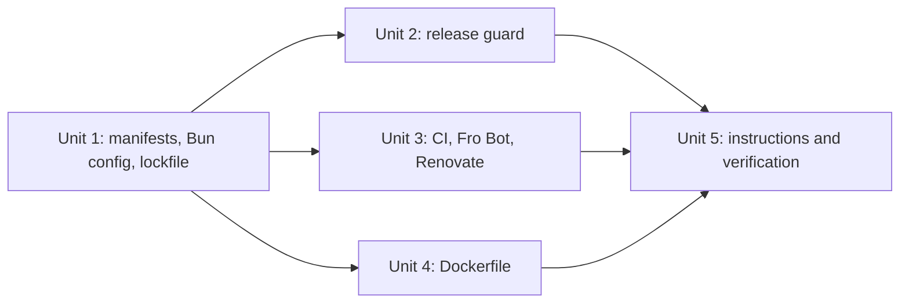

# refactor: Migrate the package manager from pnpm to Bun

## Overview

Bun takes over from pnpm as the package manager and script runner in local development, CI, the Docker build stages and Renovate. Node 24 still runs the server, Vitest, Vite, ESLint and TypeScript. The shipped image stays `node:24-trixie-slim` and contains no package manager. Everything lands in one PR (see origin: `docs/brainstorms/2026-10-17-migrate-pnpm-to-bun-requirements.md`).

## Problem Frame

The dashboard is the only active Fro Bot repository still on pnpm. fro-bot/agent, marcusrbrown/infra and marcusrbrown/systematic all install and run scripts with Bun. Because pnpm and Bun differ in install commands, lockfile format, workspace and supply-chain config, CI setup and Renovate tasks, anyone moving between these repos has to keep two sets in mind.

## Requirements Trace

- R1. Bun is the only package manager, and `bun.lock` is the only lockfile.
  - `wiki-writer` is outside this migration. Bun has no git-subdirectory dependency selector, so `@fro-bot/wiki-write-core` (a `github:…#<sha>&path:` spec) cannot be installed.
  - `wiki-writer` is not a Bun workspace member. The root tsconfig, ESLint and Vitest gates exclude it, except `wiki-writer/test/security-boundary.test.ts`, which all three keep. The Dockerfile copies nothing from it.
  - It returns once the package is published as `@fro.bot/wiki-write-core` (fro-bot/.github#3998).
  - Overrides and trusted dependencies live in `package.json`. The age gate and linker live in `bunfig.toml`.
- R2. CI and Docker installs are frozen. Renovate's post-upgrade install runs unfrozen, and CI's frozen install verifies the result.
- R3. Dependencies resolve fresh, and every security override still holds as a floor.
- R4. The install layout is hoisted.
- R5. Install scripts run only for `@swc/core` and `unrs-resolver`.
- R6. The release-age gate is 3 days. First-party `@bfra.me` packages are exempt by plain package name. Bun ignores `name@version` exclusion entries.
- R7. If a floor can only be met inside the window, resolution fails. The fix is a temporary plain-name exclusion, which exempts every version of that package and is removed once the window passes.
- R8. Scripts run through `bun run`. The tools still execute on Node 24.
- R9. The strip-only server invariant holds.
- R10. CI setup installs Bun with a SHA-pinned action, keeps Node 24, and caches Bun's package cache keyed on `bun.lock`.
- R11. `bun.lock` replaces `pnpm-lock.yaml` in the release paths filter, the guard script and its parity test. A change to any Bun config file the image build copies also releases.
- R12. Docker build stages install and build with Bun. The binary comes from a digest-pinned image.
- R13. The runtime stage stays Node with no package manager.
- R14. `packageManager` is the only hand-set Bun version. Docker's pin moves with it in the same Renovate PR, and a check asserts the two match.
- R15. Renovate maintains `bun.lock` through Bun.
- R16. Instruction files give Bun commands.

Success criteria carried from the origin:

- Every CI gate passes on Bun.
- A release image passes the smoke checks and Trivy.
- A fresh clone runs `bun install` and then `bun run test`.
- The Fro Bot workflow runs its gates with Bun.
- One fixture browser smoke pass is done.
- The first Renovate PR after merge installs frozen and passes CI without a manual fix.

## Scope Boundaries

- Bun stays out of production. No `Bun.serve`, no `oven/bun` runtime image, no `bun test`.
- Existing plans, brainstorms and docs/solutions pages are left as they are. They record past work.
- No new CI job and no new supply-chain gate.
- `wiki-writer` is not migrated: it is not a Bun workspace member and is not installed (see R1).
- No guard rails beyond what the requirements name.
- No changes to marcusrbrown/infra.

## Context & Research

### Relevant Code and Patterns

- `.context/bun-plan/repo-research.md` maps every touchpoint at line level. It is a local planning artifact and is not committed.
- fro-bot/agent shows the target shape:
  - `.github/actions/setup/action.yaml`: SHA-pinned `oven-sh/setup-bun`, `~/.bun/install/cache` keyed on `bun.lock`, frozen install.
  - `bunfig.toml`: hoisted linker, 3-day gate with plain-name exclusions.
  - `deploy/gateway.Dockerfile`: Bun builds, Node runs, and the production install uses `--ignore-scripts`.
- marcusrbrown/systematic `.github/renovate.json5` uses `skipArtifactsUpdate` for the `bun` and `npm` managers plus a post-upgrade `bun install`. A recent systematic Renovate PR regenerated `bun.lock` that way on the same pinned bfra-me Renovate workflow this repo uses.

### Institutional Learnings

- `docs/solutions/workflow-issues/release-paths-filter-must-cover-runtime-image-contents-2026-06-25.md`: the release workflow's paths filter, the inner guard and the parity test must change together. A path filter that is too narrow cannot be rescued by the guard.
- `docs/solutions/best-practices/trivy-base-image-alerts-unfixable-by-design-2026-08-30.md`: judge Trivy on the built runtime image. Keep reporting and enforcement separate.
- `docs/solutions/build-errors/web-bundle-server-import-boundary-2026-07-04.md`: a local `build:web` does not prove the isolated Docker web stage builds.
- `docs/solutions/workflow-issues/dev-server-hang-background-no-watch-kill-orphans-2026-06-25.md` and `docs/solutions/best-practices/operator-local-fixture-harness-2026-06-30.md` give the recipe for the fixture browser pass.

### External References

All facts below apply to Bun 1.4.3.

- Overrides: [bun.sh/docs/pm/overrides](https://bun.sh/docs/pm/overrides). Version-scoped keys write lockfile v3. Whether a key matches the dependent's declared range or the resolved version is not settled by the docs, so the resolved `bun.lock` is the proof of each floor.
- Lifecycle scripts: [bun.sh/docs/pm/lifecycle](https://bun.sh/docs/pm/lifecycle). `trustedDependencies` replaces Bun's default trusted list. `bun pm untrusted` lists blocked scripts.
- Install settings: [bun.sh/docs/pm/cli/install](https://bun.sh/docs/pm/cli/install).
  - `minimumReleaseAge` is in seconds.
  - `minimumReleaseAgeExcludes` takes plain package names. Bun ignores `name@version` entries, and globs do not match.
  - Resolution fails when no version qualifies.
  - `linker = "hoisted"` must be set explicitly.
  - A frozen install does not enforce the age gate.
- Scripts: [bun.sh/docs/runtime](https://bun.sh/docs/runtime). `bun run` runs `pre`/`post` hooks. A bin with a node shebang runs on Node unless `--bun` is passed. `bun run` auto-loads `.env`.
- [oven-sh/setup-bun](https://github.com/oven-sh/setup-bun). It reads `packageManager` by default, and its built-in cache covers only the binary.
- [Renovate Bun manager](https://docs.renovatebot.com/modules/manager/bun/). It does not update `packageManager: bun@x`.

## Key Technical Decisions

- **Bun 1.4.3 in `packageManager`.** It is the latest release and matches fro-bot/agent's manifest. setup-bun reads the field without extra inputs.
- **Docker gets Bun from a digest-pinned `oven/bun` image.** A shared stage holds the image, and the builder and prod-deps stages copy the binary from it. A digest pin covers the whole artifact, while a checksum download is verified against a file from the same host. Use the Debian multi-arch index digest so it works on trixie glibc.
- **One Renovate group for the Bun version.**
  - A custom regex manager updates `packageManager: bun@x` from oven-sh/bun releases.
  - The Dockerfile manager updates the `oven/bun` tag and digest.
  - A package rule groups both into one PR.
  - A Vitest test asserts the Dockerfile's `oven/bun` tag equals the `packageManager` version. This is a mechanical drift check with no manual baseline.
- **Overrides use version-scoped keys** (`brace-expansion@2`, `brace-expansion@5`, `fast-uri@3`, `katex@0`, `toml@4`, `undici@7`). A plain name would over-apply across majors. `undici` carries the most risk. Because these keys match the declared range, the resolved `bun.lock` is what proves each floor, not the key syntax.
- **Plain-name age-gate exclusions** cover every `@bfra.me` package in the resolved tree. Today those are `@bfra.me/es`, `@bfra.me/eslint-config` and `@bfra.me/tsconfig`.
- **`trustedDependencies: ["@swc/core", "unrs-resolver"]`.** Since the list replaces Bun's defaults, `msgpackr-extract` stays blocked. None of the three is a production dependency, so the prod-deps stage also uses `--ignore-scripts`.
- **Renovate:** `skipArtifactsUpdate` for the `bun` manager, with post-upgrade tasks `bun install` and `bun run fix`. This copies the systematic setup.
- **The `pretest` hook stays.** `bun run test` runs it. Docs say `bun run test`, never bare `bun test`, which would start Bun's own runner and skip both the build and Vitest.
- **`.env` auto-load needs no Bun setting.** `bun run` exposes `.env` to script processes, and tests must not depend on ambient env. CI checkouts have no `.env`, so the PR's CI run is the check that no test depends on it. A test that does is a test-isolation bug, fixed in place.
- **The release guard changes only as R11 requires:**
  - `bun.lock` takes over the lock-only rule;
  - `bunfig.toml` becomes a hard release path, because the prod-deps stage needs it for the hoisted layout;
  - the paths filter and parity test move with them;
  - the `package.json` comparison covers `workspaces` and `trustedDependencies`, because these fields shape the install;
  - the `pnpm.overrides` comparison is removed.

## Open Questions

### Resolved During Planning

- **Does Renovate's runner have Bun for post-upgrade tasks?** Yes. A systematic Renovate PR on the same pinned workflow regenerated `bun.lock`.
- **Does Impeccable detection change?** No. `context.mjs` prints the project context without `pnpm-workspace.yaml`.
- **Does Bun handle the `wiki-writer` git dependency?** It cannot: Bun has no git-subdirectory selector for the `&path:` spec. `wiki-writer` is outside this migration (see R1) and returns once `@fro.bot/wiki-write-core` is published (fro-bot/.github#3998).
- **Does `dev:fixture`'s inline `VAR=… node …` chain run under `bun run`?** Yes.
- **Does `bun run test` run `pretest`?** Yes.
- **What runs on Node?** Vite and tsc run on Node.
- **Does a frozen install enforce the age gate?** No. The gate applies only when versions resolve: in Renovate's post-upgrade install and in local installs.
- **Were the young packages installed?** `markdown-it` and `argparse` were inside the window when `bun.lock` was generated. They resolved with a one-time exclusion that is not committed.

### Deferred to Implementation

- **Is `bun` allowed in Renovate's post-upgrade commands for this repo?** Neither `.github/renovate.json5` nor the `fro-bot/.github` preset sets `allowedCommands`, so the allowlist comes from the shared bfra-me Renovate workflow. The existing `pnpm install` task runs, and systematic's `bun install` runs on the same pinned workflow. The first Renovate PR after merge confirms it.

## Implementation Units

- [x] **Unit 1: Manifests, Bun config and lockfile**

**Goal:** Install from Bun with the policies carried over, and generate `bun.lock`.

**Requirements:** R1, R2, R3, R4, R5, R6, R7, R8.

**Dependencies:** None.

**Files:**

- Modify: `package.json`.
  - Set `packageManager` and `overrides`.
  - Set `trustedDependencies`.
  - Change scripts `bootstrap`, `dev:fixture` and `pretest`.
- Modify: `tsconfig.json`, `eslint.config.ts` and `vitest.config.ts` to exclude `wiki-writer`, except `wiki-writer/test/security-boundary.test.ts`, which all three keep.
- Create: `bunfig.toml`, `bun.lock`.
- Delete: `pnpm-workspace.yaml`, `pnpm-lock.yaml`.

**Approach:**

- Before editing the repo, run a scratch install that checks:
  - the six version-scoped overrides against the resolved versions;
  - `bun pm untrusted` output;
  - frozen-install behavior on manifest drift and on a lockfile entry younger than the gate;
  - that `bun run test` runs `pretest`;
  - that `bun run dev:fixture` runs its inline `VAR=… node …` chain.

  If any override floor is not met in the resolved tree, stop and report. Record the age-gate and frozen-install results in the PR, since they depend on registry timing and cannot be re-run as tests.

- `bunfig.toml` holds `linker = "hoisted"`, a 3-day `minimumReleaseAge`, and plain-name `minimumReleaseAgeExcludes`.
- `wiki-writer` is not a workspace member and is not installed.
- Generate `bun.lock` with one unfrozen `bun install`. Remove the pnpm-shaped `node_modules` first.

**Test scenarios:**

- Happy path: a frozen install in the generated tree succeeds.
- Error path, covering AE1: editing a dependency range in `package.json` without updating `bun.lock` makes `bun install --frozen-lockfile` fail.
- Happy path, covering AE2: after a frozen install, `bun pm untrusted` lists `msgpackr-extract` as blocked, and the `@swc/core` and `unrs-resolver` native bindings load.
- Edge case, covering AE3: every resolved `brace-expansion`, `fast-uri`, `katex`, `toml` and `undici` version in `bun.lock` meets its override floor. No `brace-expansion` 2.x resolves at all; requests for it resolve to 5.x.
- Edge case, covering AE4 (one-time scratch check, result recorded in the PR): resolving a third-party version younger than 3 days is refused, and an `@bfra.me` release of the same age resolves.
- Error path, covering AE5 (one-time scratch check, result recorded in the PR): with a temporary plain-name exclusion, a floor that only a fresh version satisfies resolves. Without it, resolution fails.

**Verification:**

- `bun run check-types`, `bun run lint` and `bun run test` pass locally with `.env` present.
- `node .agents/skills/impeccable/scripts/context.mjs` prints the same resolved context before and after.

- [x] **Unit 2: Release guard and release workflow**

**Goal:** A change to the Bun lockfile or Bun config releases the way a pnpm lockfile change did. The smoke check proves Bun is absent from the image.

**Requirements:** R11, R13.

**Dependencies:** Unit 1.

**Files:**

- Modify: `scripts/should-release.ts`, `.github/workflows/release.yaml`.
- Test: `test/should-release.test.ts`.

**Approach:**

- The lock-only rule keys on `bun.lock`, and its reason text names it.
- `bunfig.toml` joins `isHardReleasePath`.
- The runtime-fields comparison covers `workspaces` and `trustedDependencies` next to `overrides`, since these fields shape the image.
- Remove the `pnpm.overrides` comparison and the `pnpm` types.
- Replace `pnpm-lock.yaml` with `bun.lock` in the paths filter, and add `bunfig.toml`.
- Add `bun` and `bunx` to the smoke tool loop. Add `/usr/local/bin/bun`, `/usr/local/bin/bunx` and `/root/.bun` to the residue loop.

**Patterns to follow:** the existing lock-only branch and its tests.

**Test scenarios:**

- Happy path, covering AE6: a change to `bun.lock` alone releases.
- Happy path: a change to `bunfig.toml` alone releases.
- Happy path: a `package.json` change to only `workspaces` releases, and a change to only `trustedDependencies` releases.
- Edge case: a change to `pnpm-lock.yaml` alone does not release.
- Integration: the parity test asserts `bun.lock` and `bunfig.toml` appear in the `release.yaml` paths filter.
- Existing fixtures that name `pnpm-lock.yaml` or `packageManager: pnpm@…` move to Bun values.

**Verification:** the guard tests pass, and the paths filter lists `bun.lock` and `bunfig.toml`.

- [x] **Unit 3: CI setup, Fro Bot workflow and Renovate**

**Goal:** CI, the Fro Bot review and Renovate install and run with Bun.

**Requirements:** R2, R8, R10, R14, R15.

**Dependencies:** Unit 1.

**Files:**

- Modify:
  - `.github/actions/setup/action.yaml`
  - `.github/workflows/main.yaml`
  - `.github/workflows/fro-bot.yaml`, for the prompt text and gate commands
  - `.github/renovate.json5`

**Approach:**

- The setup action uses SHA-pinned `oven-sh/setup-bun`, which reads `packageManager`. Keep `setup-node` 24 and remove `cache: pnpm`. Cache `~/.bun/install/cache` with a `bun-install-v…` key built from a hash of `bun.lock`. Install with `bun install --frozen-lockfile`.
- `main.yaml` and the Fro Bot gates call `bun run <script>`. The Impeccable `npx` call and the strip-only `node` loop stay as they are.
- Renovate changes:
  - post-upgrade commands `bun install` and `bun run fix`;
  - `skipArtifactsUpdate` for the `bun` manager;
  - a custom regex manager for `packageManager: bun@x`;
  - a group rule tying it to `oven/bun`.

**Test expectation:** none. These are config changes, and CI on the PR exercises them. The Fro Bot review runs through the PR's own setup action, so the `main.yaml` checks are the authoritative signal for the setup change.

**Verification:**

- On the PR, every main.yaml job installs with Bun and passes.
- A second run hits the Bun cache.
- `actionlint` passes.

- [x] **Unit 4: Dockerfile**

**Goal:** The build stages use Bun from a digest-pinned image. The runtime stage is Node only.

**Requirements:** R12, R13, R14.

**Dependencies:** Unit 1.

**Files:**

- Modify: `Dockerfile`.
- Test: `test/bun-version-pin.test.ts` (new).

**Approach:**

- A shared stage references `oven/bun:<version>@sha256:<index digest>`, where `<version>` is the bare version tag (the Debian variant) so the drift test compares it to `packageManager` by plain equality. The builder and prod-deps stages copy `/usr/local/bin/bun` from it.
- Both stages copy `package.json`, `bun.lock` and `bunfig.toml`. Nothing from `wiki-writer/` is copied.
- The builder runs `bun install --frozen-lockfile` and `bun run build:web`.
- Prod-deps runs `bun install --frozen-lockfile --production --ignore-scripts`.
- Add the Bun paths to the runtime residue removal. `CMD ["node", "src/server.ts"]` does not change.

**Test scenarios:**

- Happy path: the test reads `packageManager` and the Dockerfile's `oven/bun` tag, and they are equal.
- Error path: a Dockerfile `oven/bun` reference without a `@sha256:` digest fails the test.

**Verification:** a local `docker build` for `linux/amd64` (the release platform) and the host architecture, the release smoke loop against each image, and the Trivy enforcement and reporting passes at the release workflow's version and settings.

- Covering AE7: no `bun`, `bunx`, `npm`, `npx`, `pnpm`, `pnpx`, `corepack`, `yarn` or `yarnpkg`, and the container starts with `node src/server.ts`.
- The Trivy enforcement pass on the built image exits 0.
- `test/bun-version-pin.test.ts` passes locally.

- [ ] **Unit 5: Instructions, strings and full verification**

**Goal:** Contributor and agent instructions use Bun commands, and the migration is proven end to end.

**Requirements:** R9, R16, and the success criteria.

**Dependencies:** Units 2, 3 and 4.

**Files:**

- Modify:
  - `AGENTS.md`
  - `README.md`, which also gets a one-line note to remove `node_modules` before the first `bun install`
  - `.github/copilot-instructions.md`
  - `src/server.ts`, for the build hint message
  - the test comments and messages that cite `pnpm build:web`: `test/server.test.ts`, `test/static-assets.test.ts`, `web/src/sw.test.ts`, `web/src/privacy/build-output-no-tracking.test.ts`, `web/src/push/sw-notification.test.ts`

**Approach:** current-fact command edits only. Keep the `pretest` explanation and say `bun run test`.

**Test expectation:** none. These are text-only changes, covered by the existing gates.

**Verification:**

- `bun run check-types`, `bun run lint`, `bun run test` and `bun run build:web` pass, along with the strip-only load loop.
- The Unit 4 Docker build, smoke loop and Trivy checks pass locally.
- One fixture browser pass using `bun run dev:fixture` passes: the app loads, the runs list and a run stream work, the service worker registers, and the console shows no errors.
- After merge:
  - the release run succeeds;
  - the first Renovate PR regenerates `bun.lock`, installs frozen and passes CI.

## System-Wide Impact

- **Interaction graph:** CI setup feeds `main.yaml` and `fro-bot.yaml`. The release guard feeds `release.yaml`, which feeds the Docker build and the infra dispatch. Renovate feeds PRs. All of these move together in one PR.
- **Error propagation:** a broken setup action fails every CI job on the PR, which is visible. No PR job builds the image, so the local build, smoke loop and Trivy run before merge.
- **State lifecycle risks:**
  - Old `pnpm-store` caches stay until GitHub evicts them. They are harmless because the key prefix differs.
  - A contributor's pnpm-shaped `node_modules` has to be removed before installing with Bun.
- **Unchanged invariants:**
  - The server runtime, `node src/server.ts`, the strip-only lint and the `node:24-trixie-slim` digest stay the same.
  - The writer boundary holds: the Dockerfile copies nothing from `wiki-writer/`, and `wiki-writer/test/security-boundary.test.ts` runs.
  - The release CalVer and the infra dispatch are untouched.

## Risks & Dependencies

| Risk                                                  | Mitigation                                                                                              |
| ----------------------------------------------------- | ------------------------------------------------------------------------------------------------------- |
| Bun cannot install the `wiki-writer` git dependency   | `wiki-writer` is outside the migration (R1) and returns once the package is published                   |
| A version-scoped override misses a requester          | The resolved `bun.lock` is checked against every floor (AE3)                                            |
| Fresh resolve changes runtime transitive dependencies | Gates, the local image smoke check, Trivy and the fixture browser pass                                  |
| No PR job builds the image                            | Local build, smoke loop and Trivy before merge. If the release fails, rerun it with `workflow_dispatch` |
| Renovate's Bun post-upgrade task fails                | Copy the pattern proven in systematic. Check the first Renovate PR after merge                          |
| Frozen installs do not enforce the age gate           | The gate applies where versions resolve: Renovate's post-upgrade install and local installs             |

## Documentation / Operational Notes

- The changes to CI, the release workflow, the Dockerfile, Renovate, the root manifest and the lockfile need Marcus's sign-off before push.
- Rollback: re-pin infra to the previous dashboard release, or revert the PR. A revert restores `pnpm-lock.yaml` and `pnpm-workspace.yaml` from history, so no install or re-resolve is needed.

## Sources & References

- **Origin document:** [docs/brainstorms/2026-10-17-migrate-pnpm-to-bun-requirements.md](../brainstorms/2026-10-17-migrate-pnpm-to-bun-requirements.md)
- Sibling repos: fro-bot/agent (setup action, `bunfig.toml`, gateway Dockerfile); marcusrbrown/systematic (`.github/renovate.json5`).
- External docs: listed under External References.
