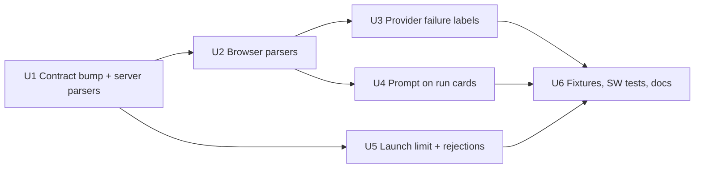

# feat: Adopt gateway operator contract 1.12.0

## Overview

Move the dashboard from operator contract 1.11.0 to 1.12.0:

- Run cards show the operator's launch prompt: a one-line preview on a collapsed card, and the full prompt rendered as Markdown on an expanded card. This closes #628.
- A run that failed with a session error names the provider failure when the gateway reports one.
- The launch form blocks prompts over 8,000 UTF-16 units and explains the gateway's prompt rejections.
- Approval notifications open the waiting run, the same as question notifications.

## Problem Frame

Gateway `v0.124.0` serves contract 1.12.0 (fro-bot/agent#1859). Production runs 1.11.0, with the gateway pinned at `v0.123.0`. The version check is exact, so the dashboard and gateway must ship together (fro-bot/.github#3512).

Without this work, a 1.12.0 gateway drops every operator stream into drift. The REST surfaces (`GET /operator/runs`, `POST /operator/runs`) carry no version check, so during the skew window the list loads and launches succeed, but the operator cannot watch, cancel or answer the runs.

1.12.0 adds:

- `RunSummary.prompt`: the prompt exactly as submitted, on web-launched runs only, non-empty, at most 8,000 UTF-16 units. It is never on the status frame.
- `providerFailureReason` on `RunSummary` and on the status frame, only when the phase is FAILED and `failureKind` is `session-error`. Values are `provider-auth-unavailable`, `model-not-available`, `provider-rejected-request` and `unclassified`, and later MINOR versions may add more.
- Launch rejections, both checked before repo access: `400 {error:'bad request', reason:'prompt-too-long'}` when the untrimmed `.length` is over 8,000, and `400 {error:'prompt is required'}` for a whitespace-only prompt.
- Approval pushes carry `data.runId` and `route: '/operator#<runId>'`, or `route: '/'` with no `runId` when the ID fails `^[\w-]{1,128}$`.

## Requirements Trace

- R1. Server, browser and fixture pins move to 1.12.0 together. Drift still fails closed.
- R2. The two run-summary parsers (server and browser) accept `prompt` and `providerFailureReason`; the two status-frame parsers (server SSE reader and browser stream) accept `providerFailureReason`. Unknown, malformed or misplaced values are dropped and never reject the run or frame.
- R3. The prompt is Markdown. A collapsed card shows a one-line plain-text preview. An expanded card renders the full prompt through the run-output Markdown renderer, which builds DOM nodes from tokens, so HTML in a prompt stays literal text.
- R4. A known provider reason replaces the generic session-error label with a dashboard-owned label. Unknown, `unclassified` or absent reasons keep the generic label. Raw codes never reach the DOM.
- R5. The approval push opens the waiting run with an open window and on a cold start. An approval and a question for the same run stay separate notifications.
- R6. The launch form blocks prompts over 8,000 UTF-16 units with an inline message, and handles both gateway prompt rejections without a CSRF retry.
- R7. Fixtures and tests cover Fro Bot's acceptance cases on #3512: Markdown prompts rendered as Markdown, HTML in a prompt kept as literal text, 8,000 vs 8,001 units including emoji, older runs without a prompt, unknown and absent reasons, no stale label on a non-failed run, and distinct approval and question notifications.

## Scope Boundaries

- No contract compatibility window. The exact pin stays.
- No character counter and no `maxlength` on the prompt textarea (`maxlength` truncates silently).
- No notification `tag`. The service worker sets none today, so nothing deduplicates.
- No provider reason in `run_failed` push copy. The push payload does not carry it, so the notification keeps saying "session error" while the card names the provider failure.
- The prompt is not added to the card's accessible label. Screen readers read the card's text content as today.

### Deferred to Separate Tasks

- Infra rollout: move `apps/gateway/upstream.json` to `v0.124.0` and deploy the dashboard release in the same window (marcusrbrown/infra, coordinated by Marcus).
- Remaining #3512 live checks (CSRF recovery after upgrade, browser and reconnect checks, checkout, cancel, logout).

## Context & Research

### Relevant Code and Patterns

- Pins: `src/gateway/operator-contract/version.ts` (single server constant) and `PINNED_CONTRACT_VERSION` in `public/operator-stream.js`, held equal by `test/static-assets.test.ts` and `test/operator-stream-core.test.ts`. Fixture `ready` frames use `OPERATOR_CONTRACT_VERSION` in `src/gateway/operator-fixture-sse.ts`.
- Vendored contract: `src/gateway/operator-contract/` and its README. Upstream `provider-failure-reason.ts`, `run-status.ts` and `launch-prompt.ts` import gateway or runtime types, so vendor wire types and constants only, as the trimmed `run-status.ts` already does.
- Parsers (closed copies that drop unknown fields): `parseRunSummary` in `src/gateway/operator-contract/run-summary.ts`, the status branch of `src/gateway/operator-sse-reader.ts`, `parseRunSummaryItem` in `public/operator-run-index.js`, and the status branch of `parseSseFrame` in `public/operator-stream.js`.
- Failure labels: label maps in `public/operator-stream.js` and `public/operator-run-index.js`, the stream vs run-index parity test in `test/operator-run-index-core.test.js`, and the service-worker copy in `web/src/push/sw-notification.ts`. `reasonLabel` is sticky across frames (`derived ?? prev` in `nextStreamState`).
- Card anatomy: three builders insert slots by hand (`renderRunCard` and `ensureRunCardAnatomy` in `public/operator-run-index.js`, the optimistic card in `public/operator-launch.js`). `SUBSTRUCTURE_ROLES` lists stream-owned regions that collapse hides. `updateCardInPlace` repaints list-owned fields, and `diffRunIndexList` write-protects the active-stream card.
- Rendering: the run-output Markdown renderer in `web/src/operator/markdown-output.ts`, loaded by `web/src/operator/renderer-source.ts` and handed to the stream by `web/src/operator/runtime.ts`. The `innerHTML`-family ban scan in `test/static-assets.test.ts` covers `public/` and `web/src/operator/`.
- Click guard: `clickBelongsToContent` and `bindCardActivation` in `public/operator-run-index.js`.
- Launch: `submitLaunch` and `launchRun` in `public/operator-launch.js` (a 400 triggers one CSRF refresh and retry, and the body is discarded). Form markup in `web/src/views/Operator.tsx`.
- Service worker: `buildNotification`, `readWireRunId` and `RUN_JUMP_TYPES` in `web/src/push/sw-notification.ts` already accept an approval `runId`. `web/src/push/notification-click.ts` routes it, and `web/src/sw.ts` builds `showNotification` options as `{body, data}`.
- Privacy: the `payloadContents` claim in `web/src/privacy/claims.ts` already says approval pushes can carry a run ID. Its `sourceNote` says the gateway sends none.
- Fixtures: scenario tables and `statusFrame` in `src/gateway/operator-fixture-sse.ts`, summary rows and the launch route in `src/routes/operator-fixture-harness.ts`, the allowed-field check in `test/operator-fixture-harness.test.ts`, and the literal scan in `test/operator-fixture-sanitization.test.ts`.

### Institutional Learnings

- `docs/solutions/best-practices/consume-gateway-operator-contract-1-8-0-2026-10-07.md`: move all pins together, parse new optional fields softly into closed objects, render text only, build fixtures from real wire shapes. Its statement that summaries carry only status and failure kind needs the 1.12.0 fields.
- `docs/solutions/best-practices/operator-failure-reason-rendering-contract-1-6-0-2026-07-08.md`: unknown reason values never reject; dashboard-owned labels with a generic fallback; raw codes never in text, attributes, classes or accessible names.
- `docs/solutions/best-practices/local-fixture-harness-must-mirror-wire-contract-2026-07-03.md`: fixtures mirror upstream wire shapes exactly.
- `docs/solutions/ui-bugs/nested-control-click-bubbles-to-run-card-2026-10-10.md`: content inside the toggle card must not toggle it; test with a parent click counter. DOM tests live under `web/src/**`.
- `docs/solutions/workflow-issues/css-selector-emitter-mismatch-2026-07-04.md`: emitted classes and roles are a styling contract with a parity test.
- `docs/solutions/workflow-issues/pwa-service-worker-registration-invisible-to-unit-tests-2026-06-25.md`: verify service-worker behavior in a real browser.
- `docs/solutions/workflow-issues/unit-green-is-not-feature-done-verify-the-assembled-surface-2026-06-23.md`: verify the assembled page, not only units.

## Prior-Art Survey

```json
{
  "schema_version": 2,
  "verdict": "extend",
  "scope": "src/gateway/operator-contract, src/gateway/operator-sse-reader.ts, src/gateway/operator-fixture-sse.ts, src/routes/operator-fixture-harness.ts, public/operator-stream.js, public/operator-run-index.js, public/operator-launch.js, web/src/sw.ts, web/src/push, web/src/privacy, web/src/views/Operator.tsx, web/src/operator, test/operator-*",
  "freshness": {
    "vcs_reference": "6e01959"
  },
  "budget": {
    "max_search_passes": 15,
    "max_candidate_inspections": 25,
    "exhausted": false
  },
  "candidates": [
    {
      "path_or_symbol": "src/gateway/operator-contract/version.ts",
      "description": "OPERATOR_CONTRACT_VERSION, the single server pin",
      "disposition": "extend"
    },
    {
      "path_or_symbol": "public/operator-stream.js PINNED_CONTRACT_VERSION",
      "description": "browser pin, held equal by test",
      "disposition": "extend"
    },
    {
      "path_or_symbol": "src/gateway/operator-contract/run-summary.ts parseRunSummary",
      "description": "server closed run-summary copy",
      "disposition": "extend"
    },
    {
      "path_or_symbol": "src/gateway/operator-sse-reader.ts",
      "description": "server status-frame parser",
      "disposition": "extend"
    },
    {
      "path_or_symbol": "public/operator-run-index.js parseRunSummaryItem",
      "description": "browser closed run-summary copy",
      "disposition": "extend"
    },
    {
      "path_or_symbol": "public/operator-stream.js parseSseFrame",
      "description": "browser status-frame parser with soft optional fields",
      "disposition": "extend"
    },
    {
      "path_or_symbol": "public/operator-stream.js nextStreamState reasonLabel",
      "description": "sticky failure label derivation",
      "disposition": "extend"
    },
    {
      "path_or_symbol": "public/operator-run-index.js renderRunCard, ensureRunCardAnatomy, updateCardInPlace",
      "description": "card anatomy and list-owned repaint",
      "disposition": "extend"
    },
    {
      "path_or_symbol": "web/src/operator/markdown-output.ts",
      "description": "token-to-DOM Markdown renderer used for run output",
      "disposition": "reuse"
    },
    {
      "path_or_symbol": "public/operator-launch.js submitLaunch, launchRun",
      "description": "launch submit, 400 CSRF retry, optimistic card",
      "disposition": "extend"
    },
    {
      "path_or_symbol": "web/src/push/sw-notification.ts buildNotification",
      "description": "already admits approval runId and route",
      "disposition": "reuse"
    },
    {
      "path_or_symbol": "web/src/sw.ts showNotification options",
      "description": "no tag today",
      "disposition": "reuse"
    },
    {
      "path_or_symbol": "web/src/privacy/claims.ts payloadContents",
      "description": "claim correct, sourceNote stale",
      "disposition": "extend"
    },
    {
      "path_or_symbol": "src/routes/operator-fixture-harness.ts",
      "description": "fixture summaries and launch route",
      "disposition": "extend"
    },
    {
      "path_or_symbol": "src/gateway/operator-fixture-sse.ts",
      "description": "fixture scenarios and statusFrame",
      "disposition": "extend"
    }
  ]
}
```

## Key Technical Decisions

- **The prompt is list-owned.** It comes from the run summary and is painted by the run index, like repo and time. The stream never paints it, so a finished-run cache hit needs no new field. On the active-stream card, which `diffRunIndexList` write-protects, the launch seed stays until the card collapses and the list adopts it. The seed is the exact text that was sent, so it matches the stored prompt.
- **Two prompt elements.** A preview line shows on a collapsed card: the raw prompt as `textContent`, kept to one line by CSS `white-space: nowrap` with an ellipsis, which also folds line breaks. A prompt body shows on an expanded card: the full prompt rendered as Markdown, capped at about 12 lines' height with its own scroll. CSS switches between them on `data-expanded`. Neither is in `SUBSTRUCTURE_ROLES`.
- **The body is rendered on expand, with the run-output Markdown renderer unchanged.** The runtime already loads the renderer (`web/src/operator/renderer-source.ts`). When it loads, the runtime hands it to the run index through a new `setPromptRenderer`. A card renders its prompt body when it expands, including the expand right after a launch, and keeps the result until the prompt text changes. If the renderer isn't loaded yet, or throws, the body is the raw text with `pre-wrap`, and the next expand renders Markdown. Nothing repaints bodies globally, so the write-protected active card is never touched outside its own expand. The renderer builds DOM nodes from tokens with `html:false`, http(s)-only links and its node cap, and needs no new gate because nothing about it changes.
- **No prompt sanitizer.** The prompt renders through `textContent` or the token renderer, exactly as submitted.
- **One prompt rule for every parser.** A prompt is kept when it is a string, not empty after `trim()`, and at most 8,000 in raw `.length`. Anything else is omitted and the summary stays valid. Only the two run-summary parsers carry `prompt`; the status frame never has it.
- **Provider labels are specific and monotonic.** A known reason replaces the session-error label only when the status is failed and `failureKind` is `session-error`. A reason on any other kind is ignored. A generic session-error label never replaces a provider-specific label for the same run, so `nextStreamState` keeps a held provider label over a derived generic one. Lookups use a `Map`. Copy:
  - `provider-auth-unavailable`: "Model provider unavailable"
  - `model-not-available`: "Model not available"
  - `provider-rejected-request`: "Model provider rejected the request"
- **Launch limit matches the gateway.** A single `readPrompt()` returns the untrimmed textarea value, which is counted, sent and seeded. Emptiness is checked with `trim()`. The disabled state comes from one function (`inFlight || tooLong`) called on input, reset and after the in-flight `finally`. The submit handler re-checks the length, because `requestSubmit()` bypasses a disabled button.
- **The too-long message has its own status node.** It is a `role="status"` node linked to the textarea with `aria-describedby`, with `aria-invalid` on the textarea, and it is announced only when the prompt crosses the limit either way. `#launch-error` stays for submit outcomes. Copy: "Prompt is too long. Keep it to 8,000 characters or fewer; emoji can count as more than one."
- **Prompt rejections are not retried.** On a 400, `launchRun` parses the body inside a try/catch. `reason === 'prompt-too-long'` and `error === 'prompt is required'` map to fixed copy with no CSRF retry. Any other 400 keeps the existing refresh-and-retry path. The body is never rendered.
- **No notification tag.** With no tag nothing replaces anything, so an approval and a question for the same run stay separate. A test pins that the `showNotification` options have no `tag` or `renotify`.

## Open Questions

### Resolved During Planning

- Should the prompt be stream-painted? No. It is summary data, and stream painting would break on a finished-run cache hit.
- Does the approval deep link need service-worker changes? No. #640 already admits an approval `runId`. This plan adds tests only.
- Does `reasonLabel` derivation change? Yes. A held provider label survives a later generic session-error frame (Unit 3).
- Does showing the prompt change the privacy page? No. It is an in-session display with no new off-device flow.

### Deferred to Implementation

- The exact grid rows for the prompt at desktop and at 480px and below: the designer decides, keeping the existing row rules intact.
- Whether `ensureRunCardAnatomy` needs an extra `insertBeforeFirstRole` anchor for the prompt: settle it when wiring the three builders; the anatomy test decides.
- How the fixture launch route treats a non-string prompt: mirror the gateway route at `v0.124.0`.

## Implementation Units



- [x] **Unit 1: Contract bump and server parsers**

**Goal:** Pin 1.12.0 everywhere and accept the new fields on the server side.

**Requirements:** R1, R2

**Dependencies:** None

**Files:**

- Modify: `src/gateway/operator-contract/version.ts`, `src/gateway/operator-contract/run-summary.ts`, `src/gateway/operator-contract/run-status.ts`, `src/gateway/operator-contract/index.ts`, `src/gateway/operator-contract/README.md`, `src/gateway/operator-sse-reader.ts`, `public/operator-stream.js` (pin only)
- Create: `src/gateway/operator-contract/launch-prompt.ts`, `src/gateway/operator-contract/provider-failure-reason.ts` (wire types and constants only)
- Test: the existing run-summary contract test, `test/operator-sse-reader.test.ts`, `test/static-assets.test.ts`, `test/operator-stream-core.test.ts`

**Approach:**

- Diff the vendored files against `v0.124.0` and copy the wire types, `OPERATOR_LAUNCH_PROMPT_MAX_LENGTH`, `OPERATOR_LAUNCH_PROMPT_TOO_LONG` and `OPERATOR_PROVIDER_FAILURE_REASONS`. Leave out helpers that import gateway or runtime code.
- The server run-summary parser copies `prompt` under the shared prompt rule. Both server parsers copy `providerFailureReason` when it is a known value on a failed `session-error` run. Anything else is omitted.
- The README lists the new files without naming a version, and its paragraph on caps states that the server applies the prompt length bound and no sanitizing.

**Execution note:** Test-first for the parser cases.

**Patterns to follow:** the 1.11.0 plan's Unit 1 and the trimmed `run-status.ts` vendoring.

**Test scenarios:**

- Happy path: a summary with a valid prompt and `failureKind: 'session-error'` plus `providerFailureReason: 'model-not-available'` parses with both fields.
- Edge case: a prompt of exactly 8,000 units including a surrogate pair is kept; 8,001 is omitted and the summary stays valid.
- Edge case: an empty, whitespace-only or non-string prompt is omitted.
- Error path: an unknown reason is omitted and the summary or frame is kept.
- Error path: a known reason with `failureKind: 'inactivity-timeout'`, or on a non-failed status, is omitted.
- Integration: the server and browser pins are equal, and a `ready` frame whose version differs from `OPERATOR_CONTRACT_VERSION` is drift. No test types a version literal.

**Verification:** check-types, lint and the contract and reader tests pass, and no hand-typed version literal exists outside the two allowed constants.

- [x] **Unit 2: Browser parsers**

**Goal:** Accept the new fields in the browser.

**Requirements:** R2

**Dependencies:** Unit 1

**Files:**

- Modify: `public/operator-run-index.js`, `public/operator-run-index.d.ts`, `public/operator-stream.js`, `public/operator-stream.d.ts`
- Test: `test/operator-run-index-core.test.js`, `test/operator-stream-core.test.ts`

**Approach:**

- `parseRunSummaryItem` copies `prompt` under the shared prompt rule and a valid `providerFailureReason`. The stream's status branch copies `providerFailureReason` only.

**Execution note:** Test-first.

**Patterns to follow:** soft `failureKind` handling in both browser parsers.

**Test scenarios:**

- Happy path: a multi-line Markdown prompt is kept byte for byte.
- Edge case: 8,000 vs 8,001 units including a surrogate pair; empty, whitespace-only and non-string prompts are omitted.
- Error path: an unknown reason, or a known reason on a non-`session-error` kind, is omitted and the run or frame is kept.

**Verification:** browser parser tests pass with the same keep and drop results as Unit 1's server tests.

- [x] **Unit 3: Provider failure labels**

**Goal:** Name the provider failure on failed session-error runs in both the collapsed card and the stream.

**Requirements:** R4, R7

**Dependencies:** Unit 2

**Files:**

- Modify: `public/operator-stream.js`, `public/operator-run-index.js`
- Test: `test/operator-stream-core.test.ts`, `test/operator-run-index-core.test.js`

**Approach:**

- One label `Map` per module, held equal by the existing stream vs run-index parity test.
- In `nextStreamState`, a held provider-specific label wins over a derived generic session-error label for the same run. The collapsed card applies the same mapping from the summary.

**Execution note:** Test-first.

**Test scenarios:**

- Happy path: each known reason on a failed `session-error` run shows its label on the collapsed card and in the stream.
- Edge case: `unclassified`, an unknown value or no reason shows the existing session-error label.
- Edge case: a failed frame with a provider label followed by a failed `session-error` frame without a reason keeps the provider label.
- Error path: a reason on a non-failed or non-`session-error` run shows no provider label.
- Integration: a summary-seeded card and a live stream for the same run agree on the label; a finished-run cache hit repaints the same label.

**Verification:** label parity tests pass, and no raw reason code appears in text, attributes, classes or accessible names.

- [x] **Unit 4: Prompt on run cards**

**Goal:** Show the prompt on every card: a one-line preview collapsed, rendered Markdown expanded. Closes #628.

**Requirements:** R3, R7

**Dependencies:** Unit 2

**Files:**

- Modify: `public/operator-run-index.js` (`renderRunCard`, `ensureRunCardAnatomy`, `updateCardInPlace`, expand path, `setPromptRenderer`), `public/operator-run-index.d.ts`, `public/operator-launch.js` (optimistic card seed), `web/src/operator/runtime.ts` (hand the renderer to the run index), `web/src/index.css`
- Test: `test/operator-run-index-core.test.js`, `web/src/operator/run-card-prompt.test.ts` (jsdom), `web/src/operator/runtime.test.ts`, `test/static-assets.test.ts` (selector parity and sink scan)

**Approach:**

- Add `run-prompt-preview` and `run-prompt` elements in the same position in all three builders, outside `SUBSTRUCTURE_ROLES`. Keep `insertBeforeFirstRole` anchors consistent so a launch-adopted card and a fetched card have the same DOM order.
- `updateCardInPlace` sets the preview and resets the body when the view's prompt changes, and clears both when the view has none. Runs without a prompt render empty elements hidden by `:empty`.
- The launch card seeds the preview and body text with the exact text that was sent.
- The expand path, including `markCardExpandedForLaunch`, renders the body with the current prompt renderer when the body isn't rendered for the current text yet; otherwise it keeps plain text.
- Clicks in the body rely on the existing `clickBelongsToContent` guard (selection and controls), with a parent click-counter test.
- CSS (designer): the preview is one line with an ellipsis; the body uses the run-output Markdown styles, about a 12-line cap with its own scroll, `overflow-wrap: anywhere` and `min-width: 0`, with the desktop and 480px grid rows and the skeleton updated.

**Execution note:** Test-first for the anatomy, expand rendering and click behavior; the designer owns the CSS and a browser pass.

**Patterns to follow:** list-owned repo and time slots; `adoptLaunchSeededTime`; the click-bubbling guard and its parent click-counter test.

**Test scenarios:**

- Happy path: a fetched card, a launch card and an upgraded card all have `run-prompt-preview` and `run-prompt` in the same DOM position.
- Happy path: expanding a card with a Markdown prompt renders headings, lists and code; collapsing shows the one-line preview.
- Edge case: a card whose list view loses its prompt clears both elements; an older run with no prompt shows nothing.
- Edge case: HTML in a prompt shows as literal text on the assembled card.
- Edge case: expanding before the renderer loads shows plain text; after `setPromptRenderer`, the next expand renders Markdown; a renderer that throws leaves plain text.
- Integration: a launched run's card, expanded at launch, shows the sent prompt.
- Integration: clicking a link or selecting text in the body does not toggle the card (parent click counter).
- Integration: a finished-run cache hit leaves the prompt in place.

**Verification:** jsdom and core tests pass, selector parity holds, and a fixture browser pass shows collapsed and expanded prompts in light and dark at desktop and 390px.

- [x] **Unit 5: Launch prompt limit and rejections**

**Goal:** Block over-limit prompts in the form and handle the gateway's prompt rejections.

**Requirements:** R6, R7

**Dependencies:** Unit 1

**Files:**

- Modify: `public/operator-launch.js`, `web/src/views/Operator.tsx`, `src/routes/operator-fixture-harness.ts` (launch route), `web/src/index.css` if the status line needs styling
- Test: `web/src/operator/launch-form.test.ts` (jsdom), `test/operator-fixture-harness.test.ts`

**Approach:**

- Use `readPrompt()`, one disabled-state function, the status node and the copy from Key Technical Decisions.
- `launchRun` returns the parsed 400 reason. `submitLaunch` maps the two prompt rejections to fixed copy and skips the retry.
- The fixture launch route checks the untrimmed `.length > 8000`, then whitespace-only, before scenario and idempotency checks.

**Execution note:** Test-first.

**Test scenarios:**

- Happy path: a prompt of exactly 8,000 units, including emoji, submits untrimmed.
- Edge case: 8,001 units disables Launch and shows the message once; going back under the limit clears it and re-enables Launch.
- Edge case: after an in-flight launch finishes, an over-limit prompt keeps Launch disabled.
- Edge case: `requestSubmit()` with an over-limit prompt sends nothing.
- Error path: a 400 with `reason: 'prompt-too-long'` shows the fixed copy and makes no second request.
- Error path: a 400 with `error: 'prompt is required'` shows fixed copy and makes no second request.
- Error path: a 400 with no body or another shape keeps the existing CSRF refresh-and-retry.
- Integration: the fixture launch route returns both 400 shapes.

**Verification:** launch and fixture tests pass, and the existing CSRF 400 tests still pass.

- [x] **Unit 6: Fixtures, service-worker tests and docs**

**Goal:** Cover the acceptance cases in fixtures, pin the notification behavior, and update docs.

**Requirements:** R5, R7

**Dependencies:** Units 3, 4 and 5

**Files:**

- Modify: `src/gateway/operator-fixture-sse.ts`, `src/routes/operator-fixture-harness.ts`, `web/src/privacy/claims.ts`, `docs/solutions/best-practices/consume-gateway-operator-contract-1-8-0-2026-10-07.md`
- Test: `test/operator-fixture-harness.test.ts`, `test/operator-fixture-sanitization.test.ts`, `web/src/push/sw-notification.test.ts`, `web/src/push/notification-click.test.ts`, a `web/src/sw` options test

**Approach:**

- Fixture scenarios: each known provider reason, `unclassified`, an unknown value, and `session-error` with no reason. Static summary rows: a Markdown prompt (headings, lists, code, a link), an 8,000-unit prompt, a prompt containing HTML and a `javascript:` link, and no prompt. All prompts are synthetic.
- Extend the fixture allowed-field and literal-scan tests to the new keys.
- Service-worker tests: approval with a valid `runId` jumps; an invalid route falls back to `/`; cold start opens `/#<runId>`; an approval and a question for the same run produce two notifications; options carry no `tag` or `renotify`.
- Rewrite the `claims.ts` `sourceNote` and the 1.8.0 doc's statement of summary fields to the current facts.

**Test scenarios:**

- Happy path: each fixture scenario serves the wire shape the gateway sends at `v0.124.0`.
- Integration: an approval push with `route: '/operator#<runId>'` focuses an open window and sends `OPEN_RUN`; with no window it opens `/#<runId>`.
- Edge case: two approvals for different runs stay two notifications, each opening its own run.

**Verification:** full gates pass (`bun run check-types`, `bun run lint`, `bun run test`), and a fixture browser pass covers the prompt preview and rendered body, provider labels and the launch limit.

## System-Wide Impact

- **Interaction graph:** run index (list-owned prompt, expand rendering, labels), runtime (renderer handoff), stream (labels), launch (seed and limit), service worker (tests only), fixture harness.
- **Error propagation:** new optional fields never reject a summary or frame. Prompt rejections end the launch with fixed copy. Other 400s keep the CSRF retry.
- **State lifecycle risks:** the active-stream card keeps the launch seed until collapse; a rendered body is kept until its prompt text changes; the label rule is monotonic per run.
- **API surface parity:** server and browser parsers share one prompt rule and one reason rule; two label maps stay aligned through the parity test.
- **Unchanged invariants:** exact contract pin, the `innerHTML`-family ban, stream-only reveal for stream-owned regions, terminal-sticky cards, the Markdown renderer, and the finished-run cache record shape.

## Risks & Dependencies

| Risk                                                                                   | Mitigation                                                                                                                                                                                                  |
| -------------------------------------------------------------------------------------- | ----------------------------------------------------------------------------------------------------------------------------------------------------------------------------------------------------------- |
| Deploy skew: either side alone drops every stream while the list and launch still work | Merging only cuts a release; infra deploys after its own approvals. Never approve the dashboard deploy without the gateway; roll back both together. Confirm the drift notice tells the operator to reload. |
| Open tabs and the cached shell keep the old pin until reload                           | Same drift notice; the service worker update flow from #638 picks up the new bundle.                                                                                                                        |
| An 8,000-unit prompt with many lines or a long token breaks the card layout            | Expanded cap with its own scroll, `overflow-wrap: anywhere`, `min-width: 0`; browser pass at 390px.                                                                                                         |
| An expand before the renderer loads shows plain text                                   | Accepted; the next expand renders Markdown.                                                                                                                                                                 |
| A generic frame overwrites a provider label                                            | Monotonic label rule with a test.                                                                                                                                                                           |

## Documentation / Operational Notes

- Rollout: infra moves the gateway pin to `v0.124.0` and deploys the dashboard release in the same window. After deploy, check health and an authenticated SSE `ready` at 1.12.0, then: a new web launch shows its prompt, a forced provider rejection shows its label, and an approval tap opens the waiting run. Roll back both together if any check fails.

## Sources & References

- fro-bot/.github#3512 comments 6250835979 (requirements) and 6250852550 (acceptance cases)
- fro-bot/agent#1859, release `v0.124.0`, issues #1840 and #1845
- Closes #628
- Prior plan: `docs/plans/2026-10-13-001-feat-operator-contract-1-11-0-plan.md`
