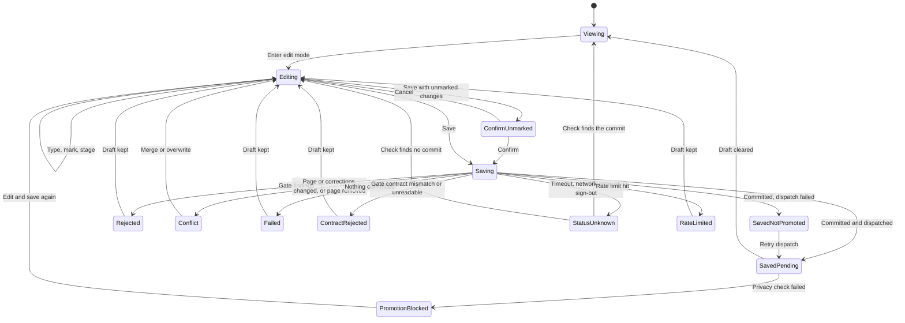
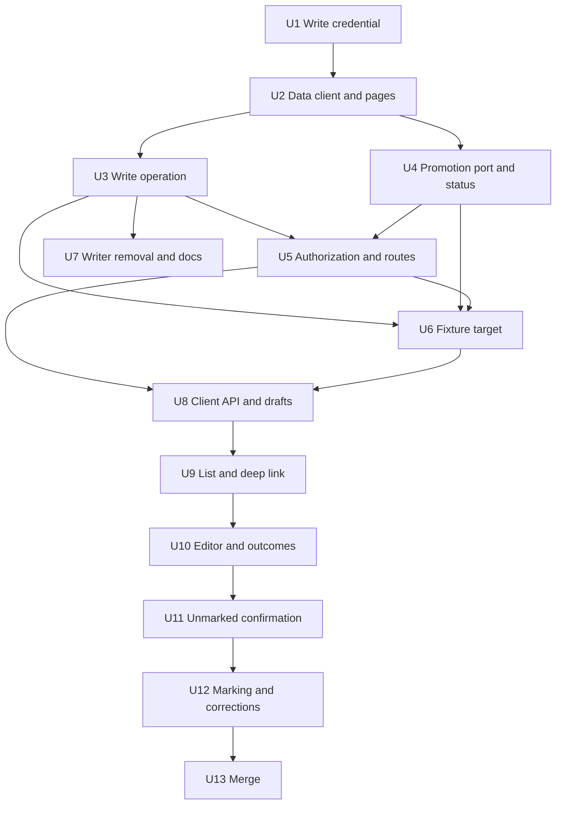
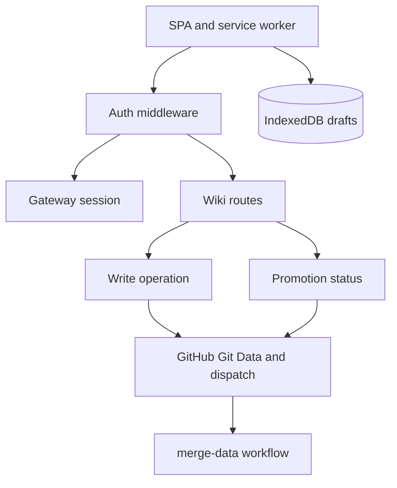

# feat: Wiki editor in the dashboard

## Overview

The dashboard gets a wiki page list and an in-place Markdown editor. A save commits the page to `fro-bot/.github:data` as Fro Bot and sends the `promote-data` repository dispatch. The page publishes when the operator merges the promotion PR.

The write path moves into the dashboard server. The separate `wiki-writer` service is deleted, and its write logic is reused with the seven changes in KTD8.

Delivery is four pull requests, landed one at a time:

| PR  | Phase | Delivers                                                                                                     | Visible to the operator                                                                                                              |
| --- | ----- | ------------------------------------------------------------------------------------------------------------ | ------------------------------------------------------------------------------------------------------------------------------------ |
| 1   | A     | Server write path, authorization, fixture write target, `wiki-writer` removal, docs                          | No new UI. The `/wiki/<id>` shell route and the `/operator` redirect change are live. The write path is inert without the write key. |
| 2   | B     | Client API, IndexedDB drafts, page list, editor, all eight outcomes, unmarked-change confirmation, deep link | List and editor. Every change counts as unmarked. Plain-text conflict view.                                                          |
| 3   | C     | Span marking, corrections panel, marked-span detection                                                       | Corrections that survive regeneration                                                                                                |
| 4   | D     | Compare-and-merge, mark remap, page-removed variant                                                          | Merge view for conflicts                                                                                                             |

Infra work in `marcusrbrown/infra` follows PR 1 and gates the first real save.

---

## Problem Frame

Fixing a wrong wiki page today means filing an issue and waiting for a regeneration. The editable-wiki work in `fro-bot/.github` defines the editing path. Its dashboard half does not exist.

The `wiki-writer` service in this repository isolates write authority behind internal HMAC auth. It is complete, but it has no image, no deploy path, no caller, and no durable replay store. The isolation protects nothing the operator needs protected, because the operator is the only user and signs in to the dashboard. The owner has decided that the dashboard holds write authority scoped to that operator, with ordinary best practice and no extra isolation. The origin document carries the full rationale.

---

## Requirements Trace

The origin document owns requirement text. This table maps each requirement to the units that satisfy it.

| ID  | Intent                                                                                             | Units                                                        |
| --- | -------------------------------------------------------------------------------------------------- | ------------------------------------------------------------ |
| R1  | List editable pages; each opens the editor                                                         | U2, U5, U9                                                   |
| R2  | Editor route is the Edit deep-link target; allowlisted return link                                 | U5, U9. The return-link half is deferred (Scope Boundaries). |
| R3  | Raw Markdown body; frontmatter system-owned and kept                                               | U2, U3, U10                                                  |
| R4  | Mark corrected spans; confirm unmarked changes                                                     | U3, U11, U12                                                 |
| R5  | Corrections list with status; retire or flag for reconfirmation; empty state                       | U2, U3, U12                                                  |
| R6  | Explicit edit entry; keep/discard on cancel; navigation guard; durable draft showing its base      | U8, U10, U12, U13                                            |
| R7  | Gate-contract check, then shared write gates; any rejection commits nothing                        | U2, U3, U10                                                  |
| R8  | Per-page conflict guard; compare-and-merge; explicit overwrite                                     | U3, U10, U13                                                 |
| R9  | Operator identity match, same-origin CSRF protection, rate limit; fail closed                      | U5                                                           |
| R10 | Fro Bot commits; operator identity and operation ID recorded server-side                           | U3                                                           |
| R11 | Write path derived from an existing page ID and checked against the allowlist                      | U2, U3                                                       |
| R12 | Dispatch `promote-data` after commit; pending state links to the promotion PR                      | U4, U9, U10                                                  |
| R13 | Eight separately reported outcomes                                                                 | U3, U4, U5, U10                                              |
| R14 | Unknown commit state is not retried; resolved from history                                         | U3, U5, U8, U10                                              |
| R15 | Saving state disables Save; rate-limited save has its own message                                  | U5, U10                                                      |
| R16 | Write path in the dashboard server with a contents-write Fro Bot token scoped to `fro-bot/.github` | U1, U3                                                       |
| R17 | Remove `wiki-writer`; move the core package to root dependencies; rewrite AGENTS.md invariant 1    | U7                                                           |
| R18 | Saving works in gateway mode and the fixture harness; not in signed-cookie mode                    | U1, U5, U6                                                   |
| AE1 | Gate findings listed, nothing committed, draft stays                                               | U3, U10                                                      |
| AE2 | Conflict shows both versions to compare and merge; overwrite is explicit                           | U10 (plain-text view), U13 (merge)                           |
| AE3 | Changes to other pages do not conflict                                                             | U3                                                           |
| AE4 | Save joins an open promotion PR                                                                    | U4, U10                                                      |
| AE5 | Timeout shows "Save status unknown"; the lookup resolves it                                        | U3, U8, U10                                                  |
| AE6 | Dispatch failure shows "Saved, not promoted" with retry dispatch                                   | U3, U4, U10                                                  |
| AE7 | Unmarked changes need confirmation                                                                 | U11 (every change is unmarked), U12 (marked spans excluded)  |
| AE8 | Valid session for another identity is refused                                                      | U5                                                           |

Success criteria trace to the gates in Phased Delivery:

- The operator corrects a page, merges the promotion PR, and the fix publishes. The gate is the closing real save after PR 4.
- A marked correction survives regeneration. U3 records it in the shared corrections format, and the upstream pipeline enforces survival.
- No `wiki-writer` service or secret exists to deploy. U7 removes it, and the infra handoff is limited to one key slot, one mount, three environment variables, and one deploy payload field.

---

## Scope Boundaries

- Turning on the Edit link on the published wiki.
- The unauthenticated wiki's behavior.
- Creating, renaming, or deleting wiki pages. The editor only corrects existing pages.
- Any GitHub write other than wiki pages and corrections on `fro-bot/.github:data` and the promotion dispatch.
- Merging the promotion PR automatically.
- A rendered preview in the editor.
- Live gate feedback while typing. Gates run on save only.
- A WYSIWYG or framework editor surface. The editor adds no editing-framework dependency.
- Extra isolation or hardening beyond ordinary best practice, by owner decision.

### Deferred to Separate Tasks

- Edit link enablement on the published wiki, including the `return` parameter, the return-link allowlist, and the "Back to the wiki page" link: separate work in `fro-bot/.github`, after PR 2 ships and the `/wiki/<id>` contract in `docs/runbooks/wiki-editor.md` is stable.
- Fro Bot key slot, read-only mount, environment variables, and the `remote-deploy.ts` changes: separate change in `marcusrbrown/infra`, after PR 1 releases.
- A `docs/solutions/` write-up of the cross-PR lessons: after PR 4 lands.

---

## Context & Research

### Relevant Code and Patterns

- `src/server.ts`: `buildDashboardApp` registers `onError`, secure headers, the per-IP rate limiter, the auth middleware with a gateway branch and an Arctic branch, `/auth`, `/api`, and the `/` shell route. `createDashboardServer` wires credentials from the environment.
- `src/server.ts` auth middleware: the gateway branch validates the session through a gateway round trip (`getCurrentSession`) on every request, then sets `gatewaySession` (with numeric `operatorId`). It never compares against a configured operator. The Arctic branch compares `session.login` to `operatorLogin` and sets `sessionLogin`. A failed session gets a 302 redirect in both branches, and a 401 only when no operator login is configured. A fetch from the client therefore sees a redirect when the session is gone.
- `src/server.ts` rate limiter: a module-level map with one fixed ceiling per key and a testing reset. The only keys today are client IPs. A limited request gets a plain-text 429.
- `src/github/app-client.ts`: `mintInstallationToken` takes a `Record<string, 'read'>`, so write scopes are unrepresentable on the read client. `src/github/installations.ts` keeps a module-level token cache keyed by installation ID.
- `src/secrets.ts`: `readOptionalMultilineSecret` reads a PEM from `<NAME>_FILE` or `<NAME>`. `readOptionalSecret` rejects newlines and suits IDs.
- `src/session.ts`: `loadCookieKey` reads `DASHBOARD_COOKIE_KEY` or a key file and throws on a short key.
- `src/github/metadata.ts`: reads `metadata/repos.yaml` from the `data` ref through an injected reader, the precedent for a read seam.
- `src/routes/auth.ts`: `deriveLogoutCsrfToken` and the logout POST, the only CSRF check on the dashboard origin.
- `src/routes/listener.ts`: POST handlers. The ingest handler shows a bounded body read, and the acknowledgement handlers sit behind the session middleware.
- `src/routes/operator-fixture-harness.ts` and `src/gateway/operator-fixture-routes.ts`: the fixture router, mounted under a public prefix when the harness is active. The wiki fixture stays out of that prefix.
- `wiki-writer/src/write-operation.ts`: gates, commit flow, outcome union, per-path blob guard, and the `Fro-Operation-Id` trailer reconcile that walks at most 32 parents.
- `wiki-writer/src/github-data-client.ts`: path allowlist, transport seam, and a snapshot that reads every blob on every call.
- `wiki-writer/src/gate-contract.ts`: marker fetch from the `main` branch with a cache, stale ceiling, and timeout.
- `node_modules/@fro.bot/wiki-write-core` (hoisted, already installed): exports `parseCorrections`, `serializeCorrections`, `recordCorrection`, `retireCorrection`, `flagCorrectionForReconfirmation`, `reconfirmCorrection`, `reconstructFrontmatter`, `buildWikiIngestChanges`, `lintWikiSnapshot`, `validateRenderingPolicy`, `verifyCorrectionSurvival`, `WikiIngestError`, and `GATE_CONTRACT_VERSION`. `buildWikiIngestChanges` always appends to `knowledge/log.md` and rebuilds `knowledge/index.md`. `lintWikiSnapshot` and wikilink validation take the full file map. `parseCorrections` throws on an empty file.
- `web/src/App.tsx`: view state is a `useState` union, and the operator view stays mounted under `display: none`. There is no router.
- `web/src/api/listener.ts` and `web/src/push/subscribe.ts`: fetch helpers with a `Result` shape, a timeout through `AbortSignal.timeout`, and a CSRF refresh with one retry.
- `web/src/operator/sign-in-recovery.ts`: the client already auto-redirects to the gateway sign-in once per tab, guarded by `sessionStorage`.
- `web/src/pwa/logout-purge.ts`: logout deletes only Cache Storage entries. It does not touch IndexedDB.
- `web/src/sw.ts`: `/auth/*`, `/operator/auth/*`, and `/api/*` are `NetworkOnly`. Navigations fall back to the precached shell except for a denylist.
- `web/src/operator/no-server-imports.test.ts`: the pattern for a source-scan guard under `web/src`.
- `test/dockerfile-boundary.test.ts`: parses Dockerfile stages and asserts the prod-deps install uses `--production` and that no stage copies the whole build context.
- `.github/workflows/release.yaml` path filter: already covers `Dockerfile`, `package.json`, `bun.lock`, `bunfig.toml`, `src/**`, `web/**`, and `public/**`. No filter change is needed.

Facts observed on the live `fro-bot/.github` repository through the GitHub API while planning. U2, U3, and U4 re-verify them:

- The repository is public. The `data` branch holds 47 allowed pages: 32 repo pages, 12 topic pages, 3 entity pages, and no comparison pages.
- Repo pages carry `node_id` in frontmatter. One entity page checked does not.
- `knowledge/corrections.yaml` does not exist on `data`. The first marked save creates it.
- Pipeline commits on `data` are authored as `fro-bot[bot]` with the `109017866+fro-bot[bot]@users.noreply.github.com` address and are GitHub-verified. The writer's identity constant uses a different address.
- A ruleset named "data branch: Fro Bot App only" is active on `data` with update, non-fast-forward, and creation rules. Its bypass list is not visible to the token used.
- `merge-data.yaml` runs the privacy checks as steps inside the workflow run, so a failed check fails the run. It uses `cancel-in-progress` for `repository_dispatch` runs, and a weekly schedule backs up the dispatch.
- Blocked promotion is a recurring state. Recent scheduled `merge-data.yaml` runs stopped at the step "🔒 Block private wiki pages".

### Institutional Learnings

- `docs/solutions/best-practices/safe-operator-launch-surface-2026-06-20.md`: mutating routes need explicit auth, CSRF, origin checks, and a rate limit. Errors must not act as an oracle.
- `docs/solutions/security-issues/github-app-credential-domain-conflation-2026-06-15.md`: keep credential domains distinct and scope permissions at mint time.
- `docs/solutions/security-issues/cross-source-redaction-denylist-before-query-2026-06-15.md`: the read path stays fail-closed. The editor must not weaken it.
- `docs/solutions/best-practices/operator-local-fixture-harness-2026-06-30.md` and `docs/solutions/best-practices/local-fixture-harness-must-mirror-wire-contract-2026-07-03.md`: the fixture mirrors wire shapes exactly, answers `no-store`, and has a production-absence test.
- `docs/solutions/workflow-issues/fixture-fault-sentinels-need-browser-controlled-keys-2026-07-11.md`: fault triggers must be values the shipped client sends organically, such as a resource ID listed in the normal list.
- `docs/solutions/best-practices/operator-first-pwa-routing-and-fail-states-2026-06-26.md` and `docs/solutions/workflow-issues/pwa-service-worker-registration-invisible-to-unit-tests-2026-06-25.md`: React owns lifecycle, the service worker never caches authenticated API paths, and a browser check is the only proof.
- `docs/solutions/best-practices/operator-approval-channel-consumption-2026-06-22.md` and `docs/solutions/logic-errors/state-machines-without-a-do-nothing-branch-2026-09-21.md`: a stale response must not revive a settled state, and every state machine needs a do-nothing branch.
- `docs/solutions/workflow-issues/unit-green-is-not-feature-done-verify-the-assembled-surface-2026-06-23.md`: green units do not prove the assembled feature across several PRs.
- `docs/solutions/workflow-issues/release-paths-filter-must-cover-runtime-image-contents-2026-06-25.md`: change the release filter, its guard, and its parity test together when build inputs change.
- `docs/solutions/build-errors/web-bundle-server-import-boundary-2026-07-04.md`: the web builder copies only `web/`, so client code cannot import server code.

### External References

- `node-diff3` (MIT, no runtime dependencies): `diff3Merge(mine, base, theirs)` over line arrays returns resolved and conflict blocks. `jsdiff` has no three-way merge, and `diff-match-patch` is archived.
- IndexedDB quotas are best-effort and differ by browser. `localStorage` is synchronous and capped near 5 MiB per origin, which makes it unsafe for 512 KB drafts.
- W3C Text Quote Selector model: an exact quote plus prefix and suffix re-finds a span after the surrounding text changes.
- Accessible merge pattern: a heading per hunk, native buttons for the two choices, Tab reachable, a polite status region announcing each resolution, and no focus jumps.
- `marcusrbrown/infra` `apps/dashboard/src/remote-deploy.ts`, read while planning: the deploy payload is version 2 with exactly five named fields. Each field has a size constant and a seen flag, and the field loop is hard-coded to five. An unknown field is rejected, and a missing field fails. The GitHub App key is published to one active path, and publication failures carry an allowlisted detail string.

---

## Prior-Art Survey

```json
{
  "schema_version": 2,
  "verdict": "extend",
  "scope": "src/, web/src/, wiki-writer/src/",
  "freshness": {
    "vcs_reference": "2b09cb933c82bfc4849d6aae1c0980b14c53f9dd"
  },
  "budget": {
    "max_search_passes": 6,
    "max_candidate_inspections": 16,
    "exhausted": true
  },
  "candidates": [
    {
      "path_or_symbol": "wiki-writer/src/write-operation.ts:createWikiWriteOperation",
      "description": "execute(): target allowlist, content size cap, gate-contract check, ledger idempotency lookup, snapshot headSha vs expectedParentSha (412), per-path blob SHA vs expectedBlobSha (412), frontmatter reconstruction, gates.run, ledger begin, blob/tree/commit with OPERATION_TRAILER, updateRef with force false. No dispatch step, no draft or merge input.",
      "disposition": "extend"
    },
    {
      "path_or_symbol": "wiki-writer/src/write-operation.ts:reconcile",
      "description": "After a failed updateRef, re-reads the snapshot, matches the page digest, and walks commit parents for the OPERATION_TRAILER line matching operationId and expectedParentSha. Returns succeeded or indeterminate. Owns the commit-trailer state.",
      "disposition": "reuse"
    },
    {
      "path_or_symbol": "wiki-writer/src/write-operation.ts:createSharedWikiWriteGates",
      "description": "run(): corrections.yaml parse and serialize, buildWikiIngestChanges as manual-edit with corrections applied, lintWikiSnapshot deterministic findings, validateRenderingPolicy on page content. Returns ok with files, or findings.",
      "disposition": "reuse"
    },
    {
      "path_or_symbol": "wiki-writer/src/github-data-client.ts:createGitHubDataClientWithTransport",
      "description": "Git Data client for the wiki repo ref: getSnapshot, createBlob, createTree, createCommit, updateRef with force false, getCommit. Path allowlist via isAllowedWikiPath. Transport has no POST dispatches method.",
      "disposition": "extend"
    },
    {
      "path_or_symbol": "wiki-writer/src/contract.ts:WikiWriteRequest",
      "description": "Private writer wire type with operation, repository, ref, path, content, optional operationId, expectedParentSha, expectedBlobSha, corrections. No draft or merge fields.",
      "disposition": "extend"
    },
    {
      "path_or_symbol": "wiki-writer/src/server.ts:createWikiWriterAppWithInjectedSecret",
      "description": "HMAC-authenticated private writer HTTP surface mapping WikiWriteResult to HTTP status.",
      "disposition": "reuse"
    },
    {
      "path_or_symbol": "wiki-writer/src/operation-ledger.ts:createOperationLedger",
      "description": "node:sqlite operation ledger keyed by operation_id with lifecycle state.",
      "disposition": "reuse"
    },
    {
      "path_or_symbol": "wiki-writer/src/gate-contract.ts:createGateContractChecker",
      "description": "Fetches a gate-contract marker from fro-bot/.github main with TTL cache, stale ceiling and timeout; returns a proceed decision.",
      "disposition": "insufficient",
      "insufficiency_reason": "Gates the writer on remote gate-contract version readiness, not page content, so it cannot serve as the per-save content gate."
    },
    {
      "path_or_symbol": "wiki-writer/src/fixture.ts:createFixtureWikiWriterApp",
      "description": "Test fixture wiring the writer app with a hard-coded secret.",
      "disposition": "insufficient",
      "insufficiency_reason": "Test-only wiring with a hard-coded secret; not a production write boundary."
    },
    {
      "path_or_symbol": "src/github/metadata.ts:readRepoMetadata",
      "description": "Reads metadata/repos.yaml from the data ref for the redaction denylist, fail-closed.",
      "disposition": "insufficient",
      "insufficiency_reason": "Read-only and page-agnostic; no blob SHA, commit, trailer, or content-gate semantics."
    },
    {
      "path_or_symbol": "src/github/app-client.ts:DashboardAppClient",
      "description": "Dashboard GitHub App client minting installation tokens with PEM/JWT error redaction.",
      "disposition": "insufficient",
      "insufficiency_reason": "Mints read-only installation tokens by construction; cannot perform the commit."
    },
    {
      "path_or_symbol": "src/server.ts",
      "description": "Installation-token contents GET read path.",
      "disposition": "insufficient",
      "insufficiency_reason": "Read-only contents fetch; no write, commit, or blob-SHA concurrency logic."
    },
    {
      "path_or_symbol": "src/session.ts:SessionManager",
      "description": "HMAC-signed session cookie; operator identity source for authenticated routes.",
      "disposition": "reuse"
    },
    {
      "path_or_symbol": "src/routes/auth.ts:deriveLogoutCsrfToken",
      "description": "HMAC double-submit CSRF token from cookie key, login and a one-hour window; checked only by logout POST.",
      "disposition": "extend"
    },
    {
      "path_or_symbol": "src/gateway/operator-client.ts",
      "description": "Gateway-facing mutating client with CSRF header, idempotency key and one CSRF retry.",
      "disposition": "insufficient",
      "insufficiency_reason": "Targets the fro-bot/agent gateway; its CSRF and idempotency handling is a pattern to copy, not a path to reuse."
    },
    {
      "path_or_symbol": "web/src/shell/AppShell.tsx",
      "description": "Stores the theme string in localStorage; only client persistence pattern.",
      "disposition": "insufficient",
      "insufficiency_reason": "One fixed-key string; no per-page draft keying, content, versioning or restore."
    }
  ]
}
```

The verdict is `extend`. The write operation, the Git Data client, and the gates move into `src/wiki/` with the changes listed in Key Technical Decisions. The HMAC server, the ledger, and the writer fixture do not move into `src/wiki/`. The `SessionManager` and `deriveLogoutCsrfToken` entries are not used by the write routes: gateway mode does not use the signed session cookie, and the write routes check `Origin` instead of a token (KTD7).

---

## Key Technical Decisions

- KTD1. **Posture.** The dashboard holds GitHub write authority scoped to the single operator. The plan applies ordinary best practice and adds no extra isolation. The write capability stays narrow: one repository, one branch, an explicit path allowlist, and one dispatch event.

- KTD2. **Separate write credential seam.** Writes use a Fro Bot App client with its own factory, its own token cache, and its own permission type. The permission type is `contents: write` and nothing else. The existing read client, its permission type, and its module-level cache do not change. Mints request `repositoryNames` for `.github`, so the token covers only that repository. One credential, this token, serves the save path (snapshot, guards, commit, dispatch) and all promotion-status reads (open PR, workflow runs, run jobs). Page list and page read use the existing read mint. The pre-U1 credential check (below) decides whether the type needs one addition. A boundary test fails if any module outside the allowed set imports the write client (U1).

- KTD3. **Promotion is a repository dispatch on every save.** The server sends `promote-data` with no payload after every successful commit. Saves made while a promotion PR is open land in that PR. Merging stays manual. The weekly workflow schedule is a backstop, so a failed dispatch is not data loss.

- KTD4. **Promotion status is branch-level and read from the workflow run.** The privacy checks run as steps inside the `merge-data` run, so a blocked promotion is a failed run, not a PR check. Status is a function of the open PR and the newest run of the workflow, of any event type. Scheduled runs can fail the same way.
  - A run in progress, queued, or cancelled is pending. A failed run is blocked, with a coarse reason from the failed step's name and a link to the run. A successful run is settled, with the PR link when one is open. A cancelled run is pending because `cancel-in-progress` cancels a run when a newer dispatch arrives.
  - After a save, status ignores any run created before that save's commit time, so an older failure cannot answer for a newer save. No run yet means pending.
  - Blocked is scoped to the `data` branch, not to one save. The editor shows it on the page list and when a page opens, not only after a save. The operator reads the reason, edits, and saves again.
  - "Saved, not promoted" comes only from the save response, where the dispatch call failed. The server does not reconstruct it later.
  - The real path must be able to return "Promotion blocked". "Promotion status unavailable" is shown only for a transient read error: a network error, a timeout, a 5xx, or a GitHub rate limit. A 403 or 404 on the status reads is a configuration fault, logged distinctly at error level, and the pre-U1 check exists to prevent it.

- KTD5. **Promotion polling has a budget.** The editor reads promotion status once after a save and once when a page opens or the list loads. While the state is pending, it repeats at an interval of at least 15 seconds. It stops when the state settles or the tab is hidden. One status read costs at most three GitHub requests: the open-PR list, the newest run, and that run's jobs when it failed. The server coalesces repeated status reads within the polling interval. At the minimum interval the cost is at most 720 requests an hour, well under the 5,000 an hour floor for a GitHub App installation.

- KTD6. **Operator identity is a configured numeric ID.** A new `DASHBOARD_OPERATOR_ID` holds the operator's GitHub numeric ID. Gateway sessions already carry `operatorId`, which the contract says to prefer over `login` for access decisions. A write route requires `gatewaySession.operatorId` to equal the configured ID. The fixture harness and Arctic autologin compare `sessionLogin` to the configured operator login instead, and only while the fixture harness is active. Every other combination, including a plain Arctic OAuth deployment and an unset ID, yields `canWrite: false`. A set-but-invalid ID fails at startup, matching how a whitespace-only operator login fails today. `canWrite` and a coarse reason ride on the wiki read responses, and the editor opens read-only with the reason when it is false.

- KTD7. **CSRF for dashboard-origin writes.** Every write route requires an exact `Origin` match to the configured dashboard origin, an `application/json` content type, and no CORS headers. A missing or different `Origin` is refused. The expected origin comes from configuration, never from the `Host` header. Gateway mode takes it from the existing gateway operator origin setting, because the reverse proxy serves both on one origin. U1 confirms the production value. Fixture mode derives it from the loopback bind. Because gateway-session CSRF tokens belong to another service, the plan adds no token. Writes also get their own rate-limit key, `operator:<id>`, with a lower ceiling than the per-IP limit.

- KTD8. **The write operation is reused with seven changes.**
  - There is no branch-wide head guard. Conflict detection is per page: the page's blob SHA must match what the editor loaded.
  - The corrections guard is per page, not per file. A save that writes corrections re-reads `knowledge/corrections.yaml`, compares a digest of this page's entries with the digest the editor loaded, and reapplies the save's marks and staged actions to the file as read. A mismatch is a conflict of the corrections kind. A marked save on page A never conflicts a later marked save on page B. A save with no marks and no staged actions does not check corrections.
  - Reconcile uses path-scoped history. It lists commits touching the page path and the corrections path since the operation started, and matches the trailer. Unrelated pipeline commits cannot push the trailer out of range.
  - There is no operation ledger. The `Fro-Operation-Id` trailer is the only idempotency record.
  - Dispatch is an injected port. The operation commits, calls the port, and returns saved or saved-not-promoted. U4 implements the port.
  - Reads keep the writer's full snapshot, because the gates take the full file map. A content-addressed blob cache keyed by blob SHA, in process and bounded, spares refetching unchanged blobs. The cold read is measured (U2).
  - A typed gate error that carries findings, such as an eroded correction, becomes a rejection with those findings. Other gate throws stay a generic rejection.

- KTD9. **A moved head retries inside the request.** Pipeline commits to `data` are frequent, and every save also rewrites the derived index and log files from its snapshot. A non-forced ref update that fails is classified by re-reading the head. If the head differs from the attempted parent, the head moved. The operation re-reads the snapshot and re-runs the gates, up to a small bounded number of attempts, and each attempt re-checks the page and corrections guards. Only a guard mismatch reports a conflict. Exhausting the attempts reports a failure that is safe to retry. If the head is unchanged, the failure was not a race, so it is a failure or, for a timeout, a reconcile. A ruleset refusal therefore cannot loop and cannot masquerade as a conflict.

- KTD10. **Retire and reconfirm are staged and committed with Save.** The editor stages them in the draft. One commit carries the page body, new marks, and the staged transitions, so one save has one set of outcomes. The server applies the transitions to the corrections as read at save time, before the survival check, so retiring a correction whose span was edited away passes. A corrections-only save, with an unchanged body, is allowed.

- KTD11. **Page identity and the corrections key.** A page ID names an existing allowlisted page. The server derives the path from the ID by lookup in the current tree, never by trusting a client-supplied path. The corrections key, `pageNodeId`, is the page's frontmatter `node_id`, read server-side. Correction IDs are minted by the server, and the attribution actor and timestamp come from the verified session. Marking is available exactly when the page has a `node_id`. A page without one is editable with no marks, and the editor says plainly that edits to that page do not survive regeneration.

- KTD12. **Gate contract on open and on save.** The cached marker check runs when the editor opens a page and again on every save. A version mismatch is a no-retry outcome that says the dashboard needs a deploy, and the draft is kept. An unreadable marker is retryable.

- KTD13. **The client persists the pending operation before sending.** The draft stores the operation ID, the base blob SHA, the base text, the send time, and whether the body changed, before the request goes out. A 401 or redirect, a network error, or a timeout mid-save becomes "Save status unknown". The unknown state offers a "Check save status" action that runs the lookup in place. The lookup also runs when the page next opens. It asks the server to find the operation ID in path-scoped history. A found commit shows the save as done. A missing commit restores the draft with Save again. If history cannot decide, the editor shows the conflict view and labels the newer version "possibly your save". The client never retries an unknown save automatically.

- KTD14. **Drafts live in raw IndexedDB.** A small wrapper with get, put, delete, and list serves drafts, and no library is added. `idb` is only a transitive dependency of Workbox and is not imported. A draft record also stores the page's corrections base, sourced from the read model when the page opens and refreshed with the page blob base on merge or overwrite. Quota and write errors surface as "draft not saved locally". Drafts survive sign-out and session expiry, because a draft is the operator's own unsaved work and session expiry should not destroy it. Orphaned drafts, whose page is gone upstream, stay listed until discarded. The server's blob guard is the only protection against two tabs editing one page.

- KTD15. **Three-way merge with `node-diff3`.** The package is a new exact-pinned dependency, approved by the owner, and lands with its first consumer in PR 3. Merge is line-level. Marks are stored as UTF-16 offsets plus a quote anchor of the exact text and a prefix and suffix. A mark is remapped through the merge, then its quote is verified at the new position. An overlapping edit flags the mark for review. A mark is never silently moved.

- KTD16. **"Unmarked change" has two stages.** In PR 2, no marking exists, so every difference from the base text is unmarked, and any changed draft requires confirmation. In PR 3, it becomes a diff against the base minus the marked spans. A deletion needs a mark anchor on the surrounding text, or it counts as unmarked. Any base change, such as a merge, invalidates a prior confirmation.

- KTD17. **Deep link.** The server serves the SPA shell for one-segment `/wiki/<id>` paths behind the normal session check. The gateway pins its own `return_to` to `/operator`, so the deep link cannot ride that parameter. A short-lived, HttpOnly return cookie carries the validated page target across login after in-app session loss. The server sets it when it redirects an unauthenticated request for a `/wiki/<id>` path. The client navigates to `/auth/login?next=<target>` when it detects a lost session, and the gateway login handler sets the cookie from the validated `next` value. The existing `/operator` redirect to `/` consumes it. The service worker keeps `/api/*` network-only.

- KTD18. **The fixture is a fake write target behind the real routes.** In fixture mode, the data-client transport seam is an in-memory repository with pages and blob SHAs. It sits behind the real `/api/wiki/*` routes. It is not mounted under the public `/__fixture/operator` prefix. Fixture pages whose IDs select an outcome appear in the normal list, so the shipped client can reach every outcome. A production-absence test proves the fake cannot be wired outside fixture mode. The `canWrite` path in fixture mode needs `DASHBOARD_OPERATOR_LOGIN` and a cookie key, and the `dev:fixture` setup documents both.

- KTD19. **Client and server wire types are separate.** The web builder copies only `web/`, so the client cannot import server types. The client parses every response with its own validators and treats an unknown shape as contract drift. A plain-text 429 from the per-IP limiter is rate-limited, not drift. A shared sample file feeds a conformance test on each side.

- KTD20. **`wiki-writer` is removed, not archived.** U7 deletes the workspace, the Dockerfile copies, the writer-specific checks, and the vitest include. It rewrites the invariant text. The `2026-08-31` plan gets `superseded` in its frontmatter and nothing else. Historical migration documents stay as they are. AGENTS.md invariant 2 is unchanged.

- KTD21. **Every PR has a gate, and the closing real save follows PR 4.** PR 1 is gated at route level: the real `/api/wiki` routes driven through the Hono app against the fixture target, the production-absence test, and the service-worker network-only check. PRs 2 to 4 are gated by a fixture browser pass of the flow built so far plus the service-worker network-only check. After the infra handoff and PR 4, one real save closes the work.

- KTD22. **Every save appends to `knowledge/log.md`.** The core package's manual-edit build always appends a log entry and rebuilds the index. The log is the pipeline's record of manual edits, and the dashboard keeps it. A save therefore commits the page, the log, the index, and the corrections file when the save writes it. The derived files are recomputed from the snapshot each attempt read.

---

## Open Questions

### Resolved During Planning

- Span marking gesture, visual state, unmark, and anchors: U12 and KTD15, with `@designer` owning the design.
- Where `pageNodeId` and correction IDs come from, and which pages can carry marks: KTD11.
- Compare-and-merge layout and mark carry-through: U13 and KTD15.
- Deep-link URL: KTD17. The return-link contract is deferred (Scope Boundaries).
- Where drafts are stored and whether they clear on sign-out: KTD14.
- How the dashboard finds the open promotion PR and the effect of a cancelled run: KTD4.
- Where the operator identity comes from in gateway mode: KTD6.
- Which signal carries the privacy-check result: KTD4, with the pre-U1 credential check.
- Where gate findings point: a finding carries its `target` text only when that text occurs in the submitted content, so the client can locate it. Otherwise the finding is page-level. Gates run on save only (Scope Boundaries).
- The overwrite mechanism: overwrite is a save re-based onto the newer page blob and corrections base the operator just saw in the conflict view, after an explicit confirm. The server contract is unchanged.
- Whether the `bunfig.toml` exemption stays: it stays. `@fro.bot/wiki-write-core` remains a first-party package that needs the release-age exemption as a root dependency.
- Whether the release path filter needs a change: it does not.
- Whether saves write the log: KTD22.

### Deferred to Implementation

- The exact environment variable names for the Fro Bot key slot. The plan proposes `DASHBOARD_FRO_BOT_APP_ID` and `DASHBOARD_FRO_BOT_APP_KEY` with `_FILE` precedence. U1 fixes the names, and the runbook hands them to infra.
- Whether the Fro Bot App is on the bypass list of the "data branch: Fro Bot App only" ruleset. The closing real save proves it, and U3 maps a ruleset refusal to a failure.
- The real HTTP status GitHub returns for a non-forced ref update on a moved head and for a ruleset refusal. KTD9 does not depend on the status, but the first real save confirms the mapping.
- The cold-read measurement result and whether anything beyond the blob cache is warranted (U2).
- The production value of the gateway operator origin and whether it equals the browser's dashboard origin (U1), and that a service-worker-controlled POST carries the expected `Origin` header (PR 2 browser pass).
- How much of each finding message to pass through. Default: kind, path, `target` when present in the submission, and the gate's own message only when it names submitted text or a page path. U3 sweeps the shared gates' messages to confirm.
- The encoding of the single-segment page ID, and the exact values of the save timeout, the head-moved retry bound, the blob cache bound, and the write rate-limit ceiling.
- Whether marks render as an overlay behind the textarea or as a list with jump-to-span. `@designer` decides in U12, under the no-framework constraint.
- The exported diff primitives of `node-diff3`. U12 confirms its types and falls back to its longest-common-subsequence export if a plain diff is missing.
- Whether the privacy page needs a sentence about on-device drafts. Drafts never leave the device, so the default is no change. U8 confirms with the owner.
- Whether the in-memory IndexedDB fake is enough. If it proves too costly, adding `fake-indexeddb` as a dev dependency needs owner approval.

---

## Output Structure

    src/github/        write credential client (U1)
    src/wiki/          config, paths, data client, gates, write operation, promotion, authorization, fixture target
    src/routes/wiki.ts /api/wiki routes (U5)
    web/src/api/       client API module (U8)
    web/src/wiki/      drafts, location, outcomes, marks, unmarked detection, merge, remap
    web/src/views/     list, editor, corrections panel, merge view
    docs/runbooks/wiki-editor.md

The per-unit file lists are authoritative.

---

## High-Level Technical Design

> _This illustrates the intended approach and is directional guidance for review, not implementation specification. The implementing agent should treat it as context, not code to reproduce._

### Editor save lifecycle

The editor holds one lifecycle per page. Every terminal state has a way back to editing, and "Save status unknown" has no automatic retry.



### Outcome contract

The response body carries a discriminant. The client switches on the discriminant, never on the status code alone.

| Outcome                    | Trigger                                                                                                    | Draft                            | Operator action                                                                     |
| -------------------------- | ---------------------------------------------------------------------------------------------------------- | -------------------------------- | ----------------------------------------------------------------------------------- |
| Saved, pending publication | Commit landed and dispatch accepted                                                                        | Cleared                          | Open the promotion PR link, or wait while the PR opens. Saving again is not needed. |
| Rejected                   | A gate or request check refused. Nothing committed.                                                        | Kept                             | Fix the findings and save                                                           |
| Conflict                   | The page blob changed, this page's corrections changed on a save that writes them, or the page was removed | Kept                             | Merge or overwrite. For a removed page, copy the text out. The view names the kind. |
| Failed                     | Nothing committed: a GitHub error, or the head kept moving past the retry bound                            | Kept                             | Save again                                                                          |
| Gate-contract rejected     | Marker version mismatch (no retry) or marker unreadable (retryable)                                        | Kept                             | Mismatch: wait for a dashboard deploy. Unreadable: retry.                           |
| Save status unknown        | The ref update result could not be proven, or the client lost the response                                 | Kept, with the pending operation | No retry. Use "Check save status".                                                  |
| Saved, not promoted        | Commit landed and the dispatch call failed (from the save response only)                                   | Cleared                          | Retry dispatch. No new commit.                                                      |
| Promotion blocked          | The newest promotion run failed its privacy check                                                          | Cleared                          | Read the reason, edit, and save again                                               |
| Rate-limited               | Per-operator limiter or a GitHub rate limit                                                                | Kept                             | Wait, then save                                                                     |

---

## Phased Delivery

Each phase is one pull request. A PR merges before the next starts. Docs ship in the PR that changes the behavior they describe.

### Phase A (PR 1): Server write path, writer removal, docs

- Units U1 to U7.
- The write path is inert without the Fro Bot key. With no key, or no `DASHBOARD_OPERATOR_ID`, the wiki routes answer reads and report `canWrite: false`. No write path can run.
- The gate is route-level: the real `/api/wiki` routes driven through the Hono app against the fixture target, covering every outcome; the production-absence test; and the service-worker network-only check for `/api/wiki/*`.

### Infra handoff (after PR 1 releases)

The change lands in `marcusrbrown/infra`. `apps/dashboard/src/remote-deploy.ts` uses payload v2 with exactly five named fields. An unknown field is rejected, and a missing field fails. Publishing a second key therefore needs all of these:

- A new case branch for the new field in the payload reader.
- A seen flag for it, with duplicate detection.
- A required-field check that includes it.
- A size constant for it, counted in the total payload limit.
- A second publish step to a new active path, with its own allowlisted failure detail.
- The TypeScript payload type change.
- The compose read-only mount for the new path.

Observed in the same file: the field loop is hard-coded to five and must become six.

Three environment variables:

- The key location (the proposed `DASHBOARD_FRO_BOT_APP_KEY_FILE`).
- The Fro Bot App ID.
- `DASHBOARD_OPERATOR_ID`, set to the operator's numeric GitHub ID.

The Fro Bot App installation on `fro-bot/.github` must grant contents write. `docs/runbooks/wiki-editor.md` is the handoff document.

### Phase B (PR 2): Client API, drafts, list, editor, outcomes, unmarked confirmation, deep link

- Units U8 to U11.
- The conflict outcome ships a plain-text view of both versions with an explicit overwrite. The merge view is PR 4.
- Every change counts as unmarked until marking arrives in PR 3, so every save of a changed draft shows the confirmation.
- The gate is a fixture browser pass of list, open, edit, confirm, and save through every outcome the fixture offers, a reload that restores a draft, a check that the POST carries the expected `Origin` through the service worker, and the service-worker network-only check.

### Phase C (PR 3): Span marking, corrections panel, marked-span detection

- Unit U12. It adds `node-diff3`, its first consumer being marked-span detection.
- The gate is a fixture browser pass of mark, save, panel status, retire, flag, and the confirmation, plus the service-worker network-only check.

### Phase D (PR 4): Compare-and-merge and page-removed variant

- Unit U13.
- The gate is a fixture browser pass of a conflict resolved through the merge view, a keyboard-only pass, and a removed-page pass, plus the service-worker network-only check.

### Closing check

After the infra handoff and PR 4, the operator saves one real correction, sees the promotion PR, and merges it. This is the only check that proves the real credential, the ruleset bypass, the dispatch, and the privacy-check read end to end.

---

## Implementation Units

### Pre-U1 research: write-credential check

This check settles KTD2's permission type.

- **Result.** A Fro Bot installation token minted for `fro-bot/.github` with `permissions: {contents: 'write'}` came back with exactly `{contents: write, metadata: read}`. With that token, these reads all returned 200: a failed `merge-data.yaml` run, its jobs, the `merge-data.yaml` runs list, open `data`→`main` PRs, and the `data` ref. That run's only non-success step is "🔒 Block private wiki pages", and a second failed run stopped at the same step.
- **Decision.** KTD2's permission type is `contents: write` only. The promotion-status reads need no further scope, and the infra handoff adds no App permission.
- **Installation scope.** The Fro Bot App installation grants far more than this, including `administration`, `secrets` and `workflows` write. The narrow scope comes only from the mint-time `permissions` subset, so U1's permission type is the boundary that keeps it narrow.
- The real promotion-status path can return "Promotion blocked" (KTD4).

### Unit dependencies



UI units (U9 to U13) state the behavior. `@designer` owns the visual and interaction design within that behavior, and the CI Impeccable design check must pass.

### U1. Write credential seam and operator configuration

- [x] Landed

**Goal:** A separate Fro Bot App client mints contents-write installation tokens scoped to `fro-bot/.github`. Configuration reads the key slot and the operator ID. A missing key leaves every write path off.

**Requirements:** R16, R18, R9 (configuration half).

**Dependencies:** The pre-U1 research check.

**Files:**

- Create: `src/github/fro-bot-app-client.ts`
- Create: `src/wiki/config.ts`
- Modify: `src/server.ts`
- Test: `test/wiki-write-credential.test.ts`
- Test: `test/wiki-credential-boundary.test.ts`

**Approach:**

- The client has its own factory, JWT-authenticated Octokit, token cache, and permission type. It does not import or share state with `src/github/app-client.ts` or `src/github/installations.ts`.
- The permission type makes any scope except `contents: write` unrepresentable.
- Each mint passes `repositoryNames` for `.github`. The installation ID for `fro-bot/.github` is resolved through the App JWT, as the read path does, and cached for a bounded time.
- The token cache is per client instance and keyed by installation. It expires from the expiry the token response reports, with a refresh buffer.
- Errors pass through the existing sanitizer so PEM blocks, JWTs, and tokens never reach logs.
- `config.ts` reads the App ID with the single-line secret reader and the key with the multiline reader. It reads `DASHBOARD_OPERATOR_ID` as a positive integer and the expected dashboard origin for the `Origin` check. In gateway mode the expected origin is the existing gateway operator origin setting, whose default is the public dashboard origin. U1 confirms that this holds in production and adds a dedicated setting only if it does not. A set-but-invalid value throws at startup. An absent key or ID yields a configuration that reports write capability off, with a reason code.
- `createDashboardServer` builds the write client only when both the ID and key are present. If exactly one is present, it logs a warning and leaves writes off, as the read-credential pair does.

**Execution note:** Test-first for the permission typing, cache separation, and fail-closed configuration.

**Patterns to follow:**

- `src/github/app-client.ts` for the throttled Octokit and error sanitization.
- `src/github/installations.ts` for the token cache and expiry buffer.
- The pair check in `createDashboardServer` for the credential pair.
- `docs/solutions/security-issues/github-app-credential-domain-conflation-2026-06-15.md`.

**Test scenarios:**

- Happy path: with an ID and key, a mint requests exactly `contents: write` and `repositoryNames` of `.github`, and returns the token.
- Happy path: two mints within the expiry window hit the cache once. A mint after expiry mints again.
- Edge case: the write cache and the read cache are independent. Minting a write token does not populate the read cache for the same installation.
- Edge case: `DASHBOARD_OPERATOR_ID` of zero, negative, fractional, or non-numeric throws at startup. Unset yields write capability off.
- Error path: only one of ID and key present leaves write capability off and logs a warning. Neither present does the same.
- Error path: a failed mint surfaces a sanitized error with no PEM, JWT, or token text.
- Integration: a scan test fails if any module imports `fro-bot-app-client.ts` or the write-token provider type, except `src/server.ts` (wiring), `src/wiki/write-operation.ts`, and `src/wiki/fixture-target.ts`. Every other `src/wiki/` module and every `src/github/` read module fails the scan.

**Verification:**

- With no key configured, the server boots and every write capability reports off.
- The credential boundary test passes, and a deliberate violation fails it.

---

### U2. Data client, gate-contract check, and page read models

- [x] Landed

**Goal:** Move the allowlist, the Git Data client, and the gate-contract check into `src/wiki/`. Add a content-addressed blob cache, path-scoped history, and the page list and read models. Measure the cold read.

**Requirements:** R1, R3, R5, R7, R11, R16.

**Dependencies:** U1.

**Files:**

- Create: `src/wiki/paths.ts`
- Create: `src/wiki/data-client.ts`
- Create: `src/wiki/gate-contract.ts`
- Create: `src/wiki/pages.ts`
- Modify: `package.json` (add `@fro.bot/wiki-write-core` at its pinned version to root dependencies)
- Modify: `bun.lock`
- Test: `test/wiki-paths.test.ts`
- Test: `test/wiki-data-client.test.ts`
- Test: `test/wiki-gate-contract.test.ts`
- Test: `test/wiki-pages.test.ts`

**Approach:**

- `paths.ts` holds the page-path allowlist (the four page directories, one level deep, `.md`) and the corrections path, moved from the writer. It maps a page ID to a path only by finding the ID in the current tree.
- `data-client.ts` keeps the transport seam and the writer's full snapshot read. The transport gains list-commits-by-path, create-dispatch, list-pulls, list-workflow-runs, and list-run-jobs.
- A blob cache keyed by blob SHA sits in front of the per-blob fetch. Blob SHAs are content-addressed, so a head change refetches only changed blobs. The cache is in process, bounded by total bytes, never written to disk, and never logged.
- The snapshot reads the full tree listing but fetches blobs only under `SNAPSHOT_PATH_PREFIXES` (`knowledge/` and `metadata/repos.yaml`), which is every path the core gates read. The `data` branch carries the whole repository, so a full blob read is about 550 requests. Commits use the full tree SHA as `base_tree`, so files outside the snapshot are kept.
- List and page reads take a read-token provider, which uses the existing read mint. The save path and promotion-status reads take the write-token provider from U1. The two providers have different types.
- The tree call reports truncation. A truncated tree fails closed.
- `pages.ts` builds the list (ID, title, type, updated, whether the page can carry marks) and the read model. The read model holds the body without frontmatter, the page blob SHA, the page's corrections entries with status and a stale flag, the digest of those entries (the corrections base), the head commit SHA, the contract state, and `canWrite` with its reason. Frontmatter is parsed with the core package, and `node_id` decides mark capability.
- A missing `knowledge/corrections.yaml` is an empty set with the digest of the empty set. An unreadable or empty one is corrupt, because the core `parseCorrections` throws on an empty file. A corrupt file is an error state, never an empty list.
- `gate-contract.ts` keeps the cache, stale ceiling, and timeout, and maps a decision to mismatch (no retry) or unreadable (retryable).
- A measurement step times a cold snapshot read against the live `data` tree, counting requests and wall time, and records both in the runbook. The narrowed snapshot measured 56 requests and 3.3 to 3.9 s cold, and 3 requests and 0.7 s warm.

**Patterns to follow:**

- `wiki-writer/src/github-data-client.ts`, `wiki-writer/src/gate-contract.ts`, and their tests, moved and extended.
- `src/github/metadata.ts` for an injected reader and typed errors.

**Test scenarios:**

- Happy path: the list returns every allowlisted page with type, title, and mark capability. A page with `node_id` can carry marks. A page without it cannot.
- Happy path: the read model strips frontmatter, returns the page blob SHA, and returns the corrections entries and digest for that page only.
- Edge case: page IDs with traversal, an absolute path, an encoded slash, a trailing dot segment, or an unknown name are rejected before any network call.
- Edge case: a missing corrections file yields an empty set with the empty digest.
- Edge case: an empty corrections file is reported as corrupt, not as an empty list and not as a crash.
- Edge case: the digest is stable under entry order and changes when any of the page's entries changes. An entry for another page does not change it.
- Edge case: a second read of an unchanged blob makes no fetch. A head change refetches only the changed blob.
- Edge case: a truncated tree fails closed with an unavailable error.
- Error path: an unreadable corrections file returns an error, never an empty list.
- Error path: a tree or blob read failure returns a typed unavailable error, never a partial list.
- Error path: the gate-contract marker is unreadable, the version differs, and the cache is stale beyond the ceiling. Each maps to the right retry class.
- Integration: the contract version compared against the marker is read from the core package's export, not typed as a literal.

**Verification:**

- All moved writer tests pass in their new location.
- A page ID can never produce a path outside the allowlist.
- The cold-read figures are recorded in the runbook.

---

### U3. Write operation

- [x] Landed

**Goal:** One save runs the guards and gates, commits as Fro Bot, calls an injected dispatch port, and reports a distinct outcome. It stays correct while pipeline commits move the head.

**Requirements:** R4, R5, R7, R8, R10, R11, R13, R14, R16. Satisfies AE1, AE3, AE5, and the commit half of AE6.

**Dependencies:** U2.

**Files:**

- Create: `src/wiki/gates.ts`
- Create: `src/wiki/write-operation.ts`
- Test: `test/wiki-gates.test.ts`
- Test: `test/wiki-write-operation.test.ts`

**Approach:**

- The save request carries an operation ID, a page ID, the page base blob SHA, the corrections base digest, the body, marks (text, start, end), and staged transitions (retire, flag, reconfirm). It carries no operator identity, correction IDs, or timestamps.
- The check order is: page ID and request shape, size cap, gate contract, snapshot, page existence, page blob guard, corrections guard when the save writes corrections, frontmatter reconstruction, gates, commit, dispatch port.
- A page absent from the snapshot reports a conflict of the page-removed kind. A page blob mismatch reports a conflict of the page kind.
- The corrections guard follows KTD8. It re-reads the file as of this attempt's snapshot, computes the digest of this page's entries, and compares it with the request's digest. A mismatch reports a conflict of the corrections kind, with the page's current entries in the response. A match reapplies the marks and staged actions to the file as read.
- Gates apply the staged transitions and new marks to the corrections read at save time, then run the shared build, survival, lint, and rendering checks. Retired and superseded corrections skip the survival check.
- The server mints correction IDs and builds attribution from the verified session login and the server clock. A mark on a page without `node_id` is rejected.
- A gate error that carries findings becomes a rejection with those findings. Findings carry `target` only when that text occurs in the submission.
- The commit message keeps the manual-edit subject and adds two trailers: the operation ID and the operator login from the session. The commit sends no author or committer. GitHub then attributes it to the Fro Bot App and signs it, as it does for the pipeline's verified `data` commits; GitHub's bot signature verification requires no custom author or committer.
- The commit carries the page, the appended `knowledge/log.md`, the rebuilt `knowledge/index.md`, and the corrections file when the save writes it (KTD22). Blobs are created only for files whose content changed.
- Ref-update failures follow KTD9: re-read the head to classify, retry a moved head within the bound, fail on an unchanged head, and run reconcile on a timeout or server error.
- Reconcile lists commits touching the page path and the corrections path since the operation started, matches the operation trailer, and reports success on a match. No match or a listing failure reports an indeterminate result. A lookup entry point serves the reopen case: given an operation ID, a page ID, and a start time, it runs the same path-scoped match.
- A successful commit calls the injected dispatch port and returns saved, or saved-not-promoted when the port reports failure. The response carries the commit SHA and the commit time.
- GitHub rate-limit responses map to the rate-limited outcome with a retry hint.
- Logs carry the operation ID, outcome class, and attempt count. They never carry page text, finding text, or repository names.

**Execution note:** Implement test-first. Write the guard, outcome, retry, and reconcile tests against a fake transport and a fake dispatch port before any production code.

**Patterns to follow:**

- `wiki-writer/src/write-operation.ts` and `wiki-writer/test/write-operation.test.ts`, moved and rewritten for the seven changes in KTD8.
- The package's `WikiIngestError` and correction functions.

**Test scenarios:**

- Happy path: a body edit on an unchanged page commits one commit with the page, the appended log, the rebuilt index, and no corrections file, and returns a commit SHA. Covers AE3: commits to other pages between load and save do not conflict.
- Happy path: the commit's log file contains an entry for the manual edit.
- Happy path: a save with two marks creates the corrections file when absent, records both with server-minted IDs and session attribution, and the survival check passes.
- Happy path: staged retire, flag, and reconfirm change the corrections state in the same commit as the body. A corrections-only save with an unchanged body commits.
- Happy path: the commit message carries both trailers, and the operator trailer comes from the session argument, not the request.
- Happy path: a marked save on page A, then a marked save on page B from an editor loaded before A's save, both commit. B reapplies its marks to the file as A left it.
- Edge case: retiring a correction whose span the body no longer contains passes the survival check. Without the retire, the same body is rejected with the eroded-correction finding.
- Edge case: a save with no marks and no staged transitions never runs the corrections guard.
- Edge case: an empty corrections file makes a save that reads corrections reject with a corrupt-corrections finding, not a crash.
- Edge case: a save at exactly the size cap commits. One byte over is rejected before any network call.
- Edge case: the head moves once between the snapshot and the ref update. The save re-reads, re-runs the gates, and commits.
- Edge case: the head moves more times than the bound allows. The result is failed, safe to retry, with nothing committed.
- Edge case: the ref update fails with the head unchanged, as a ruleset refusal would. The result is failed, with no retry loop and no conflict.
- Edge case: a marked save on a page without `node_id` is rejected.
- Error path: the page blob changed after load. The result is a conflict of the page kind, nothing is committed, and the response carries the current blob SHA. Covers the guard half of AE2.
- Error path: the page is gone. The result is a conflict of the page-removed kind.
- Error path: this page's corrections entries changed since load and this save writes corrections. The result is a conflict of the corrections kind, with the current entries in the response. The same drift on a save that writes no corrections is not a conflict.
- Error path: a rendering-policy violation returns rejected with findings and commits nothing. Covers AE1.
- Error path: a frontmatter reconstruction failure returns a generic rejection.
- Error path: the gate contract mismatches. The result is gate-contract rejected with no retry. An unreadable marker is retryable. Neither commits.
- Error path: the ref update times out. Reconcile finds the trailer in the page's history, and the result is succeeded with the commit SHA. Covers the server half of AE5.
- Error path: the ref update times out and reconcile finds nothing. The result is indeterminate and nothing is retried. The lookup later answers missing.
- Error path: the path history listing itself fails. The result is indeterminate.
- Error path: busy `data` with more than a page of unrelated commits since the start still finds the trailer through the path-scoped listing.
- Error path: the dispatch port reports failure. The result is saved-not-promoted with the commit SHA, and the commit is untouched. Covers AE6.
- Error path: a GitHub rate-limit response returns rate-limited with a retry hint.
- Integration: no log line in any scenario contains page text, a finding's text, or a repository name.

**Verification:**

- Every outcome in the outcome contract is reachable from a test against the fake transport.
- No scenario commits when it reports anything but success.

---

### U4. Dispatch port and promotion status

- [x] Landed

**Goal:** Implement the dispatch port that U3 calls, and report branch-level promotion status from GitHub: the open PR, a pending run, or a blocked run.

**Requirements:** R12, R13. Satisfies AE4, AE6.

**Dependencies:** U2.

**Files:**

- Create: `src/wiki/promotion.ts`
- Test: `test/wiki-promotion.test.ts`

**Approach:**

- The dispatch port sends event type `promote-data` with no payload through the write-token provider. Any non-success response, timeout, or thrown error is a dispatch failure. Retry dispatch calls the same port. It commits nothing and has the same rate limit and outcomes.
- Status follows KTD4. It finds the open PR with head `data` and base `main`. It finds the newest run of the `merge-data` workflow of any event type. It maps the run to pending, blocked, or settled.
- A failed run maps to blocked with a link to the run and a coarse reason from the failed step's name. Step names carry a leading symbol, so the match ignores it and tolerates unknown names. An unrecognized failed step is still blocked with a generic reason.
- An optional `since` time, from the save response, makes status ignore runs created before that commit. With no qualifying run yet, status is pending.
- Status uses the write-token provider, with at most three GitHub requests per read (KTD5). Repeated reads inside the polling interval are served from a short in-process cache.
- Network errors, timeouts, 5xx responses, and rate limits become "unavailable". A 403 or 404 becomes a configuration fault, logged at error level, and is not shown as unavailable.
- The status response carries only states, step-name reasons, and URLs.

**Execution note:** Implement the status mapping test-first, one test per run state.

**Patterns to follow:**

- The data-client transport seam from U2.
- `.github/workflows/merge-data.yaml` in `fro-bot/.github` for the event type and `cancel-in-progress` behavior.

**Test scenarios:**

- Happy path: a dispatch returns success.
- Happy path: with an open promotion PR and a successful run, status is settled with the PR number and URL. Covers AE4: the save joins the PR.
- Happy path: with no PR yet and a run in progress, status is pending with no PR link.
- Edge case: the newest run was cancelled by a newer dispatch. Status is pending, not blocked.
- Edge case: two saves in a row produce two dispatches. The first run is cancelled and the second succeeds. Status is settled with the PR link.
- Edge case: a failed run followed by a later successful run clears blocked.
- Edge case: a scheduled run that failed at the private-page step reads as blocked with no save involved.
- Edge case: a run created before `since` is ignored, and status is pending until a newer run appears.
- Edge case: two reads inside the polling interval make one set of GitHub requests.
- Error path: the dispatch call fails or times out. The port reports failure. Retry dispatch after a failure succeeds without a commit, and it respects the rate limit. Covers AE6.
- Error path: a failed run whose failed step is the privacy check returns blocked with a link and a coarse reason. An unrecognized failed step returns blocked with a generic reason.
- Error path: a timeout, a 5xx, and a rate limit each return unavailable. A 403 and a 404 return a configuration fault and log at error level.
- Integration: no status response contains log text or a repository name.

**Verification:**

- Every run state in the status mapping has a test.
- The real path returns blocked for a failed run, with the status reads made through the write-token provider.

---

### U5. Authorization chain and wiki routes

- [x] Landed

**Goal:** Expose the wiki read and write routes behind operator-identity, origin, content-type, and rate-limit checks. Serve the deep-link shell and carry the page target across login.

**Requirements:** R1, R2, R9, R13, R14, R15, R18. Satisfies AE8.

**Dependencies:** U3, U4.

**Files:**

- Create: `src/wiki/authorize.ts`
- Create: `src/wiki/return-target.ts`
- Create: `src/routes/wiki.ts`
- Create: `test/fixtures/wiki-wire-samples.json` (sample responses read by this unit's conformance test and by the U8 client parser test)
- Modify: `src/server.ts`
- Modify: `web/src/sw.test.ts`
- Test: `test/wiki-authorize.test.ts`
- Test: `test/wiki-routes.test.ts`
- Test: `test/wiki-return-target.test.ts`
- Test: `test/operator-route-redirect.test.ts`
- Test: `test/gateway-auth.test.ts`

**Approach:**

- Routes mount at `/api/wiki`: list pages, read page, save, retry dispatch, operation lookup, and promotion status. Read routes need only the session. Write routes (save, retry dispatch) run the full chain.
- The chain order is: write capability configured, session identity match (KTD6), exact `Origin` match (KTD7), JSON content type, per-operator rate limit, then a bounded body read before parsing. An oversized body answers 413. A failed identity answers 403 with a coarse code that does not reveal which check failed.
- The write rate limit reuses the fixed-window mechanism with a separate key space and a lower ceiling. The existing limiter is parameterized by ceiling so the IP limit is unchanged.
- Read responses include `canWrite` and the reason code. Every wiki response is `no-store`.
- A save response is a discriminated union over the outcome contract. This unit fixes one distinct status family per outcome. A save response carries the commit SHA and commit time, which the client passes as `since` to promotion status.
- Session loss is not a 401. The existing middleware redirects, so the client treats a redirect on an `/api/wiki` call as a lost session.
- The shell route serves the SPA for one-segment `/wiki/<id>` paths behind the session check. The index-serving logic is factored out of the `/` handler so both routes inject the push meta tag and recompute the body length the same way.
- `return-target.ts` parses a `/wiki/<id>` target and rejects anything else. It validates the shape of the ID and nothing more. There is no `return` parameter.
- The return cookie is HttpOnly, SameSite Lax, Secure outside loopback development, short-lived, and cleared on use. It holds only a validated target. The auth middleware sets it when it redirects an unauthenticated request for a `/wiki/<id>` path. The gateway `/auth/login` handler sets it from a validated `next` parameter. The `/operator` redirect reads it and sends the browser to the target instead of `/`.
- No new public path is added. The auth middleware's public list is unchanged.
- The gateway session check is a round trip on every request, so each wiki call pays it. This is accepted for a single operator.
- `web/src/sw.test.ts` gains an assertion that `/api/wiki/*` is routed network-only.
- Logs use the route template, status class, and operation ID. Never request bodies.

**Execution note:** Implement test-first. Write the authorization matrix and the outcome-to-response mapping before the handlers.

**Patterns to follow:**

- `src/routes/listener.ts` for bounded body reads and route structure.
- `docs/solutions/best-practices/safe-operator-launch-surface-2026-06-20.md` for refusal behavior that is not an oracle.
- `docs/solutions/runtime-errors/spa-shell-truncated-by-stale-content-length-on-streamed-response-rewrite-2026-07-10.md` for shell serving.
- The existing `/operator` redirect and the gateway auth router in `src/server.ts`.

**Test scenarios:**

- Happy path: a gateway session whose `operatorId` equals the configured ID, a matching `Origin`, and a JSON body saves and returns the outcome body.
- Happy path: read routes return the list and page with `canWrite` true and `no-store`.
- Edge case: `DASHBOARD_OPERATOR_ID` unset yields `canWrite` false with a reason and a 403 on save. Reads still work.
- Edge case: a plain Arctic OAuth session yields `canWrite` false. The fixture harness with autologin yields `canWrite` true when the login matches.
- Edge case: a missing `Origin`, a different origin, a matching scheme with a different port, and a null origin are each refused.
- Edge case: a non-JSON content type is refused. A request carrying CORS preflight headers gets no CORS response headers.
- Edge case: a body just over the cap answers 413 without parsing it. A malformed JSON body answers 400.
- Edge case: the write rate limit is exceeded. The next save gets the rate-limited outcome and the IP limiter is unaffected. A second operator key is not affected.
- Error path: a valid gateway session for another operator ID is refused, and nothing is committed or dispatched. Covers AE8.
- Error path: an unauthenticated request redirects as before and never reaches a handler.
- Error path: a page ID that is unknown or malformed answers 404 before any gate runs.
- Error path: each outcome maps to its response family, and the body discriminant is present in every case.
- Integration: the conformance test checks that every response shape equals the shape in the shared sample file.
- Integration: an unauthenticated browser request for `/wiki/<id>` redirects to login with the return cookie set. After the gateway returns to `/operator`, the redirect lands on `/wiki/<id>` and clears the cookie. A second `/operator` visit lands on `/`.
- Integration: a `next` value that is not a `/wiki/<id>` path, or is absolute, is dropped and login proceeds with no cookie.
- Integration: the shell route returns the shell with the push meta tag when push is enabled and with a correct content length.
- Integration: the service-worker test confirms `/api/wiki/*` is network-only.

**Verification:**

- The authorization matrix test covers every identity case in KTD6, and each refusal commits and dispatches nothing.
- The auth middleware's public path list is unchanged.

---

### U6. Fixture write target

- [x] Landed

**Goal:** In fixture mode, the real wiki routes run against an in-memory repository that can produce every outcome, so the shipped client can reach each one.

**Requirements:** R18. Supports AE1 to AE8 verification.

**Dependencies:** U3, U4, U5.

**Files:**

- Create: `src/wiki/fixture-target.ts`
- Modify: `src/server.ts`
- Test: `test/wiki-fixture-target.test.ts`
- Test: `test/wiki-fixture-absence.test.ts`

**Approach:**

- The fixture implements the data-client transport. It holds a small set of pages across types, blob SHAs, a corrections file, a commit history with trailers, a promotion PR, and workflow runs.
- It sits behind the real `/api/wiki/*` routes, not under `/__fixture/operator`. It is imported dynamically only when the fixture harness is active, as the fixture router is.
- Fault triggers are page IDs that appear in the normal list, because the shipped client sends those organically. Pages exist for: a blob mismatch on the first save, a corrections conflict, a ref-update timeout where the commit landed, a ref-update timeout where it did not, a dispatch failure that succeeds on retry, a blocked promotion, a gate-contract mismatch, a GitHub rate limit, and a page that vanishes after it is opened. One page succeeds and joins an open PR. One page has no `node_id`.
- The fixture session is the Arctic autologin. The fixture needs `DASHBOARD_OPERATOR_LOGIN` and a cookie key for the `canWrite` path, because autologin mints no session without them. The runbook documents both for `dev:fixture`, and the tests set them.
- Responses mirror the production wire shapes exactly, because the routes are the production routes.
- Fixture mode keeps its existing guards: development or test environment and a loopback bind.
- The fixture cannot prove GitHub's own status codes. The first real save confirms those.

**Patterns to follow:**

- `src/routes/operator-fixture-harness.ts` for guards and dynamic import.
- `docs/solutions/workflow-issues/fixture-fault-sentinels-need-browser-controlled-keys-2026-07-11.md`.
- `docs/solutions/best-practices/local-fixture-harness-must-mirror-wire-contract-2026-07-03.md`.

**Test scenarios:**

- Happy path: the plain page saves through the real routes, dispatches, and reports pending with the PR link.
- Edge case: each fault page, saved through the real routes with `app.request`, returns the outcome its name promises. This is a table-driven test over the page IDs.
- Edge case: the dispatch-failure page succeeds on retry dispatch without a second commit.
- Edge case: the timeout page whose commit landed resolves as done on lookup. The one whose commit did not land resolves as missing.
- Edge case: the blocked page shows a blocked branch status on the list read and on the page read.
- Error path: with the fixture harness off, the wiki routes never use the fake. A production environment with the harness flag set still throws at startup.
- Integration: the fake module is not loaded when the harness is off, and the wiki fixture is unreachable at any `/__fixture/` path.
- Integration: the fixture list contains the fault pages, so a browser session can reach every outcome without special requests.

**Verification:**

- Every outcome in the outcome contract is reachable through the real routes at route level.
- The production-absence test passes.

---

### U7. Writer removal, boundary replacement, and documentation

- [x] Landed

**Goal:** Remove the `wiki-writer` service and everything that guarded it. Replace the boundary checks with a client-side check. Rewrite the invariants and docs to describe the dashboard's write authority.

**Requirements:** R17, R16 (documentation).

**Dependencies:** U3.

**Files:**

- Delete: `wiki-writer/` (package manifest, `src/`, and `test/`)
- Modify: `test/dockerfile-boundary.test.ts` (retargeted; drops the writer checks, keeps the others)
- Modify: `package.json` (remove the `workspaces` entry, update the description), `bun.lock`
- Modify: `Dockerfile`
- Modify: `vitest.config.ts`
- Modify: `AGENTS.md`
- Modify: `README.md`
- Modify: `.github/copilot-instructions.md`
- Modify: `docs/plans/2026-08-31-001-feat-operator-wiki-editor-plan.md` (frontmatter `status` only, set to `superseded`)
- Create: `web/src/wiki/no-key-material.test.ts`
- Create: `test/runtime-dependencies.test.ts`
- Create: `docs/runbooks/wiki-editor.md`

**Approach:**

- The Dockerfile loses both `wiki-writer/package.json` copies, their comments, and the `--filter './'` install flag, because no workspace remains. The runtime image holds the root package's production dependencies, now including the core package.
- The retargeted Dockerfile test keeps the stage parser, the assertion that the prod-deps install uses `--production`, and the assertion that no stage copies the whole build context. It drops the writer path checks and the `--filter` check.
- `bunfig.toml` is not changed. The release path filter is not changed.
- `vitest.config.ts` drops the `wiki-writer/test` include. The writer's security-boundary test is deleted with the directory.
- The new `web/src/wiki/no-key-material.test.ts` scans `web/src` for key-loading symbols, App auth imports, Octokit imports, the core package, and any import of the write client or `src/wiki/`. It follows `web/src/operator/no-server-imports.test.ts`.
- `test/runtime-dependencies.test.ts` is the writer's runtime-dependencies test retargeted at `src/`. It fails if `src/` imports a package the root does not declare, because the production image installs only root dependencies.
- AGENTS.md invariant 1 describes the current state: the dashboard holds GitHub write authority scoped to the single operator, through a separate Fro Bot credential, to `fro-bot/.github` `data` and one dispatch event. `DASHBOARD_GITHUB_APP_*` stays strictly read-only. The accepted-cost text states what the design costs: authentication compromise produces valid in-scope wiki edits, and server compromise exposes a token and key that grant contents write across the whole repository. The allowlist is enforced in application code, not by the token. Invariant 2 is not changed.
- README and `.github/copilot-instructions.md` mirror the rewritten text. The `2026-08-31` plan's frontmatter `status` becomes `superseded`, and nothing else in it changes. The historical pnpm-migration documents stay as written.
- The runbook covers the key slot, the three environment variables and proposed names, the origin setting, the `/wiki/<id>` contract for the `fro-bot/.github` Edit-link task, the pre-U1 credential check result, the cold-read figures, how a blocked promotion reads, the weekly backstop, the `dev:fixture` environment, and troubleshooting for each gate-contract outcome.

**Patterns to follow:**

- `web/src/operator/no-server-imports.test.ts`.
- The existing AGENTS.md invariant structure and `docs/runbooks/gateway-access.md`.

**Test scenarios:**

- Happy path: the new client scan passes on the current tree.
- Happy path: the retargeted Dockerfile test passes on the real Dockerfile.
- Error path: a temporary web file importing the write client, a key symbol, or the core package makes the scan fail.
- Error path: a temporary `src/` file importing an undeclared package makes the runtime-dependencies test fail.
- Error path: a prod-deps install without `--production`, and a whole-context copy, each still fail the Dockerfile test.
- Integration: no tracked file outside historical migration documents and the superseded plan references the removed workspace.
- Test expectation for the docs: none, beyond the integration check above.

**Verification:**

- The root install and gates pass with no workspace, and the production image builds with the core package present and no `wiki-writer` path.
- AGENTS.md, README, and `.github/copilot-instructions.md` agree, and none adds an invariant-2 exception.
- The superseded plan differs from its previous version in the `status` line only.

---

### U8. Client API module and draft store

- [x] Landed

**Goal:** A typed, fail-closed client for the wiki routes, and a raw IndexedDB draft store that records the pending operation before each send.

**Requirements:** R6, R9 (client half), R14. Supports AE5.

**Dependencies:** U5, U6.

**Files:**

- Create: `web/src/api/wiki.ts`
- Create: `web/src/wiki/drafts.ts`
- Create: `web/src/wiki/test-support/memory-idb.ts`
- Modify: `web/src/pwa/logout-purge.test.ts`
- Test: `web/src/api/wiki.test.ts`
- Test: `web/src/wiki/drafts.test.ts`

**Approach:**

- The API module exposes list pages, read page, save, retry dispatch, operation lookup, and promotion status. Each returns a `Result` with an error kind: session lost, network, timeout, rate-limited, contract drift, or a typed server outcome.
- Requests use `redirect: 'manual'`. An opaque redirect is a lost session, because the dashboard middleware answers a dead session with a redirect, not a 401.
- A network error and a timeout during save both map to the save-status-unknown result, like a lost session mid-save. A network error on a read is a read failure.
- Every response is parsed with the client's own validators. An unknown outcome discriminant or a missing field is contract drift. A plain-text 429 is rate-limited, not drift. The parser tests read the shared sample file from U5.
- Save has a timeout longer than the server's own GitHub budget. It never retries. The caller mints the operation ID with the browser's random UUID before calling.
- The draft store is keyed by page ID. A record holds a schema version, page ID, base blob SHA, base text, the page's corrections base (entries and digest, from the read model), draft text, update time, and the pending operation (operation ID, send time, body-changed flag, state of sending or unknown). U12 and U13 extend the record with marks and staged actions.
- The wrapper uses these IndexedDB operations and no others: `open` with an upgrade handler that creates one object store keyed by page ID, a transaction on that store, and `get`, `put`, `delete`, and `getAll` requests, with success and error handlers on requests and complete, error, and abort handlers on transactions. The in-memory fake implements exactly that list.
- Quota and write errors are classified and returned, never thrown. A missing or blocked IndexedDB returns an unavailable result.
- A pending operation is written and confirmed before the save request is issued.
- A record that fails validation is reported as unreadable and left in place. It is never silently deleted.
- Nothing in logout touches the draft store. A test pins that.

**Patterns to follow:**

- `web/src/api/listener.ts` for the `Result` shape and fetch handling.
- `web/src/push/subscribe.ts` for `AbortSignal.timeout`.
- `web/src/pwa/logout-purge.ts` for what logout deletes.

**Test scenarios:**

- Happy path: a draft round trips with its base blob SHA, base text, corrections base, and pending operation.
- Happy path: the corrections base stored in the draft is the one the read model returned when the page opened.
- Happy path: each response sample in the shared file parses to its typed outcome.
- Edge case: a 512 KB draft and base text store and load.
- Edge case: a redirect during a read maps to session lost. A redirect, a network failure, and a timeout during save each map to save status unknown.
- Edge case: a plain-text 429 maps to rate-limited, not contract drift.
- Edge case: IndexedDB is missing or blocked. The store returns unavailable and the editor can still run without persistence.
- Edge case: the in-memory fake rejects any operation outside the named list, so the wrapper cannot depend on more than it declares.
- Error path: a quota error returns a quota result, and the earlier draft is untouched.
- Error path: an unknown outcome discriminant is contract drift, not a crash.
- Error path: a corrupt record is listed as unreadable and is not deleted.
- Integration: the pending operation is already readable from the store at the moment the fake fetch is called.
- Integration: running the logout purge leaves every draft intact.

**Verification:**

- A save request cannot be issued without a stored pending operation.
- Draft survival across logout and across reload is covered by tests.

---

### U9. Page list, view routing, and deep link

- [x] Landed

**Goal:** A Wiki view lists editable pages, shows branch-level promotion status, and opens a page by its deep-link route. The route survives login. Orphaned drafts open read-only.

**Requirements:** R1, R2, R12, R18.

**Dependencies:** U8.

**Files:**

- Create: `web/src/views/WikiList.tsx`
- Create: `web/src/views/WikiEditor.tsx` (read-only page view and read-only orphaned-draft view in this unit)
- Create: `web/src/wiki/location.ts`
- Modify: `web/src/App.tsx`
- Modify: `web/src/shell/AppShell.tsx`
- Test: `web/src/views/WikiList.test.tsx`
- Test: `web/src/wiki/location.test.ts`
- Test: `web/src/App.test.tsx`
- Test: `web/src/shell/AppShell.test.tsx`

**Approach:**

- `App.tsx` gains a `wiki` view value and a selected page ID. There is no router, so `location.ts` parses `/wiki/<id>` at load, writes history entries on navigation, and handles back and forward. The operator view stays mounted as it is today.
- `AppShell.tsx` gains a Wiki navigation entry and widens the view type.
- The list shows pages grouped by type with title and updated date, and a marker for pages that have a local draft.
- The list reads promotion status once when it loads. A blocked branch shows a banner with the reason and a link to the run, so a blocked promotion is visible without saving. A pending branch shows a pending banner.
- The list has a section for drafts whose page no longer exists. Each orphaned row opens that draft read-only, never the not-found state. The read-only draft view offers Copy and Discard, and Discard asks for confirmation.
- When `canWrite` is false, the view shows the reason and the editor opens read-only. The read-only view shows the page body and its corrections.
- The deep-link route opens the page in `WikiEditor`. An unknown ID shows a not-found state, never a blank page.
- When any wiki call reports a lost session, the client navigates to `/auth/login` with a validated `next` target and does not reload in a loop.
- List loading, empty, error, and unavailable states are explicit.
- `@designer` owns the visual and interaction design of the list, the banners, the capability notice, and the orphaned-draft section.

**Patterns to follow:**

- `web/src/App.tsx` view state and `web/src/views/Listener.tsx` for a view that mounts when selected.
- `web/src/operator/sign-in-recovery.ts` for sign-in navigation with a loop guard.

**Test scenarios:**

- Happy path: the Wiki nav opens the list, and a page row opens the page.
- Happy path: loading the app at `/wiki/<id>` opens that page directly. Back returns to the list.
- Edge case: an unknown ID shows not-found with a path back to the list.
- Edge case: `canWrite` false shows the reason, and the page opens read-only.
- Edge case: a draft exists for a page, and the row shows the marker.
- Edge case: a draft whose page is gone appears in the orphaned section. Opening it shows the draft read-only. Copy copies the text. Discard asks for confirmation, and cancelling keeps the draft.
- Edge case: a blocked branch shows the banner with the reason and run link on list load.
- Error path: the list call fails, and an explicit error state shows with a retry.
- Error path: a promotion status read fails transiently, and the list still loads with an unavailable note.
- Error path: a lost session navigates to login once with the target encoded. A second lost-session signal does not loop.
- Integration: the Operator view stays mounted while the Wiki view is selected, and an `OPEN_RUN` message still switches back to Runs.

**Verification:**

- The fixture browser pass opens the list, opens a page, reloads on a deep link, opens an orphaned draft, and navigates back.
- Every view state has a visible, accessible presentation.

---

### U10. Editor, save lifecycle, and all eight outcomes

- [x] Landed

**Goal:** Edit raw Markdown in place, save it, and report each outcome separately. Resolve an unknown save in place or on reopen.

**Requirements:** R3, R6, R7, R8, R12, R13, R14, R15. Satisfies AE1, AE2 (plain-text view), AE3, AE4, AE5, AE6.

**Dependencies:** U9.

**Files:**

- Create: `web/src/wiki/outcomes.ts`
- Modify: `web/src/views/WikiEditor.tsx`
- Modify: `web/src/wiki/drafts.ts`
- Test: `web/src/wiki/outcomes.test.ts`
- Test: `web/src/views/WikiEditor.test.tsx`

**Approach:**

- Entry to editing is explicit. The editor works on the body only. The frontmatter is not shown and is not editable.
- Edits save to the draft store on a short debounce. A failed local save shows "draft not saved locally" and does not block editing.
- A restored draft states which page version it started from. If the page has changed since, the editor says so before the operator saves.
- Cancel asks whether to keep or discard the draft. A navigation guard covers reload, close, in-app navigation, and the browser back button when there are unsaved changes.
- On open, the editor reads the page, the capability, and the branch promotion status once. A gate-contract mismatch shows "the dashboard needs a deploy" and disables Save. An unreadable marker shows a retryable notice. A blocked branch shows the blocked banner with the reason and run link.
- Save flow: persist the pending operation, send, then handle the outcome. While sending, Save is disabled and the editor shows a saving state announced politely to assistive technology.
- `outcomes.ts` maps each server outcome to a display model: message, whether the draft is kept, and the available actions. Copy lives there, as in `web/src/operator/copy.ts`.
- Rejected shows each finding. A finding with a `target` selects its first occurrence in the text. Other findings are page-level.
- Conflict names its kind, page or corrections, and shows the current version and the draft as plain text, with the draft kept. For the corrections kind it also shows the corrections change, the base entries against the current ones. Overwrite re-bases the draft onto the current page blob and the current corrections base together, then requires a confirm. For a removed page, Save is disabled and the draft stays. U13 completes that variant.
- Failed and gate-contract unreadable offer Save again. Rate-limited shows its own message with the retry hint.
- Save status unknown never retries. The pending operation stays in the draft. A "Check save status" action runs the operation lookup in place. The same lookup runs on the next open. A found commit clears the draft and shows saved-not-promoted with the retry-dispatch action, because the dispatch outcome of a save that landed late is unknown. Retrying the dispatch is safe, so the save is still promoted. A missing commit restores the draft with Save again and a fresh operation ID. An undecidable lookup shows the conflict view with the newer version labeled "possibly your save".
- After a saved outcome, the editor shows promotion status. It reads once after the save, passing the commit time as `since`, then repeats at an interval of at least 15 seconds while the state is pending, and stops when the state settles or the tab is hidden (KTD5). It links the open PR when there is one, shows a blocked promotion with its reason and run link, and offers retry dispatch for saved-not-promoted.
- The pending copy says the promotion also runs on the weekly schedule and that saving again is not needed.
- Responses for an operation that is no longer current are ignored, so a late response cannot revive a settled state.
- `@designer` owns the layout, the outcome presentation, and the keyboard and focus behavior within the stated behavior.

**Execution note:** Implement the outcome-to-display mapping test-first, with one test per outcome in the contract table.

**Patterns to follow:**

- `web/src/operator/copy.ts` for centralized copy.
- `docs/solutions/best-practices/operator-approval-channel-consumption-2026-06-22.md` for ignoring stale responses.
- `docs/solutions/logic-errors/state-machines-without-a-do-nothing-branch-2026-09-21.md` for a do-nothing branch in every transition.

**Test scenarios:**

- Happy path: enter edit mode, change the text, save, and see "Saved, pending publication" with the PR link. The draft is cleared. Covers AE4.
- Happy path: reload during editing restores the draft and shows its base version.
- Happy path: cancel with changes asks keep or discard, and each choice does what it says.
- Edge case: Save is disabled while sending and cannot double-submit.
- Edge case: the page changed upstream since the draft started. The restored draft warns before saving.
- Edge case: the local draft store fails. Editing continues and shows "draft not saved locally".
- Edge case: after a saved outcome the status is read once, then not before the polling interval elapses. The reads stop when the state settles and when the tab is hidden.
- Edge case: a blocked branch on open shows the banner before any save.
- Error path: a gate rejection lists findings, selects a located target, commits nothing, and keeps the draft. Covers AE1.
- Error path: a page-kind conflict shows both versions, names the kind, keeps the draft, and requires an explicit overwrite. Overwrite sends the current blob as the base. Covers AE2 in plain text.
- Error path: a corrections-kind conflict names its kind and shows the corrections change. Overwrite refreshes the page blob base and the corrections base together, and the draft record stores both.
- Error path: a save while other pages changed on `data` succeeds. Covers AE3.
- Error path: a timeout shows "Save status unknown" with no retry. "Check save status" finds the commit and shows it done. With the commit missing, it restores the draft with Save again. Covers AE5.
- Error path: a network error mid-save shows "Save status unknown", not a failure.
- Error path: a lost session mid-save shows "Save status unknown". After sign-in, the check or the next open resolves it.
- Error path: dispatch failure shows "Saved, not promoted". Retry dispatch sends no new commit and moves to pending. Covers AE6.
- Error path: a blocked promotion shows the reason and run link. Editing and saving again re-evaluates it.
- Error path: gate-contract mismatch disables Save and says the dashboard needs a deploy. Unreadable offers retry. The draft is kept in both.
- Error path: rate-limited shows its own message and keeps the draft.
- Error path: `canWrite` false opens the editor read-only with the reason.
- Error path: a removed page disables Save and keeps the draft.
- Integration: a late response for a superseded operation does not change the displayed state.
- Integration: the polite status region announces saving, saved, and failure transitions once each.

**Verification:**

- The fixture browser pass reaches all eight outcomes plus rate-limited through the shipped client, and the reload, cancel, check-status, and navigation-guard paths.
- No state is a dead end. Every state has a visible way forward.

---

### U11. Unmarked-change notice and confirmation

- [x] Landed

**Goal:** The editor says that only marked corrections survive regeneration, and Save of a changed draft needs confirmation. Until marking exists, every change is unmarked.

**Requirements:** R4. Satisfies AE7 for PR 2.

**Dependencies:** U10.

**Files:**

- Create: `web/src/wiki/unmarked.ts`
- Modify: `web/src/views/WikiEditor.tsx`
- Test: `web/src/wiki/unmarked.test.ts`
- Test: `web/src/views/WikiEditor.test.tsx`

**Approach:**

- The editor shows a persistent notice that only marked corrections survive the next regeneration, and that marking is not available yet. A page without `node_id` says that its edits do not survive regeneration.
- `unmarked.ts` holds the detection rule behind one function. In this unit it returns "unmarked" whenever the draft text differs from the base text (KTD16).
- Save of a changed draft opens a confirmation that states unmarked changes will be lost at the next regeneration. Cancel returns to editing. Confirm saves.
- A confirmation is recorded against the current base and text. Any base change or text change clears it.
- `@designer` owns the notice and the confirmation within the stated behavior.

**Patterns to follow:**

- The U10 editor and outcome mapping.

**Test scenarios:**

- Happy path: the notice is visible while editing and in the read-only view of a markable page.
- Happy path: a changed draft opens the confirmation on Save. Confirm saves, and cancel returns to editing. Covers AE7.
- Edge case: an unchanged draft has no confirmation and Save is disabled.
- Edge case: after confirming, a further edit clears the confirmation and asks again.
- Edge case: a base change after confirmation clears the confirmation.
- Edge case: a page without `node_id` shows the stronger notice and still asks for confirmation.

**Verification:**

- The fixture browser pass meets the notice and the confirmation on every save.

---

### U12. Span marking, corrections panel, and marked-span detection

- [x] Landed

**Goal:** Mark corrected spans, list the page's corrections with status, stage retire and flag actions, and count only changes outside marked spans as unmarked.

**Requirements:** R4, R5, R6. Satisfies AE7.

**Dependencies:** U11.

**Files:**

- Create: `web/src/wiki/marks.ts`
- Create: `web/src/views/WikiCorrections.tsx`
- Modify: `web/src/wiki/unmarked.ts`
- Modify: `web/src/views/WikiEditor.tsx`
- Modify: `web/src/wiki/drafts.ts`
- Modify: `package.json` (add `node-diff3` at an exact version)
- Modify: `bun.lock`
- Test: `web/src/wiki/marks.test.ts`
- Test: `web/src/wiki/unmarked.test.ts`
- Test: `web/src/views/WikiCorrections.test.tsx`
- Test: `web/src/views/WikiEditor.test.tsx`

**Approach:**

- A mark is a UTF-16 start and end plus a quote anchor: the exact text with a short prefix and suffix. The text of a mark is the load-bearing field the server stores. Offsets are hints.
- A visible "Mark as correction" button is enabled whenever the selection is non-empty. Marking therefore works by keyboard and by touch, not only by pointer. A mark can be removed. Marks persist in the draft, with the record schema extended and older records migrated.
- The editor says at all times that only marked corrections survive regeneration. A page without `node_id` offers no marking.
- The corrections panel lists the page's corrections with status. It shows a correction whose span no longer matches the page. It offers Retire and Flag for reconfirmation, which stage into the draft and commit with Save (KTD10). Staged actions are visible and can be undone before saving. Reconfirm is offered for a flagged correction. A page with no corrections shows an empty state.
- A mark can carry a needs-review flag. The panel lists flagged marks, and Save waits until each is kept or removed. U13 sets the flag.
- A staged action on a correction that has since vanished or changed is dropped with a notice when the corrections refresh.
- `unmarked.ts` now implements KTD16's second stage. A line-level diff finds changed blocks, a word-level diff inside each block finds changed ranges, and a range outside every marked span is unmarked. A deletion needs a mark on the surrounding text.
- A save with unmarked changes keeps the U11 confirmation. A corrections-only save, with only staged actions and an unchanged body, is allowed and skips the check.
- `node-diff3` lands here because this is its first consumer. U12 confirms its exported diff primitives and uses its longest-common-subsequence export if a plain diff is missing.
- The unmarked computation is built as the simple path first. U12 measures it on a 512 KB document with scattered edits and adds a fallback state only if the measurement fails a bound set from that measurement.
- `@designer` owns the marking presentation, the highlight rendering (overlay or list with jump-to-span), the panel, and the flagged-mark list, within the no-framework constraint.

**Execution note:** Implement the unmarked-change computation test-first with a table of base, draft, marks, and expected result.

**Patterns to follow:**

- The U10 editor and outcome mapping.
- `docs/solutions/best-practices/operator-approval-channel-consumption-2026-06-22.md` for staged state that a refresh can invalidate.

**Test scenarios:**

- Happy path: select text, press "Mark as correction", save, and the request carries the span text with offsets. The panel then shows it active.
- Happy path: with an empty selection the button is disabled. With a selection made by keyboard it is enabled.
- Happy path: stage Retire on an active correction, save, and the panel shows it retired. Covers R5.
- Happy path: flag a correction, then reconfirm it.
- Edge case: a draft with only marked changes saves without a confirmation.
- Edge case: a deletion with a mark on the surrounding text counts as marked. A deletion with no mark counts as unmarked.
- Edge case: a mark spanning emoji and combining characters keeps the exact text and correct UTF-16 offsets.
- Edge case: a page with no corrections reads "A page with no corrections shows an empty state." as the empty state. A page with no `node_id` offers no marking and states that edits will not survive.
- Edge case: a corrections-only save with an unchanged body is allowed and skips the unmarked check.
- Edge case: a base change after confirmation clears the confirmation.
- Edge case: a flagged mark appears in the panel, and Save stays disabled until it is kept or removed.
- Error path: save with unmarked changes asks for confirmation. Cancel returns to editing, and confirm saves. Covers AE7.
- Error path: a staged retire on a correction that vanished is dropped with a notice, not sent.
- Error path: an eroded-correction rejection lists the finding, and staging a retire for it lets the next save pass.
- Edge case: a correction whose span no longer matches the page shows that status in the panel.
- Integration: a 512 KB document with scattered edits is measured. If it exceeds the measured bound, the editor says marked-span detection is unavailable rather than skipping the confirmation. Without a failed measurement, no fallback state exists.

**Verification:**

- The fixture browser pass marks a span, saves, retires and flags a correction, and meets the confirmation.
- Marks and staged actions survive a reload.

---

### U13. Compare-and-merge, mark remap, and page-removed variant

- [x] Landed

**Goal:** Resolve a conflict hunk by hunk, carry marks through the merge, and handle a page removed upstream.

**Requirements:** R8, R6. Completes AE2.

**Dependencies:** U12.

**Files:**

- Create: `web/src/wiki/merge.ts`
- Create: `web/src/wiki/remap-marks.ts`
- Create: `web/src/views/WikiMerge.tsx`
- Modify: `web/src/views/WikiEditor.tsx`
- Modify: `web/src/wiki/drafts.ts`
- Test: `web/src/wiki/merge.test.ts`
- Test: `web/src/wiki/remap-marks.test.ts`
- Test: `web/src/views/WikiMerge.test.tsx`
- Test: `web/src/views/WikiEditor.test.tsx`

**Approach:**

- A page-kind conflict response returns the current page text and blob SHA. The base is the text stored in the draft. The merge input is mine (the draft), base, and theirs (current), as line arrays.
- Non-overlapping changes merge automatically. Each overlapping change is a hunk with a heading, both versions, and native Accept mine and Accept theirs buttons. The buttons are reachable by Tab. A polite status region announces each resolution, such as "Hunk 2 of 5 resolved: mine", with no focus jumps.
- The merged text becomes the draft with its page base set to the current blob and its corrections base refreshed from the current entries. The merge view is the conflict view for page changes from this unit on. The explicit overwrite path stays for an operator who wants the draft to win.
- A corrections-kind conflict keeps its view from U10: the kind, the corrections change, and a refresh of the corrections base. Staged actions are revalidated against the refreshed entries.
- `remap-marks.ts` maps each mark's offsets through the merge by tracking which segments came from mine, base, or theirs. It then verifies the mark's quote at the new position. A mark inside text taken from mine moves with it. A mark that touches text taken from theirs, or whose quote fails to verify, gets the needs-review flag from U12. A flagged mark is never silently moved.
- A merge changes the base, so a prior unmarked-change confirmation is cleared (KTD16).
- The page-removed variant shows that the page no longer exists upstream, keeps the draft, keeps Save disabled, and offers a copy-out of the draft text. The draft stays in the orphaned-draft list until the operator discards it.
- The merge is built as the simple path first. U13 measures a 512 KB worst case and adds a fallback, such as one whole-document conflict or moving the merge to a worker, only if the measurement fails a bound set from that measurement.
- `@designer` owns the merge layout and the removed-page presentation within the stated behavior.

**Execution note:** Implement the mark remap test-first, since silent mark movement is the main correctness risk.

**Patterns to follow:**

- The U10 conflict handling and U12 mark model.
- The accessible merge pattern in External References.

**Test scenarios:**

- Happy path: disjoint edits by the operator and upstream merge with no hunks, and marks stay on their text. Covers AE2.
- Happy path: one overlapping hunk resolved as mine, and another as theirs, produce the expected text and announce each resolution.
- Happy path: after a merge, the draft record holds the current page blob and the refreshed corrections base.
- Edge case: upstream inserts lines above a marked span, and the mark's offsets move and its quote verifies.
- Edge case: upstream changes text inside a marked span, and the mark is flagged for review, not moved.
- Edge case: a hunk resolved as theirs removes a marked span, and the mark is flagged.
- Edge case: mark text containing emoji or combining characters remaps with correct UTF-16 offsets.
- Edge case: a merge with no conflicts still sets the base to the current blob.
- Edge case: the draft is unchanged from the base. The merge takes theirs wholesale.
- Edge case: a staged retire whose correction changed upstream is dropped with a notice after the corrections refresh.
- Error path: the removed-page variant disables Save, keeps the draft, and copies the text out.
- Error path: a second conflict arrives after a merge. The merge restarts from the latest base.
- Integration: keyboard-only operation resolves every hunk, the status region announces each resolution once, and focus never jumps.
- Integration: after a merged save, the page blob guard accepts the new base and the promotion state shows as usual.
- Integration: a 512 KB worst-case merge is measured. A fallback exists only if the measurement failed its bound.

**Verification:**

- The fixture browser pass resolves a conflict through the merge view with the keyboard only, keeps marks verified, and handles a removed page.

---

## System-Wide Impact



- **Interaction graph:** The auth middleware gains no new public path. The `/` handler's shell logic is shared with the new `/wiki/<id>` route. The rate limiter gains per-key ceilings. The `/auth/login` gateway handler and the `/operator` redirect gain the return-cookie handling. `createDashboardServer` gains the write client. The service worker's rules do not change. Each wiki request pays the gateway session round trip.
- **Error propagation:** GitHub failures become typed outcomes, never raw errors. A lost session is an opaque redirect that the client turns into "Save status unknown" mid-save or a sign-in navigation elsewhere. Gate-contract mismatch is a no-retry outcome.
- **State lifecycle risks:** A commit can land without the client learning of it. The pending operation in the draft, the trailer, and path-scoped history cover that. The derived index and log files are rewritten on every save, so they come from the snapshot each attempt read. A dispatch can fail after a commit. The save response reports that, and the weekly schedule backs up a missed dispatch.
- **API surface parity:** The fixture serves the same routes as production. The client parses its own copy of the wire types, and a shared sample file keeps the two in step.
- **Integration coverage:** Unit tests cannot prove the service worker passes `/api/wiki/*` through with a correct `Origin`, that `/wiki/<id>` loads through the worker, that login returns to the target, or that the real dispatch starts a run. The fixture browser pass covers the first three. The closing real save covers the last.
- **Unchanged invariants:** `DASHBOARD_GITHUB_APP_*` stays strictly read-only and its permission type is untouched. The aggregator's redaction and fail-closed behavior, and AGENTS.md invariant 2, are unchanged. No operator-gateway route moves into the dashboard. The unauthenticated wiki, the listener channel, push, and the operator runtime behave as before. `/api/*` stays network-only in the service worker.

---

## Risks & Dependencies

| Risk                                                                                                                                                                                                                                         | Mitigation                                                                                                                                                                                                                                 |
| -------------------------------------------------------------------------------------------------------------------------------------------------------------------------------------------------------------------------------------------- | ------------------------------------------------------------------------------------------------------------------------------------------------------------------------------------------------------------------------------------------ |
| Reconcile window: the commit lands but its trailer falls outside what the lookup lists.                                                                                                                                                      | Path-scoped history with a `since` bound and bounded paging. An undecidable lookup falls back to the conflict view labeled "possibly your save".                                                                                           |
| Dispatch `cancel-in-progress` cancels an in-flight run, so a run can end cancelled while its commit is still unpromoted.                                                                                                                     | A cancelled run is pending (KTD4). A later successful run promotes the branch head. The weekly schedule is a backstop.                                                                                                                     |
| IndexedDB eviction or quota loss removes a draft.                                                                                                                                                                                            | Quota and write errors are caught and shown as "draft not saved locally". The server holds saved text, so the loss is limited to unsaved work.                                                                                             |
| `node-diff3` performance at a 512 KB worst case.                                                                                                                                                                                             | U12 and U13 build the simple path, measure, and add a fallback only if the measurement fails.                                                                                                                                              |
| The Fro Bot App installation grants broad write scopes, including `administration`, `secrets` and `workflows`, on `fro-bot/.github`.                                                                                                         | Every mint requests `{contents: 'write'}` for the one repository. The pre-U1 check confirmed the minted token comes back as exactly `{contents: write, metadata: read}`. U1's permission type makes any wider request unrepresentable.     |
| Gateway session cookie attributes, including SameSite, live in `fro-bot/agent` and cannot be read here.                                                                                                                                      | The design does not depend on SameSite. The exact `Origin` check, the JSON-only content type, and the absence of CORS carry the CSRF protection. The runbook records the attributes once confirmed.                                        |
| The token grants contents write across all of `fro-bot/.github`, and the allowlist lives in application code. `main` is protected with required checks (observed). `data` has a ruleset "Fro Bot App only" whose bypass list is not visible. | Mint requests scope the token to the one repository. AGENTS.md states the cost plainly. The key sits behind a read-only mount. The closing real save proves the ruleset bypass, and a ruleset refusal is a failure, not a conflict (KTD9). |
| The editor shows raw `data` content, including any private repository names, and caches blob text in process.                                                                                                                                | The origin document accepts this for the single operator. The cache is memory-only and bounded. Logs never carry page text. The promotion privacy check stays the boundary for `main`.                                                     |
| Pages without a `node_id` cannot hold marks.                                                                                                                                                                                                 | The editor says so and offers no marking (KTD11). Edits to those pages stay unmarked and need confirmation.                                                                                                                                |
| `merge-data` is a workflow in another repository. A change to its steps or names changes how blocked reads.                                                                                                                                  | The reason mapping tolerates unknown step names and still reports blocked with a link.                                                                                                                                                     |
| Session loss answers with a redirect, which a fetch cannot distinguish from many network failures.                                                                                                                                           | The client uses manual redirect mode and treats an opaque redirect as a lost session. Mid-save it is unknown, never failure.                                                                                                               |
| Head moves during a save. Pipeline commits are frequent and every save rewrites the derived index and log files.                                                                                                                             | The bounded in-request retry re-reads and re-runs gates (KTD9).                                                                                                                                                                            |
| Commit identity differs from pipeline commits, or API commits are unverified.                                                                                                                                                                | U3 matches the pipeline's `fro-bot[bot]` identity and checks the signing behavior before merge.                                                                                                                                            |
| The wire types drift between server and client, which cannot share source.                                                                                                                                                                   | A shared sample file feeds both conformance tests (KTD19).                                                                                                                                                                                 |
| `fro-bot/.github` changes the Edit link contract.                                                                                                                                                                                            | The `/wiki/<id>` contract is in the runbook. The link enablement is its own task.                                                                                                                                                          |
| The cold full snapshot read is slow or request-heavy.                                                                                                                                                                                        | U2 measures it and adds caching beyond the blob cache only if the measurement shows a need.                                                                                                                                                |
| `remote-deploy.ts` rejects unknown fields and fails on missing ones, so the payload and the reader must change together.                                                                                                                     | The infra change lists every edit it needs (Phased Delivery) and lands as one change.                                                                                                                                                      |
| A new exact-pinned dependency and a lockfile change need review.                                                                                                                                                                             | The owner approved `node-diff3`. It lands in PR 3 with its first consumer. The core package change is a move to root dependencies at the version already pinned.                                                                           |
| The Fro Bot App installation on `fro-bot/.github` lacks contents write.                                                                                                                                                                      | The `merge-data` workflow already mints a contents-write token for the same repository. The handoff checklist confirms the installation.                                                                                                   |
| `knowledge/log.md` is public and records every manual edit.                                                                                                                                                                                  | Accepted (KTD22). The log is the pipeline's record of manual edits.                                                                                                                                                                        |

---

## Alternative Approaches Considered

- **A public shell route for the deep link:** widens the auth surface, so the route stays behind the session check.
- **`localStorage` for drafts:** synchronous and too small for 512 KB drafts.
- **`jsdiff` or `diff-match-patch` for merge:** neither does a three-way merge.
- **Session-only drafts:** an expired session would destroy unsaved work.

---

## Documentation / Operational Notes

- `docs/runbooks/wiki-editor.md` (U7) is the operations and handoff document. Later units update it when they change behavior.
- AGENTS.md, README, and `.github/copilot-instructions.md` change in PR 1, the same PR as the removal and the new write path.
- Each UI PR attaches screenshots of the new states, using the evidence-commit pattern in `docs/solutions/workflow-issues/pr-screenshots-via-evidence-commit-2026-10-10.md`. The CI design check must pass on PRs 2 to 4.
- Browser verification needs a backgrounded dev server run without `--watch`, as in `docs/solutions/workflow-issues/dev-server-hang-background-no-watch-kill-orphans-2026-06-25.md`.
- The privacy page documents the Gateway push surface only. Drafts stay on the device and are not transmitted, so the default is no change. U8 confirms with the owner.
- Operations logs carry the operation ID, outcome class, and attempt count. They never carry page text or repository names. A save is visible in the `data` history through its trailers, and a bad save is undone by reverting its commit on that branch.
- Rollout order: PR 1 releases inert. Infra adds the key slot and variables. The first read of the list confirms `canWrite` turns true. PRs 2 to 4 follow. The closing real save happens after PR 4.
- A key rotation replaces the secret file and restarts the dashboard. The token cache refreshes on expiry.
- After PR 4, write up the cross-PR lessons under `docs/solutions/`.

---

## Sources & References

- **Origin document:** [docs/brainstorms/2026-10-20-wiki-editor-in-dashboard-requirements.md](docs/brainstorms/2026-10-20-wiki-editor-in-dashboard-requirements.md). It is tracked in this repository.
- Upstream requirements: `docs/brainstorms/2026-08-29-editable-wiki-path-requirements.md` (R1 to R18) and `docs/plans/2026-08-29-001-feat-editable-wiki-path-plan.md` in `fro-bot/.github`.
- Promotion workflow: `.github/workflows/merge-data.yaml` in `fro-bot/.github`. Failed scheduled runs stopped at the private-page step are the evidence for blocked promotion.
- Shared core: the `@fro.bot/wiki-write-core` package, as installed in `node_modules`.
- Related code: `wiki-writer/src/write-operation.ts`, `wiki-writer/src/github-data-client.ts`, `wiki-writer/src/gate-contract.ts`, `src/server.ts`, `src/github/app-client.ts`, `src/github/installations.ts`, `src/routes/auth.ts`, `web/src/App.tsx`, `web/src/sw.ts`.
- Earlier dashboard plan, superseded by this plan: `docs/plans/2026-08-31-001-feat-operator-wiki-editor-plan.md`.
- Infra deploy pattern: `apps/dashboard/src/remote-deploy.ts` in `marcusrbrown/infra`, read through the GitHub API while planning. The infra `apps/dashboard/AGENTS.md` was not read.
- Runbook for gateway access: `docs/runbooks/gateway-access.md`.
