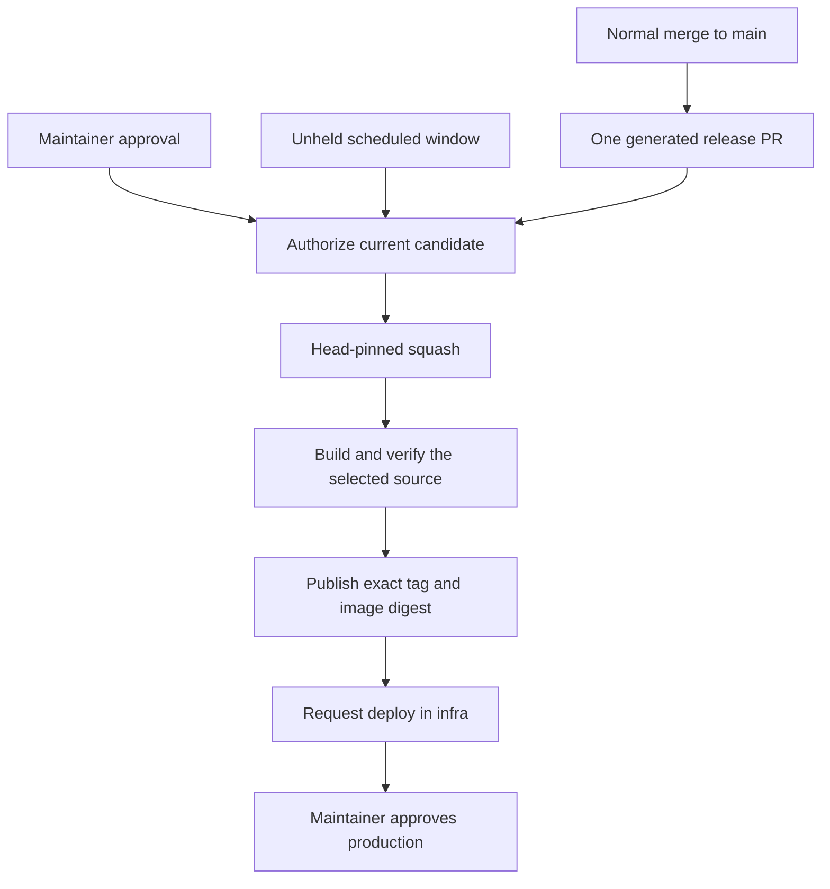

# feat: Hold dashboard releases in a pending PR

## Overview

Replace publish-on-merge with one generated release PR. The maintainer can approve it early, or the gate can release a current, green batch on Sunday or Wednesday at 15:00 UTC if the hold is off. Reuse the container publisher and leave production approval in infra.

## Problem Frame

The current release guard classifies individual pushes to `main`. A qualifying push, or a manual dispatch on `main`, can publish and request deployment. The infra gate gives the maintainer control over deployment, but does not batch releases or provide a chance to review their contents before publication. See [origin requirements](../brainstorms/2026-11-19-held-releases-requirements.md).

## Requirements Trace

- R1–R2. Keep one generated PR with release notes for qualifying changes. Ordinary merges update the batch but never publish. U1, U2, U4; AE1, AE3. Resolve one release attempt before starting another. U3, U4; AE4.
- R3–R5. An exact maintainer approval can release a green batch during a hold. The twice-weekly gate can release without a human review when unheld. It evaluates the hold before acting and reports why it skips. U2, U4; AE2.
- R6. Authorize the exact candidate and publish only the verified resulting squash commit. Never replace it with a newer `main` tip. U2, U3; AE3.
- R7–R8. Keep CalVer, image smoke and vulnerability gates, and recovery without duplicate publications. Request deployment of the verified tag and digest only after publication. Infra still requires approval and coordinates gateway contract changes. U3, U4; AE4, AE5.

## Scope Boundaries

- No change to ordinary PR merge behavior, branch rules, global auto-merge settings, CalVer syntax, or the infra dispatch inputs and approval environment.
- No new runtime credentials, publishing service, package channel, or hotfix workflow. An urgent fix uses the same release PR and maintainer approval path.
- No grant expansion or bypass as part of this plan. If existing App grants do not support the required actions, obtain a separate decision before enabling release automation.

## Context & Research

- `.github/workflows/release.yaml` owns the per-push guard, the build at the event SHA, immutable-digest smoke and Trivy gates, CalVer and SHA image aliases, GitHub Release, verified `latest`, and best-effort infra dispatch. The publication App and GHCR token are separate. Failure cleanup can remove the Git tag and release without cleaning image aliases or proving where `latest` points.
- `scripts/should-release.ts` separates runtime paths and dependency changes from known non-runtime work. `scripts/compute-release-tag.ts` allocates CalVer tags. `test/should-release.test.ts` currently checks parity with the workflow's outer path filter.
- Live `main` rules require a PR, squash merge, strict status checks from designated providers, and CodeQL merge protection. They require zero approving reviews. The existing publisher uses a repository-scoped `fro-bot` App token. The maintainer confirmed the installed App has PR write and is not on the `main` bypass list. Actual required-check delivery on the generated PR still needs the preparation-only rehearsal.
- Systematic provides the generated changelog PR, exact-head approval and maintainer hold precedent. Agent separates preparation from authorized publication. Do not copy its synthetic `next` branch, protected `release` branch, or merge commits. Do not copy Systematic's npm publishing or separate gate-approval attestation.
- `docs/solutions/workflow-issues/release-paths-filter-must-cover-runtime-image-contents-2026-06-25.md` records the risk of filtering out changes before classification. `docs/plans/2026-07-31-001-feat-security-workflow-baseline-plan.md` records the image-gate and credential split. `docs/brainstorms/2026-06-25-002-release-dispatches-gated-deploy-requirements.md` covers the separate infra gate. The new plan moves the publication decision, not those boundaries.

## Prior-Art Survey

```json
{
  "schema_version": 2,
  "verdict": "extend",
  "scope": "fro-bot/dashboard working tree: .github/workflows, scripts, test, Dockerfile, .github/renovate.json5, and src",
  "freshness": {
    "vcs_reference": "ede756aa7b465a71e3e39b537e537881b113b11d"
  },
  "budget": {
    "max_search_passes": 4,
    "max_candidate_inspections": 10,
    "exhausted": true
  },
  "candidates": [
    {
      "path_or_symbol": ".github/workflows/release.yaml",
      "description": "Per-push and dispatched publisher: guard, candidate build, image gates, Git tag and GHCR promotion, GitHub Release, infra handoff. No authorization or batch input.",
      "disposition": "extend"
    },
    {
      "path_or_symbol": "scripts/should-release.ts",
      "description": "Classifies release-worthy paths and manifest and lockfile changes for one revision interval.",
      "disposition": "extend"
    },
    {
      "path_or_symbol": "scripts/compute-release-tag.ts",
      "description": "Allocates the next CalVer suffix in the current UTC month from Git tags.",
      "disposition": "reuse"
    },
    {
      "path_or_symbol": "test/release-workflow.test.ts",
      "description": "Pins release job trust and token scopes, including the separate infra dispatch credential.",
      "disposition": "extend"
    },
    {
      "path_or_symbol": "test/should-release.test.ts",
      "description": "Tests classifier behavior and the outer release path filter.",
      "disposition": "extend"
    },
    {
      "path_or_symbol": ".github/workflows/main.yaml",
      "description": "Runs the required repository CI jobs on pull requests and main pushes.",
      "disposition": "reuse"
    },
    {
      "path_or_symbol": "Dockerfile (ARG DASHBOARD_VERSION)",
      "description": "Builds the runtime image and embeds the selected version in the web bundle.",
      "disposition": "reuse"
    },
    {
      "path_or_symbol": ".github/renovate.json5",
      "description": "Configures dependency update PRs, not publication.",
      "disposition": "insufficient",
      "insufficiency_reason": "Has no release batch or publication authority."
    },
    {
      "path_or_symbol": ".github/workflows/fro-bot.yaml",
      "description": "Runs reviews and scheduled agent reports, not artifact publication.",
      "disposition": "insufficient",
      "insufficiency_reason": "The daily agent and review scopes are not release gates."
    },
    {
      "path_or_symbol": "src/wiki/promotion.ts",
      "description": "Requests promotion of wiki data in fro-bot/.github.",
      "disposition": "insufficient",
      "insufficiency_reason": "Wiki promotion uses a separate credential boundary and does not publish dashboard images."
    }
  ]
}
```

## Key Technical Decisions

- KTD1. **Preserve eligibility per main merge.** Walk first-parent intervals from the last verified release source, which becomes the verified squash after publication. Pass each interval's changed paths and before/after manifests to the existing classifier. One net diff can hide a lock-only runtime update followed by an unrelated allowlisted dev dependency update. Ignore generated notes-only merges when classifying. The notes list qualifying intervals, but the image includes the full authorized snapshot.
- KTD2. **One reproducible candidate.** Use a reserved same-repository branch and one open PR to `main`. Generate a single notes-only commit on the current `main` tip. Keep notes version-neutral until CalVer allocation; publication uses the committed notes. Verify the exact parent and recompute the expected tree. PR titles and commit authors are not authority. Refresh the same PR when either notes or `main` changes, even if new changes to `main` would not open a batch on their own. A base-only advance invalidates approval and needs fresh checks. Do not rewrite an identical candidate or touch a branch or PR with ambiguous ownership.
- KTD3. **Head-pinned squash with a post-merge source proof.** Verify the candidate from trusted `main` code. The approval path uses the maintainer's last live review state just before merge: current, non-dismissed, and on that head. The scheduled path uses the final live hold read and a single authorization per slot. The merge API compares the head, not the base, review, or hold. A revocation after the final read is not atomic with merge. Require strict rules and CodeQL with no bypass, then verify the squash's parent and tree before publishing. If either differs from the selected candidate, stop and reconcile even if the squash landed. Do not treat commit text or the merge actor alone as authorization.
- KTD4. **One trusted controller for selection and publication.** Carry the existing publisher into the new controller rather than use a publish-on-close handoff. A read-only PR review workflow only wakes the controller through the default-branch `workflow_run` trigger. The controller uses neither the wake run's artifacts, caches, nor executable code; it reads live GitHub state. Direct routes are `main` push for preparation, `schedule` for the scheduled decision, and a maintainer-only `main` dispatch for reconsidering an existing approval or recovering an authorized squash. Serialize these routes under one release concurrency group. Prefer GitHub's native pending queue if workflow tooling supports it; re-read state rather than trust event delivery or order.
- KTD5. **Keep decision evidence separate from release identity.** Record the PR, head, base, tree, live review or window, and workflow run and attempt in a controller-owned Actions artifact before requesting the squash. Put its artifact ID in one `Fro-Release-Authorization` trailer. Fetch the commit and its PR associations by GitHub's reported merge SHA; the trailer, parent, and tree must all come from that commit. Verify the artifact's repository, workflow, trusted revision, run and attempt independently of its contents. For gated images, the trusted run records both gate results against the exact source and digest. Recovery also verifies the merge actor and digest. A draft GitHub Release records the selected CalVer, squash, gated digest and reviewed notes before public version writes. It is not authorization or gate evidence. Verify the CalVer and SHA aliases, publish the draft, then verify `latest`. A public release with incomplete `latest` still blocks new batches and deploy requests. Resume the same digest only with matching evidence and no newer verified publication. Do not delete a release, allocate a second tag, or move `latest` backwards to clear a conflict.

  Before publishing, attach `release-proof.json` to the draft with the existing App. Verify the uploader, the file digest, and the repository, release ID, version, source, and image digest in the file. Later batches use it only with the published release, independent merge facts, first-parent history, Git tag, and matching image aliases. The file does not authorize merges or recovery of an unfinished release.

- KTD6. **Stage cutover and start held.** Use the existing App confirmed by the maintainer, with repository-scoped mints limited to the task. Retire the legacy publisher and run an owner-approved preparation-only rehearsal on this repo. Keep merge, image and release writes, and infra dispatch disabled independently of the hold. Record the actual required check names, providers, results and checked revision for the generated candidate. Verify non-bypass enforcement on the first separately authorized held release. If authority or check delivery changes, stop rather than substitute a broad personal token or manufactured checks.

## Technical Design

This diagram shows the intended flow, not an implementation specification.



## Open Questions

### Resolved During Planning

- **Release history:** First stop new legacy push and manual publishers and reconcile queued or in-flight runs. Then record the latest published CalVer, tag, source, versioned digest, successful image gates, and final `latest` readback. Prove the source is on the first-parent history of cutover `main`. Stop and ask the maintainer if that evidence is missing or contradictory.
- **Failed attempt:** A maintainer can retry the same authorized batch. A new batch can absorb unpublished changes only after reconciliation shows it is safe to supersede the failed attempt. Build failure before any public version mutations can be retried. An ambiguous public result is not absence.
- **Hold:** Use `release-hold` on the generated PR. Start held. Refreshes retain the label. If a held PR ships early, carry the hold to the next generated PR; the most recent generated PR retains the state while no batch is open. Allow the maintainer to set or clear it on the current or most recent generated PR. Re-read the current label before scheduled merge. Automation mirrors the hold during replacement, but must not clear it. An unverified carry-forward or ambiguous label state blocks scheduled release.
- **Activation:** Keep the preparation-only setting separate in workflow startup configuration. Default to release writes disabled until the approved cutover. The hold is a live PR read, not an Actions variable, and no App Variables permission is needed.
- **Recovered deploy request:** Request deploy after verified publication on the normal path. If that run stops and no accepted dispatch can be proved, mark deployment unconfirmed and give the maintainer the exact published tag and digest. Use the existing infra lookup or request path; do not add a deploy ledger or automatically resend.

### Deferred to Implementation

- **Permission and check confirmation:** Reuse the installed App without changing grants or rules. Mint only the permissions needed for repository preparation, PRs and merge. Verify that the real generated PR receives its checks without extra approval in the separately authorized rehearsal. No state-changing probe or grant change is implicit in the App preflight.
- **Workflow integration:** Verify App-created PR event delivery and the proof file's real upload and readback during cutover. The release controller reconciles current state under one concurrency group. A missing or expired Actions record blocks recovery of an unfinished release. The runbook directs the maintainer to reconcile the PR, Git tag, image, and release before retrying.

## Implementation Units

### U1. Discover and render the pending batch

- [x] Establish App feasibility and build the read-only reconciliation seam for one generated candidate.

**Requirements:** R1, R2; F1, AE1. **Dependencies:** None.

**Files:** Extend `scripts/should-release.ts` only as needed for clean reuse. Add `scripts/release/batch.ts` and `test/release-batch.test.ts`. Adjust `test/should-release.test.ts` when replacing path-filter parity with proof that no outer path filter can discard an eligible merge.

**Approach:** Take a verified release source SHA as input and validate that it is on the first-parent history. Evaluate the intervening commits and render deterministic notes for `docs/releases/batch.md` without writing a ref or file. List qualifying merges, with the subject and PR link when available. Treat subjects and PR metadata as data, not workflow inputs. The controller supplies the verified baseline and publishes the candidate notes; discovery neither allocates a version nor queries GitHub.

**Patterns and tests:** Use temporary Git repos as in `test/compute-release-tag.test.ts`. Cover docs and web test exclusions, hard paths, dependency classes, lock-only followed by dev-only, reverts, generated merges, baseline missing or non-ancestor, and unchanged rerender. Guard errors block rather than becoming skips.

**Verification:** The same verified baseline and `main` produce the same notes. A later discovery accounts for qualifying work from coalesced events. Discovery requires a non-shallow checkout and rejects a non-ancestor baseline or a classifier error.

### U2. Authorize and verify the exact squash

- [x] Add and test local candidate, review, schedule, and squash-proof rules.
- [x] Wire GitHub observations and the squash request. Verify live behavior in the cutover rehearsal.

**Requirements:** R2–R6; F2, AE2, AE3. **Dependencies:** U1 App feasibility and deterministic candidate validation.

**Files:** Add `scripts/release/gate.ts` and `test/release-gate.test.ts`. Extend `test/release-workflow.test.ts` as wiring lands.

**Approach:** Read the current PR, ancestry, and paginated maintainer review state. Use the designated maintainer's GitHub user ID for approval and to attribute an intentional hold change. Preserve the label on refresh and mirror it on replacement; do not interpret a missing label as clearance if carry-forward failed. Seal the decision record before the squash and recheck the live review or label just before requesting it. Base-only refreshes show which approval was invalidated. Identify the slot from the cron entry and the original run's UTC date, never the rerun date. Skip if the slot cannot be identified or its UTC day has ended. An absent candidate, stale revision, hold or missing checks records a skip in the Actions run summary. A missing run grants no schedule authorization and is not backfilled. An owner dispatch can recheck an unconsumed current review after a lost signal; it still needs the green exact head and does not grant approval itself.

**Patterns and tests:** Follow Systematic's exact-head pin, not its approval bot. Cover current approval, docs-only base refresh, later negative or dismissed review, fork or unrelated PR, altered candidate, and checks absent or stale. Pin hold carry-forward after an early held release, hold added before the final read, and failed or unauthenticated clearance. Cover duplicate or dropped slot, manual close, and API conflict. Lose the review wake-up with no later push; an owner recheck succeeds only while that approval is still current. Drop the merge response; recovery can verify only its exact squash. Missing evidence, a replay on another PR, and a wrong parent or tree produce no publication target.

**Verification:** One authorized tuple gives one proved squash SHA. No stale approval, hold read error, or unmatched merge can yield a publication target.

### U3. Publish and recover one source

- [x] Build the inactive image-gated publisher and test recovery against local fixtures.
- [ ] Verify the publisher's live observations and exact-source handoff during U4.

**Requirements:** R2, R6–R8; F2, AE4, AE5. **Dependencies:** U2 source proof.

**Files:** Carry the publisher from `.github/workflows/release.yaml` into `.github/workflows/held-release.yaml`. Add `scripts/release/publication.ts` for decisions and `scripts/release/publisher.ts` for GitHub and registry reads and writes, with focused tests for each. Extend `test/release-workflow.test.ts`. Reuse `scripts/compute-release-tag.ts`, its existing tests, and `Dockerfile`.

**Approach:** Carry the selected squash SHA through checkout, image build, tag, notes, and release evidence. Read the notes from that commit without checking it out in the publishing job. Preserve exact-digest smoke and enforced Trivy. Build and gate jobs do not get merge, publication App, or infra dispatch credentials. Keep the existing GHCR scope, mint the repository-scoped publication token after verifying the trusted checkout, and preserve the isolated infra dispatch job and environment. Validate controller and gate evidence before trusting a draft or its aliases. Retry that identity across UTC month rollover. If public artifacts exist but the matching release record is missing, stop rather than reconstruct it. A failed or interrupted dispatch does not undo verified publication. Report confirmed failure or unknown delivery separately and provide the version and digest for manual reconciliation in infra. Do not enable the new publisher until U4 verifies the rehearsal.

**Patterns and tests:** Extend the existing publisher and its token-scope tests. Cover interruption or lost success after each artifact write, including the candidate image, draft, tag, each alias, public release, and `latest`. Cover expired or mismatched gate evidence, month rollover, `main` advancing while publication is unresolved, and stale retry after a newer release. Stop just before and just after dispatch; neither an unverified send nor an unknown response should trigger an automatic repeat. Candidate digests do not create public release artifacts or requests before the gates pass.

**Verification:** Repeat attempts either converge on the same verified version/digest or stop with an actionable conflict. An unrelated `main` tip, version alias, or stale response never determines the shipped image.

### U4. Replace the old trigger and cut over held

- [x] Connect preparation, review, schedule, and recovery without a direct publish path.
- [ ] Rehearse the cutover with publication disabled, then verify the first held release and separate infra request.

**Requirements:** R1–R8; F1, F2, AE1–AE5. **Dependencies:** U1–U3 and separate maintainer approval for the live cutover and rehearsal.

**Files:** Retire `.github/workflows/release.yaml`. Wire `.github/workflows/held-release.yaml` and a read-only `.github/workflows/held-release-review.yaml` signal. Update `test/release-workflow.test.ts` and `test/should-release.test.ts`. Add `docs/runbooks/dashboard-releases.md` and link it from `README.md`.

**Approach:** Ship U3's wiring and U4 together. Before that merge, the maintainer disables the legacy workflow including manual dispatch; drain or reconcile its queued and running work. Verify the baseline with legacy publication off. The separately named controller starts with release writes disabled, and the maintainer enables preparation only for the rehearsal. Ordinary pushes prepare candidates, but may not start a new batch while the previous publication is unresolved. The maintainer enables release authorization with the hold on only after the rehearsal succeeds. If it fails, stay preparation-only or disabled. Never re-enable or rerun the legacy publisher. The normal CI and infra triggers are unchanged.

**Patterns and tests:** Keep `Check Workflows` and existing behavior tests. Assert the review signal has no checkout, secret or write token, and that it cannot supply authority, artifacts or source to the default-branch controller. Test the maintainer ID and `main` ref on dispatch; no supplied source, version or window can bypass approval. Verify a regular push, a recovery attempt before activation, and a second batch during unresolved publication cannot publish. With writes disabled for the rehearsal, check the generated PR gets the actual required checks on GitHub's applicable revision. Exercise stale approval, a held schedule, missing grants, and lost responses without releasing or deploying anything.

**Verification:** Ordinary merges and cutover publish nothing. The first held release requires a fresh maintainer approval after activation; a rehearsal review does not count. Compare the squash, gate evidence, tag, public release, version and SHA aliases, and `latest`. Record the exact infra request separately from deployment approval. The maintainer clears the hold after reviewing the evidence; that only enables the next eligible scheduled decision.

## System-Wide Impact

- Required CI still runs on the generated PR. No job should treat a skipped bot review as proof that tests ran. Use the applicable server-side checks and verified merge.
- The event SHA is no longer the artifact source on review, scheduled, or recovery runs. A post-merge validation failure leaves `main` intact but blocks all publication and requests reconciliation.
- A release workflow may be stopped between GitHub and registry writes. Preserve enough state to resume safely; never treat absence of a log as absence of a side effect.
- No change to the gateway contract or deploy payload. Deploy dashboard and gateway builds that change the contract as a coordinated pair, and roll them back together.

## Risks & Dependencies

| Risk                                                     | Mitigation                                                                                                                                                            |
| -------------------------------------------------------- | --------------------------------------------------------------------------------------------------------------------------------------------------------------------- |
| App cannot create a checked PR or merge without bypass   | Required preflight. Leave automation disabled rather than relaxing ordinary PR rules.                                                                                 |
| Base or approval changes near a squash                   | Check the current generated head and live review or hold before acting. Require the verified squash parent/tree before publication.                                   |
| Cutover overlaps a legacy release                        | Establish the latest verified baseline after existing writers finish. Stop on a partial or ambiguous legacy release.                                                  |
| Duplicate, delayed, or dropped scheduled or review event | Reconcile within the shared lock. Bind the decision to one candidate and calendar slot. Recover an existing authorized merge without granting a second authorization. |
| Partial publication or lost acknowledgement              | Resume a matching draft or published release. Block inconsistent state and report decisions requiring operator action.                                                |

## Operational Notes

- If controller recovery or rollout fails, switch back to preparation-only or disable the controller. That stops review, schedule, and recovery writes; the hold only stops new scheduled releases. Account for any release already in flight. Do not restore legacy push or unconditional manual publishing as a rollback.
- Use the run summary to find the approval invalidation, skipped slot, or publication state. If no run arrived, use the current PR and Actions history; recheck a current approval or wait for the next slot. Normal operation needs no extra maintainer review beyond early release and infra approval.
- Reconcile public release and GHCR state before resuming publication. Roll back an already deployed image in infra, paired with the gateway when the contract requires it.

## Sources & References

- [Origin requirements](../brainstorms/2026-11-19-held-releases-requirements.md). This local document ships with the plan and feature.
- [Systematic release policy](https://github.com/marcusrbrown/systematic/blob/main/RELEASING.md) and [gated release plan](https://github.com/marcusrbrown/systematic/blob/main/docs/plans/2026-10-11-004-feat-gated-release-pr-plan.md), recorded as completed. Dashboard retains CalVer and uses merge-time checks instead of a bot approval attestation.
- [Agent release preparation](https://github.com/fro-bot/agent/blob/main/.github/workflows/prepare-release-pr.yaml) and [no-force-push release plan](https://github.com/fro-bot/agent/blob/main/docs/plans/2026-03-22-auto-release-no-force-push-plan.md), recorded as done. Dashboard uses the existing squash rules on `main`.
- GitHub: [merge API](https://docs.github.com/en/rest/pulls/pulls#merge-a-pull-request), [review API](https://docs.github.com/en/rest/pulls/reviews#list-reviews-for-a-pull-request), [required checks](https://docs.github.com/en/pull-requests/how-tos/merge-and-close-pull-requests/troubleshooting-required-status-checks), [workflow token event behavior](https://docs.github.com/en/actions/concepts/security/github_token#when-github_token-triggers-workflow-runs), [review signal](https://docs.github.com/en/actions/reference/workflows-and-actions/events-that-trigger-workflows#pull_request_review), [default-branch `workflow_run`](https://docs.github.com/en/actions/reference/workflows-and-actions/events-that-trigger-workflows#workflow_run), [concurrency](https://docs.github.com/en/actions/how-tos/write-workflows/choose-when-workflows-run/control-workflow-concurrency), and [Releases API](https://docs.github.com/en/rest/releases/releases).
